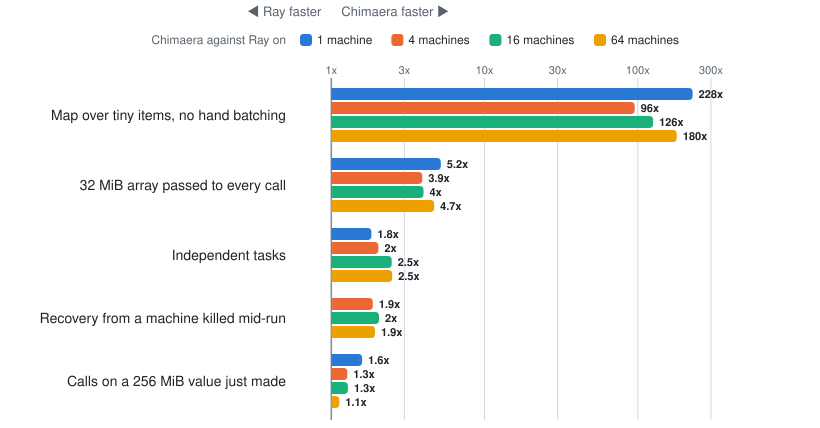
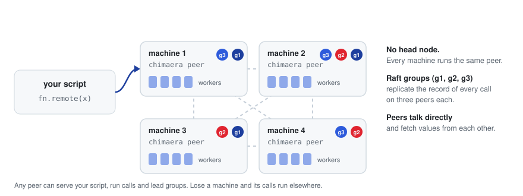
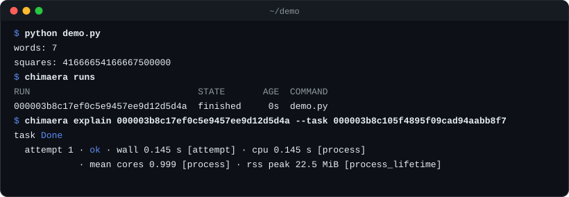

<p align="center">
  <picture>
    <source media="(prefers-color-scheme: dark)" srcset="docs/assets/logo-dark.svg">
    
  </picture>
</p>

<h1 align="center">Chimaera</h1>

<p align="center">
  <strong>Your Python, on every core of every machine, with one decorator.</strong><br>
  No head node to babysit. No CPU or memory requests to guess.<br>
  Faster than Ray on 7 of the 10 workloads we've benchmarked.
</p>

<p align="center">
  <a href="docs/getting-started.md">Get started</a> ·
  <a href="docs/README.md">Guides</a> ·
  <a href="docs/guides/from-ray.md">Coming from Ray</a> ·
  <a href="docs/api.md">API</a> ·
  <a href="docs/qualification.md#ray-comparison-cluster-1-4-16-and-64-nodes-2026-11-22">Benchmarks</a>
</p>

---

```python
import chimaera as ch

@ch.remote
def word_count(text: str) -> int:
    return len(text.split())

@ch.remote
def add(left: int, right: int) -> int:
    return left + right

total = add.remote(word_count.remote("blue sky"), word_count.remote("rain today"))
print(total.result())                       # 4

for n in word_count.map(["a", "a b", "a b c"]):
    print(n)                                # 1, 2, 3
```

That's the whole idea. `add` starts once both counts are done, and their
results go worker to worker without a detour through your script. On a laptop
the first call starts a local peer for you; on a cluster, the same file runs
unchanged.

## How it stacks up against Ray

<picture>
  <source media="(prefers-color-scheme: dark)" srcset="docs/assets/vs-ray-dark.svg">
  
</picture>

Same 64 machines, same ten workloads. Chimaera wins seven. The 150x is a map
over tiny items: Chimaera batches tiny calls by itself, and neither side was
batched by hand. Ray still wins shuffles, calls on a value just made, and CPU
scaling. Method and caveats: [qualification.md](docs/qualification.md#ray-comparison-cluster-1-4-16-and-64-nodes-2026-11-22).

<details>
<summary>The numbers behind the chart</summary>

64 × c7i.4xlarge machines (1,024 vCPU), the same machine type for both
runtimes, median of at least 45 s of repetitions (the machine-loss row is a
single run). Ray's actor, nested and machine-loss figures come from a separate
run, because the first run hit its time limit before it reached Ray's passes.

| Workload | Ray | Chimaera |
|---|---:|---:|
| Independent no-op tasks | 5,188/s | 14,203/s |
| Map over tiny items, no hand batching | 5,171/s | 774,908/s |
| 32 MiB array passed straight to 2,048 calls | 3.51 s | 0.71 s |
| 512 MiB value to 2,048 readers | 0.407 s | 0.375 s |
| Actor calls | 9,482/s | 10,973/s |
| Nested tasks (4 parents per CPU, 8 children each) | 1.29 s | 0.82 s |
| A machine killed under one-second tasks | 18.5 s | 9.6 s |
| CPU scaling efficiency | 0.656 | 0.605 |
| 10 calls on a 256 MiB value just made | 0.228 s | 0.376 s |
| Shuffle, 3.2M pairs | 0.135 s | 0.842 s |

</details>

Coming from Ray? Most Ray Core programs port line by line, and a
compatibility shim runs Ray Core programs unchanged
([from-ray.md](docs/guides/from-ray.md)).

## How it works

<picture>
  <source media="(prefers-color-scheme: dark)" srcset="docs/assets/architecture-dark.svg">
  
</picture>

There's no head node to size, babysit or lose. Every machine runs the same
`chimaera` peer, and the record of every call is replicated with Raft on three
peers. Kill a machine mid-run and its calls run somewhere else.

## What you get

### Calls sized for you

Stop guessing CPU and memory requests. After three calls the peer reserves
the memory peak it measured, so later calls wait for room instead of getting
OOM-killed. `future.explain()` shows what it picked and why, and a `cpus=` or
`memory=` you set always wins.

### Failures you can reason about

A crashed worker's calls get retried; your own exceptions don't, unless you
list them. Mark a function that charges a card `effects="external"` and it
starts at most once: if its worker dies mid-call, you get `ch.OutcomeUnknown`
instead of a second charge. Detached runs outlive your script, and any process
can pick one back up with `ch.runs.attach(run_id)`.

### A record of everything



Every call leaves a trail on its peer: each attempt, what it printed, what it
measured and why it waited. Ask from Python with `future.explain()`, or from
a shell with `chimaera status`, `runs`, `logs` and `explain`.

### Runs where your machines are

One binary covers a laptop, SSH hosts (`chimaera up`), Kubernetes
(`chimaera k8s render`) and Slurm (`chimaera slurm-launch`). Then
`chimaera run --cluster NAME -- python app.py` runs your script on it. See
[clusters](docs/guides/clusters.md) and [deploy.md](docs/deploy.md).

## Install

Chimaera isn't on PyPI yet. Build it from source with Rust (the toolchain in
`rust-toolchain.toml` installs itself through rustup), `protoc` and
Python 3.11 or newer:

```bash
git clone https://github.com/stephenoffer/chimaera && cd chimaera
cargo build --release -p chimaera-peer          # the `chimaera` binary
python -m venv .venv && . .venv/bin/activate
pip install maturin && maturin develop --release
```

For machines without Rust, `make wheel` builds a wheel with the peer binary
inside it (same OS and CPU architecture as the build machine).

## Status

Chimaera is early software. This is what works today:

| Area | State |
|---|---|
| Functions, futures as dependencies, `map`, actors, pools | Working, on one machine and across peers |
| Retries, `ch.OutcomeUnknown` for external effects, memory limits, canceling calls, deadlines | Working |
| Learned CPU and memory reservations, memory-aware admission, large values stored once | Working; across peers, placement weighs input locality and memory |
| Per-call measurements (`future.explain()`, `chimaera explain`) | Working; per-attempt cgroup readings on Linux |
| Reattaching to a run after the driver or the peer restarts (`ch.runs.attach`) | Working |
| Clusters: replicated shard groups, failover, dead voters replaced | Working on localhost clusters and on up to 64 cloud machines |
| Cluster tokens, mutual TLS, tenants with CPU quotas | Working on localhost clusters |
| Durable actors (`ch.durable.State`) and durable workflows | Working |
| Streaming generators (`ch.typing.Stream`) | Working |
| Gangs and collectives (`ch.dist.group`, `.gang()`) | Working on CPU; NCCL checked on one node of 4 NVIDIA A10Gs |
| Shuffles (`reduce_by_key`) | Working; Ray is faster today |
| Kubernetes, Slurm and SSH launchers | Working in container tests (kind, slurmd, sshd); real clouds unverified |

## Learn more

- [Getting started](docs/getting-started.md): install, a first program, a ten-minute tour
- [Guides](docs/README.md): tasks, actors, failures, resources and GPUs, data, gangs, clusters, observability
- [Coming from Ray](docs/guides/from-ray.md): the mapping, the differences that bite, and running Ray code as is
- [API reference](docs/api.md), [CLI](docs/cli.md), [configuration](docs/configuration.md)
- [Design](docs/design.md) and [architecture](docs/architecture.md), for how it works inside

## Development

```bash
make check            # fmt, clippy, Rust tests, Python tests
make linux-pytest     # the Python tests in a Linux container, with cgroup accounting
```

`crates/` holds the Rust runtime (`chimaera-core` is the replicated state
machine, `chimaera-raft` runs many Raft groups per peer, `chimaera-peer` is
the agent and CLI, `chimaera-py` the extension module), `python/chimaera`
the Python package, and `bench/` the comparisons against Ray.

## License

Apache-2.0
