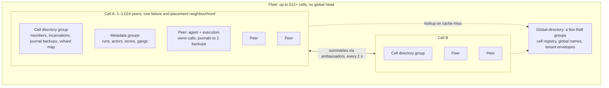

# Chimaera at every scale

**Architecture design · 21 November 2026.** This document extends [design.md](design.md). Read that first for the
API philosophy, the effects lattice, the adaptive controllers and the data path. This document makes the decisions
that bring Chimaera to Ray Core's feature set and speed and take it past Ray's scale ceiling, while keeping the API
small. The competitor review behind it is in [landscape.md](landscape.md), and the feature-by-feature matrix in
[parity.md](parity.md). The scale arguments are checked by two programs in `bench/scale/`, and their output is
reproduced in §14.

Where this document and design.md disagree, this one wins. The decisions are numbered **D1–D9** so the code,
tests and later documents can cite them.

## Contents

1. [Goals and the five rules](#1-goals-and-the-five-rules)
2. [Shape of the system: peers, cells, fleet](#2-shape-of-the-system-peers-cells-fleet)
3. [The hot path: consensus for lifetimes, not for calls](#3-the-hot-path-consensus-for-lifetimes-not-for-calls)
4. [Actors at every weight](#4-actors-at-every-weight)
5. [Objects and the data plane](#5-objects-and-the-data-plane)
6. [Scheduling without a scheduler](#6-scheduling-without-a-scheduler)
7. [Membership and metadata at 262,144 peers](#7-membership-and-metadata-at-262144-peers)
8. [Failure: no single point, and what each loss costs](#8-failure-no-single-point-and-what-each-loss-costs)
9. [Observability per call](#9-observability-per-call)
10. [Adaptive configuration](#10-adaptive-configuration)
11. [Hardware, topology and GPU clusters](#11-hardware-topology-and-gpu-clusters)
12. [Python at every experience level](#12-python-at-every-experience-level)
13. [How parity stays simple: the API budget](#13-how-parity-stays-simple-the-api-budget)
14. [Capacity and scale evidence](#14-capacity-and-scale-evidence)
15. [How we will know it works](#15-how-we-will-know-it-works)
16. [Roadmap changes](#16-roadmap-changes)

## 1. Goals and the five rules

Chimaera must do everything Ray Core does for a Python program, as fast or faster, on one laptop and on 262,144
machines, with no head node and no single point of failure, and with an API a first-time user can learn in an hour.
The libraries built on Ray Core (Data, Train, Tune, Serve, RLlib) are out of scope here. What is in scope is
everything they need from the core.

Five rules decide every trade-off below:

1. **Consensus for lifetimes, not for calls.** Replicated logs record things that live a long time and must have
   one owner: runs, actor generations, named keys, gangs, durable state. A call is too short to pay for a quorum,
   so its record travels with the call and is replicated in batches off the critical path (D2).
2. **The owner is the agent, never the Python process.** Every call, object and actor is owned by a Rust peer
   agent whose state is replicated to two neighbours. A driver, worker or actor process can die without taking
   anything with it (D3). This removes Ray's largest failure class, owner death.
3. **Nothing above a cell sees per-call traffic.** All per-call work stays inside one cell, between the owner,
   the executing peer and the owner's two journal backups. Fleet-wide components see one summary per cell per
   period and one lookup per cache miss (D1, D7). This is why cost per peer is flat from 1 to 262,144 peers (§14).
4. **Every head is a role, not a machine.** Leaders of Raft groups, journal owners, ambassadors, gang
   coordinators and provisioning owners are leases that move when a machine dies. A large fleet has tens of
   thousands of heads, none of them special (D1).
5. **One concept per job.** New capability arrives as an option on something the user already holds, or as a
   method on an object they already have. §13 keeps a budget of public names and checks every addition against it.

## 2. Shape of the system: peers, cells, fleet



**D1. Three tiers, multi-headed at each.**

| Tier | What it is | Heads (all movable) | What crosses its boundary |
|---|---|---|---|
| **Peer** | One machine, VM or allocation running the Rust agent and supervised Python executors. Owns its CPUs, memory, devices, object store and the calls it accepted. | The agent. Its call state has a successor among its journal backups. | Calls, objects and journal batches to peers in the same cell. |
| **Cell** | 1 to 1,024 peers (default 512) that share a failure domain and a fast network: a rack row, a scalable unit, an NVL72 group, one Kubernetes cluster, one Slurm partition. A complete subcluster: membership, directory, metadata groups and placement all work inside it alone. | Leaders of the cell directory group and of 8–64 metadata groups, spread across peers. Three ambassador leases. | One summary per period (free shapes, queue ages, health) and range transfers for jobs that span cells. |
| **Fleet** | Any number of cells (planning envelope 512 cells × 512 peers = 262,144). | Leaders of a few global directory groups. | Cell registry, global names, tenant budgets. |

A single machine is a fleet of one cell of one peer: the same binary, single-voter groups, no journal backups, no
membership traffic. Nothing in the design asks a laptop user to know cells exist. A 64-machine cluster is one cell.
Cells appear when an operator has more machines than fit one failure domain, and the provider launchers create
them from the topology they already know (one cell per Kubernetes cluster, Slurm partition or rack row).

**Why a cell is capped near 1,000 peers.** Throughput does not set the cap; blast radius and physics do. A cell's
loss should cost at most a few thousand in-flight calls. Gossip inside it should stay well below the sizes where
gossip systems degrade (Consul advises at most 5,000 agents per pool; CockroachDB's gossip CPU went from 6.5% at 128
nodes to 36.7% at 256; Erlang's full mesh stops near 1,500). Placement samples should stay inside one fast network.
And racks, NVL72 groups and scalable units come in 18 to 1,024 machines. Every production system past 100,000
machines partitions the same way, with larger partitions than Chimaera's: Hydra uses sub-clusters of 2,000–3,000
nodes, Borg cells average about 10,000 and are "capped by blast radius, not scalability", Twine shards hold up to
170,000. With 512 cells at the top of the envelope, the cross-cell tier is where scaling must be proven, which is
why it carries no per-call traffic and its directory is sharded (§7). [Hydra][hydra] · [Borg][borg] ·
[Twine][twine] · [Consul scale][consulscale]

## 3. The hot path: consensus for lifetimes, not for calls

### Why the current design cannot match Ray at fine grain

Today a call in a cluster costs three Raft commits: submission, grant and publication
(`crates/chimaera-peer/src/ingress.rs` proposes `SubmitTasks` and waits for it before acknowledging; the group
leader proposes `GrantAttempts`; the executing peer proposes `PublishResults`). A local peer folds the grant into
the submission, for two. With group commit that sustains throughput, but each commit is replicated three ways and a
call pays at least two quorum round trips before its result is visible. Ray's steady-state task costs one RPC from the owner to a leased worker and one reply,
with no metadata service involved. Ray pays for that speed with owner death: when the driver or worker that
submitted a task dies, its objects are lost and cannot be rebuilt. The measured result on one node is in
qualification.md: Chimaera ahead on chains, maps and large objects, behind on actor calls (1,884/s against 5,091/s)
and nested tasks. At fleet scale the gap widens: committing every call of a 5 ms workload at 262,144 peers is 1.2
billion quorum writes per second.

The answer is not to give up durability. It is to move it off the critical path and put it in the agent instead of
the Python process.

### D2. Calls are journaled, not committed

Each peer agent keeps a **call journal**: an append-only log of the calls it owns (submitted, started, finished,
cancelled). The journal is replicated **primary-backup** to two **backup peers** in the same cell, chosen
rack-diverse by the cell directory and recorded there. This is vertical Paxos: the configuration (who owns, who
backs up, which incarnation) lives in a Raft group and changes rarely; the data stream needs no consensus because
it has exactly one writer. [Vertical Paxos][vpaxos]

| Step | What happens | Waits for |
|---|---|---|
| 1. Submit | The client hands the call to its local agent over a Unix socket (shared memory for large arguments). The agent becomes the call's **owner**, appends `Submitted` to its journal buffer and returns. The client already holds the `Future`. | Nothing remote. |
| 2. Place | The owner places it (§6): usually on a warm local executor through a reused lease, otherwise on a sampled peer in the cell. | Nothing remote for local work; one message for remote. |
| 3. Run | The executing peer checks the owner's incarnation (a retired owner is refused), admits under its budgets and runs the call. | — |
| 4. Finish | Small results (≤ 64 KiB) go back to the owner inline and straight on to subscribed consumers. Large results stay in the executing peer's store and only their location travels. The owner appends `Done`. | — |
| 5. Replicate | Every 1–2 ms, or at 64 KiB, the owner sends the journal batch to both backups in parallel. Records are **safe** when both acknowledge. Unsafe records are bounded per owner (8 MiB, about 85,000 calls at 98 B each); at the bound, new submissions wait for acknowledgements. | Off the critical path until the bound. |
| 6. Compact | Records of calls whose results were consumed and released are dropped. For detached runs the owner also sends a compacted frontier (finished ranges per stage) to the run's metadata group, so the run can continue with no client. | Off the critical path. |

**Prototype evidence.** [bench/proto/hotpath](../bench/proto/hotpath/RESULTS.md) builds this path: a Rust agent
that journals every call to two backup processes and Python executors and drivers. It was measured against Ray 2.60
on the same laptop:
- **Round trip:** 17.8 µs p50, against Ray's 167 µs.
- **Actor calls:** 50k sync, 593k async and 1.63M n:n calls/s, against Ray's 5.8k, 19.1k and 26.4k.
- **The agent hop** costs about 9 µs, and `effects="external"` adds about 15 µs on one machine.
- **Journal size:** 98 B per call per backup.

Before the bound above existed, a 1.6M calls/s burst stretched the unsafe window to about 250 ms. That is why the
bound is there. With it, the worst case fell to 88–112 ms and throughput held. The window is about twice the bound
divided by the backups' apply rate, so a smaller bound gives a smaller window. The prototype leaves out the API layer, placement, accounting and failover, so its numbers are the
floor the real path builds on, not Chimaera's.

**First step on the runtime.** [bench/proto/local-group](../bench/proto/local-group/RESULTS.md) is a patch, not yet
applied, that removes the Raft log from a local peer's group:
- **Startup:** the peer recovers through Raft, then applies commands in one durable redb transaction per batch.
- **Speed:** local task and actor round trips fall by about 190 µs, to 295–337 µs p50.
- **Tests:** a crash test checks that every command that got a reply survives the process dying.
- **Snapshots:** the peer no longer writes Raft snapshots.

The journal reuses the shard state machine that exists today (`crates/chimaera-core/src/shard`). The transitions,
fencing and exactly-one-winner rules are the same; only the replication changes. Raft groups apply commands from a
quorum log. A journal applies them in its owner and ships the same command stream to its backups, which apply it
deterministically. The property tests that check the state machine today (20,000 random histories, mutants caught)
keep checking it.

**What each effect class waits for** (the effects lattice from design.md, unchanged for users):

| Effects | Before user code starts | If the owner dies |
|---|---|---|
| `"none"` (default) | Nothing. The call may run before its `Submitted` record is safe. | Safe records replay on the successor. An unsafe record was never acknowledged: the client resubmits it with the same deterministic id, or, for a nested call, the parent's replay resubmits it. |
| `"idempotent"` | Nothing. Never speculated. | Same as `"none"`. |
| `"external"` | A `Started` record is safe on both backups: one round trip inside the cell, about 50–200 µs. | `OutcomeUnknown` if `Started` is safe and `Done` is not. Never replayed. |
| Durable actor command, durable workflow step, `ch.Store` write | A Raft commit in the owning metadata group, batched with others. | Exactly the guarantees in design.md §8. |

**Call ids are deterministic**: `hash(parent call or client session, submission sequence)`. A resubmission after
any failure lands on the same id, and the executing peer, the owner and the successor all deduplicate by it. This is
what makes "may run before it is safe" correct: a call can run twice only if it is replayable, and its result is
published once.

**Lineage travels with the call.** A call carries the ids of its unsafe ancestors, so whichever peer survives can
rebuild what it needs. This is lineage stash, published by the Ray authors and never adopted by Ray: fault tolerance
off the critical path by forwarding uncommitted lineage with each task and flushing it asynchronously.
[Lineage stash][stash] Chimaera's version anchors lineage in agents with backups, not in the driver, so the chain
always ends at something that survived.

### D3. Owner failure has a successor

Owner loss is detected on the journal stream, not by gossip: an idle stream heartbeats every 200 ms, and a backup
that hears nothing for a second asks the cell directory leader to confirm with a direct probe. Gossip takes 14–16 s
to mark a peer dead everywhere in a 512-peer cell at a 1 s period, measured with the real SWIM code in the fleet
emulator. That is too slow for this path (§7). Executing peers detect
a lost executor process through its pidfd and a lost peer through its connection. Once the directory confirms and
retires the owner's incarnation (one Raft commit), its first backup becomes the **successor owner** of everything
in its journal. It takes the union of both backups' records, so a batch that reached only one of them is not
lost. Then, per call:

- not finished and replayable → placed again (attempt + 1);
- `external` with `Started` safe → `OutcomeUnknown`;
- finished → its consumers are notified again (they deduplicate).

Executing peers that are still running the dead owner's calls keep running (static stability). When they finish they
look up the successor from the directory and deliver to it. Remote clients reconnect to any peer, which routes them
by run id. The retired owner, if it was only partitioned, is fenced: every message carries the owner's incarnation,
and peers refuse retired ones.

### Why the journal is safe

Invariants, each checked by the simulation in §15:

1. **One owner per call at a time.** Ownership changes only by a directory commit that retires the old owner's
   incarnation. Every message carries the owner's incarnation, and peers refuse retired ones.
2. **One published outcome per call.** The owner applies `Done` once per call id; later attempts are recorded as
   losers, exactly as the shard state machine does today.
3. **An acknowledged `external` start is never repeated.** `Started` is safe on both backups before user code runs,
   and a successor that finds `Started` without `Done` reports `OutcomeUnknown`.
4. **A safe record survives any one peer loss, and any two in different racks.** It is on the owner and both
   backups.

The cases that break naive designs:

| Case | What happens |
|---|---|
| Owner dies before a batch is safe | Those calls were never acknowledged as safe. A client on the same machine died with it, so its run ends unless it was detached, and `detach` waits until every submitted record is safe. A remote client still holds the unsafe calls and resubmits them by id. A nested call is resubmitted by its parent's replay. A call that ran meanwhile on another peer delivers its result to the successor, which accepts it if the id is known and otherwise holds it until the resubmission arrives (bounded). |
| Owner dies after a batch is safe | The successor has every record and resumes. |
| One backup dies | The directory assigns a replacement; the owner sends it the retained window. Until then records are safe on owner + one backup, and `external` starts wait. |
| Both backups die | The owner keeps running and stops acknowledging `external` starts until a backup is assigned. Calls with effects `none` are unaffected. |
| Owner partitioned, not dead | The directory retires it; it can no longer dispatch or publish anywhere, because every peer checks incarnations. When it reconnects it rejoins with a new incarnation and an empty journal. |
| An executing peer finishes after its owner was retired | It delivers to the successor named in the directory. The successor deduplicates by call id. |
| A result arrives twice | Deduplicated by `(call id, attempt)`; only the first `Done` counts. |
| Both backups and the owner die at once (same power domain) | Backups are placed on other racks when racks are known. Without topology information, `chimaera doctor` warns that safety is limited to one failure. |

**Durability on disk.** By default journal records are in memory on three machines, which survives process and
machine loss but not a simultaneous power loss of all three. Runs that need more set `durability="disk"`: backups
then acknowledge after a group-committed fsync, adding roughly one fsync (tens of microseconds on NVMe) to `external`
starts and nothing to other calls.

### Actor calls take the direct path

An actor handle caches the actor's generation and host. A method call goes from the caller's agent to the host's
agent in one message, ordered there by `(handle, sequence)`. The host keeps a bounded table of the last sequence and
reply per handle, so a call resent by a successor owner gets the stored reply instead of running twice. Generations
change only on placement, restart or migration, and those are Raft commits in the actor's metadata group. Calls
between processes on the same peer never leave the machine. Calls to one host are coalesced into one frame when more
than one is waiting (a 50 µs window, only under load), which is how Ray's n:n actor benchmark is beaten without
changing semantics.

### Performance targets that follow

| Path | Today (local measurement; Ray on the same laptop) | Target | Why it is reachable |
|---|---|---|---|
| Local call round trip, warm executor | Task 530–628 µs, actor 607–826 µs p50 on macOS (Ray: 386–391 µs and 171–177 µs); 3.5 ms on Linux | ≤ 150 µs p50, ≤ 400 µs p99 | No commit, one IPC each way; agent work ≤ 10 µs per call. The two commits are ~330 µs of today's task round trip. The prototype's call path measures 17.8 µs p50 with journaling (bench/proto/hotpath). The Linux gap is a known open item. |
| Single-client async tasks | 15,362/s (Ray 10,416/s, 1.47×) | ≥ 3× Ray's `single_client_tasks_async` | Batched submit frames; owner-local placement with lease reuse. |
| Actor calls, one handle, async | 5,471/s (Ray 16,573/s, 0.33×) | ≥ 1.5× Ray's `1_1_actor_calls_async` | Direct path, no commit, frame coalescing. Prototype: 593k/s against Ray's 19.1k/s on the same machine. |
| n:n actor calls | 10,489/s (Ray 24,681/s, 0.43×) | ≥ Ray's `n_n_actor_calls_async` per core | Per-pair channels; nothing shared between pairs. Prototype: 1.63M/s against Ray's 26.4k/s. |
| `put` / `get` of large values | put 13.1 GB/s (Ray 54.0 GB/s, 0.24×): blake3 on every put, one thread | ≥ 90% of memory bandwidth on one peer | Shared memory, copy-on-write mapping, content addressing (built); hash on several threads while copying, or hash large values only when they cross machines. |
| Calls per second per peer | — | ≥ 20,000 unbatched, ≥ 1M batched | Agent CPU ≤ 30 µs per call (§14); ranges for maps. |
| Fleet calls per second | — | Linear in peers | Nothing above a cell sees calls (rule 3). |

[parity.md](parity.md) §3 lists every Ray microbenchmark with Ray's published value, Ray and Chimaera measured on
the same machine (`bench/microbench/`), where Chimaera's time goes and which decision closes each gap.

## 4. Actors at every weight

Ray gives every actor its own process: about 100 MB of memory and a process slot each, which limits a node to
hundreds of actors and makes "one actor per user, per session, per simulated agent" impossible. Orleans, Akka and
Erlang all show that actors can be cheap. **D4: one decorator, three weights.**

| Weight | How you ask | Cost | Use it for |
|---|---|---|---|
| **Process actor** (default) | `Cls.remote(...)` | One executor process. Full isolation, per-attempt cgroup accounting, its own GPU context. | Models, engines, anything with native threads or devices. |
| **Shared actor** | `@ch.remote(process="shared")` | A few KB to a few MB inside a shared executor. One call at a time per instance unless `concurrency=` says otherwise. On free-threaded Python, instances run in parallel. | Thousands to hundreds of thousands per peer: sessions, agents, simulations, per-key state. |
| **Virtual actor** | `Cls.options(key=k, idle="10m")` | Nothing while idle. Activated on its first call anywhere in the cell, passivated after `idle`. | Millions of keyed entities. With `state=ch.State(...)` it keeps its state across passivation and peer loss. |

Rules that keep this safe and simple:

- `key=` already means get-or-create (api.md). `idle=` adds passivation. The directory guarantees at most one
  activation per key with a fenced generation, committed in the actor's metadata group. Orleans' default grain
  directory favours availability over that guarantee during membership changes. [Orleans grain directory][orleans]
- A shared actor's crash takes down its executor's other instances. They restart like any actor on a lost peer.
  Classes with native state, GPUs or `cpus >= 1` are never shared unless the user asks.
- Shared actors share one interpreter by default, and the documentation says so: module globals are common to the
  instances in an executor. Pure-Python classes can ask for a subinterpreter each (`process="interpreter"`,
  PEP 734): globals are then separate, at about 1 ms to start an interpreter and the cost of pickling arguments
  between interpreters. Most compiled extensions do not support subinterpreters yet, so this is never automatic.
- Per-instance CPU is measured from per-thread CPU clocks. Per-instance memory in a shared executor is an estimate
  from allocation sampling, labelled as such. Ray reports neither.
- Lifecycle hooks are plain Python: if the class defines `__enter__`/`__exit__`, `__enter__` runs after
  construction and `__exit__` runs on drain, passivation, preemption or `close()`. No decorator to learn. This
  covers Modal's `@enter`/`@exit`.

**Supervision.** An actor created inside a call or another actor is that caller's child: it ends when its parent's
scope ends unless it was given `lifetime="run"` or `"detached"`. An unkeyed actor also ends when its last handle is
dropped. This is structured concurrency for actors. It ends Ray's leaked detached actors and leftover placement
groups (ray-lessons L2, R10), and it gives Monarch-style supervision trees without a new API: a child's death is
an `ActorDied` the parent sees on its next interaction, or immediately through `actor.watch()`. Errors fail fast
by default, as in Monarch. Restarts back off exponentially with jitter (Akka), and `max_restarts=(5, "10m")` bounds
restarts within a window instead of a lifetime (OTP's restart intensity), so a crash loop stops instead of burning
a GPU forever.

**Call cycles are found, not hung on.** Actor A calling B, which calls back into A while A (with
`concurrency=1`) waits, is the classic actor deadlock. Every call carries its call chain, so the host sees that the
incoming call is part of the chain A is blocked on and fails it at once with `ch.Deadlock`, naming the cycle. The
fix is `concurrency>1` or a concurrency group, which the message suggests. Orleans offers call-chain reentrancy as
an opt-in; Chimaera reports the cycle, because silently re-entering a method that is half-way through changing state
is worse than an error.

**Actor meshes.** `Cls.options(ranks=n).gang(...)` (api.md Tier 3) returns a **mesh**: one handle over n ranks.
`mesh.method.remote(x)` calls every rank and returns `Results` (one value per rank, in rank order, streaming).
`mesh[i]` and `mesh.slice(dp=0)` select ranks; `mesh.method.reduce(op)` combines values on the peers instead of in
the caller. This is Monarch's mesh model on top of the gang Chimaera already plans. [Monarch][monarch]

## 5. Objects and the data plane

The data plane in design.md §8 stands. These decisions change ownership and recovery:

- **D5. Objects are owned by the producing call's owner agent**, and their locations are journal records. A
  consumer fetches straight from the producing peer, or from the nearest replica.
- **Lost values are rebuilt from lineage**, recursively, as long as the producer is replayable. Unlike Ray the
  chain never ends at a dead driver, because every owner has a successor. Deep chains get cut points: when the
  expected rebuild cost (measured runtime of the chain × the measured loss rate) exceeds the cost of a second copy,
  the runtime keeps a second copy on another peer (§10).
- **`ch.put` values have no lineage**, so the owner keeps one asynchronous replica on another peer in the cell
  while the memory budget allows, and spills to the configured object store otherwise. When neither is possible the
  loss is reported as `DataLost` with the reason. Ray cannot rebuild `put` objects at all.
- **Popular objects are broadcast through a tree.** A value read by many peers is fetched in chunks along a
  pipelined tree, so the producer sends it once per branch, not once per reader. The per-peer single-flight fetch
  exists today.
- **Device objects stay on the device** (`transport="device"`, api.md Tier 3). The handle carries device, layout,
  the producer's completion event and the owner's generation. The transport is negotiated per pair: same process
  (DLPack), same host (CUDA IPC or the vendor's equivalent), across hosts one-sided reads through NIXL (UCX,
  libfabric, Mooncake and GDS backends) after a probe; collectives stay on NCCL or RCCL. The handle travels on the
  control path and the bytes move one-sided, the split Monarch's RDMA buffers and PyTorch's experimental
  `torch.distributed._transport` both use. Host staging is allowed only when policy permits and is counted in the
  call's record. This is Ray Direct Transport (alpha, torch tensors on actors only) made ordinary. [NIXL][nixl]
- **Zero-copy stays the default.** Arrays arrive writable through copy-on-write mappings, as today; Arrow and
  DLPack buffers cross process boundaries without copies.

## 6. Scheduling without a scheduler

There is no scheduler process. Placement is a sequence of cheap local decisions, each falling back to a wider one.

**D6. The placement ladder.**

1. **Local.** The owner runs the call on its own peer if a warm executor with a compatible lease has room. Leases
   are reused: an executor bound to a scheduling class keeps taking that class's calls with no further decision.
   No messages.
2. **In the cell.** Otherwise the owner probes `d = 2` random peers in its cell that pass the hard constraints
   (from a per-cell index of shapes, exact for rare resources such as GPUs) and starts on the one with the most
   room. [Sparrow][sparrow]
3. **Across cells.** If both are full, the owner reads the cell summaries, picks the freer of two random cells and
   probes two peers there. Summaries are at most two seconds old. They only steer probes; the probed peer's live
   answer decides.
4. **Late binding.** If every probe is full, the call is left as a reservation on each probed peer and the first to
   free a slot runs it. The others discard it.
5. **Stealing.** A peer that finishes a call with nothing queued probes two peers in its cell and takes their oldest
   unstarted, replayable call. [Dask work stealing][daskstealing]

Hard constraints filter before any of this: tenant, data residency, device kind and model, memory, labels,
isolation, ABI. A request that no peer in the fleet can ever satisfy fails at submission as `Infeasible` with the
nearest shape, using the summaries; Ray waits forever.

**Evidence.** `bench/scale/placement_sim.py` simulates 32,768 slots in 4 to 256 cells with heavy-tailed 1 s calls
(§14). At 90% load the ladder's p99 queueing delay is 10 ms, against 3.5 s for random placement and 0 for an
omniscient global queue. At 95% it is 27 ms. With 12.5% of cells receiving 40% of all submissions (3.2× their
capacity) the ladder spills 22% of calls across cells and keeps p99 at 0 ms (p99.9 7 ms); random placement reaches
13 s. Messages per call stay between 4.6 and 7.7 whether the fleet has 4 cells or 256.

**Cost model for non-trivial placements.** For calls with large inputs, the in-cell step scores candidates by
predicted finish time: queue delay + setup + input bytes ÷ measured path bandwidth + learned compute time (design.md
§4). This is what puts a call next to its 4 GiB input and a 4 MiB call on the idle peer.

**Gangs** use the topology index instead of sampling (§11). A gang coordinator, the leader of the gang's metadata
group, searches the hierarchy for a complete fit, reserves with two-phase commit and fencing (design.md §7), and
explains the smallest constraint that blocks it.

**Fairness and quotas.** Weighted dominant-resource fairness across tenants, then across runs, with aging inside a
class. Quotas are envelopes delegated down the tiers: the global directory grants each cell a share of a tenant's
budget, the cell grants each peer a share, and each peer enforces its share locally with no round trip. Unused
shares flow back on a slow loop. This is how a hard spending cap is enforced at 262,144 peers without a global
counter. [DRF][drf]

**Flow control by key.** Calls that hit a shared external service need a limit that holds across the whole fleet:
`@ch.remote(limit=ch.Limit("openai", rate="50/30s", concurrency=8))`. A limit is a quota envelope like the ones
above: its home metadata group grants token shares to the peers that use it, peers spend them locally, and unused
shares flow back. Waiting calls queue fairly across runs instead of failing. This fixes the failure that Celery's
per-worker `rate_limit` is known for, without a counter on every call. (Durable engines and task queues offer the
same: Inngest, Hatchet, DBOS.)

**Calls later and calls on a schedule.** `fn.options(start_after="10m").remote(x)` (a duration or a `datetime`)
journals the call now and starts it no earlier than that; long delays move to the run's metadata group so they
survive anything. `fn.options(key="nightly-report").schedule(cron="0 3 * * *")` registers a schedule in a
metadata group, whose leader fires it; a leader change cannot double-fire because each firing has a deterministic
call key. Celery Beat has no HA; this has no single scheduler.

**Autoscaling.** Each cell has a provisioning owner (a lease) that sees demand per shape from the cell's queues and
measured use, never logical requests alone, and asks its provider for machines. A blocked call does not make its
peer look idle (L8). The fleet tier sees only per-cell demand summaries.

## 7. Membership and metadata at 262,144 peers

**D7. SWIM inside a cell, summaries between cells, Raft only for decisions.**

- **Inside a cell**, peers run SWIM with Lifeguard's refinements: each peer probes one random member per 1 s
  period, with indirect probes through three others before suspecting it, and gossip piggybacked on the probes.
  Load per peer is constant (about 2 messages per period); first detection takes about 1.6 periods in expectation;
  the suspicion timeout is 4·log10(n) periods, about 11 s at 512 peers. Lifeguard cut false positives more than 50×
  in Consul. [SWIM][swim] · [Lifeguard][lifeguard] · [memberlist][memberlist] This replaces today's all-pairs
  pings, which cost n² messages per period. Gossip gives every peer an eventually complete view; it is not on the
  recovery path, which uses streams, connections and pidfds (D3). If measured cut detection in the emulator is too
  noisy, Rapid's multi-observer scheme (ten observers per peer) is the fallback. [Rapid][rapid]
  Measured: the fleet emulator (`crates/chimaera-fleet`) runs the real `swim.rs` for a 512-peer cell with 1% of
  peers killed mid-run.
  - **Time until every live peer sees a killed peer as dead:** 14–16 s at a 1 s period, 8–11 s at 0.5 s.
  - **False dead views:** none.
  - **Membership state:** about 31 KB per peer.
- **Suspicion is not death.** The cell directory leader confirms a suspected peer with a direct probe and then
  commits `Retire(incarnation)`. That one commit is what fences the peer everywhere, triggers journal successors and
  frees reservations. A slow peer is never retired by gossip alone, which is the static-stability rule Ray broke
  (L3, R6).
- **The cell directory group** (5 voters on different racks) holds members and incarnations, journal backup
  assignments, the vshard-to-group map and group voter sets. It changes on joins, leaves and splits only.
- **Metadata groups** (8–64 per cell) hold runs, actor generations, named keys, `ch.Store` namespaces, gangs and
  durable actor state. Engineering rules from CockroachDB and TiKV: heartbeats coalesced per peer pair (built),
  idle groups quiesce and send nothing, leaders hold leases so reads need no round trip, one disk writer per peer
  group-commits every group (built). [CockroachDB quiescence][crdbquiesce] · [TiKV hibernate regions][tikvhibernate]
- **Between cells**, three ambassadors per cell (leases held by the cell directory leader and two others) exchange
  versioned summaries every 2 s over a gossip tree: free capacity per shape, queue age, health. At 512 cells this is
  1 MiB/s into each ambassador (§14). Peers in the cell read the summaries from their ambassadors.
- **The global directory** is a few Raft groups with voters spread across cells and zones. It holds the cell
  registry, names that are global, and tenant envelopes. Every peer caches what it reads; lookups happen on misses
  only. At 262,144 peers and 0.05 misses per peer per second that is 13,000 operations per second across all global
  groups, which 7 groups at 2,000 ops/s each cover.
- **Names are scoped.** `key="x"` is scoped to the run, `"ns/x"` to the tenant's namespace in the run's home cell,
  `"global/ns/x"` fleet-wide. A global key hashes to a home cell through the global directory; its record lives in
  that cell's metadata group. Most programs never leave the first two scopes, so most lookups never leave the cell.

## 8. Failure: no single point, and what each loss costs

Every role has a successor that needs no operator:

| Role | Held by | When its host dies | Recovery time target |
|---|---|---|---|
| Ingress | Any peer | The client reconnects to another peer with its run id. | Client retry, < 1 s |
| Call owner | The submitting agent | The first journal backup becomes successor after one directory commit. | 1.5 s detection + 1 commit, < 3 s |
| Executing peer | Any peer | The owner places replayable calls again; `external` ones become `OutcomeUnknown`. | Detection, < 5 s |
| Journal backup | 2 peers per owner | The directory assigns a new backup; the owner re-sends unsafe and retained records. | < 5 s, no work lost |
| Metadata group leader | Any voter | Raft election among the remaining voters. | < 2 s |
| Metadata group voter | 3 peers | A spare replaces it (built: replacement after 10 s). | 10 s + catch-up |
| Cell directory leader | 1 of 5 voters | Election; tolerates two voter losses. | < 2 s |
| Ambassador | Lease | The cell directory leader grants a new lease. | < 4 s; summaries go stale meanwhile, placement continues inside the cell |
| Global directory leader | 1 of 5 voters | Election. Cached reads keep working during it. | < 2 s |
| Gang coordinator | The gang group's leader | The new leader reads the committed reservation decision. | < 2 s |
| Provisioning owner | Lease per cell | Lease moves; pending requests are tracked by request id, so none are doubled. | < 10 s |
| Telemetry, dashboard, `explain` | Any peer | Stateless: they query peers on demand. | Retry |

**Correlated losses.** Journal backups and voters are placed on different racks when the topology says where racks
are. A rack loss therefore costs in-flight work on that rack only. A whole cell loss stops the runs homed in it
(their state is in that cell's quorums) until a majority returns or the cell is restored from snapshot. Other cells
continue. A run that must survive a whole cell asks for `durability="region"`, which places its metadata voters and
journal backups across cells and pays cross-cell latency for it.

**Partitions.** A side with a quorum of a group keeps making progress on that group. Executing peers on the minority
side finish what they are running but cannot publish into a newer epoch. Nothing ever has two owners.

## 9. Observability per call

Every attempt gets a record of what it physically used, not what it asked for. design.md §6 specifies the
measurements; these decisions make them cheap enough to keep on and complete enough to answer "why":

- **D8. Always-on physical accounting.** CPU seconds, mean cores, throttling, memory peak and OOM events per
  attempt; GPU memory and utilization where the hardware reports them; bytes moved. How each is obtained cheaply:
  - **cgroups per executor, not per call.** Each executor process is spawned straight into its own pooled cgroup
    (`CLONE_INTO_CGROUP`, which avoids the global lock that migrating a process takes). Per-call CPU is a
    `cpu.stat` delta. Per-call memory peak comes from resetting `memory.peak` through a file descriptor before the
    call and reading it after (Linux 6.12+; older kernels report the executor's peak, labelled as such). A cgroup
    per call would not scale: memory-cgroup ids are 16-bit, about 65,000 per host including dying ones, and each
    costs tens of KB or more. `accounting="isolated"` still gives a call a dedicated executor and cgroup when asked.
    PSI triggers on each cgroup drive admission (built). [cgroup v2][cgroup2] · [clone3][clone3]
  - **macOS and hosts without delegation** report process counters (`getrusage`, `proc_pid_rusage`) with their
    scope, as today.
  - **GPUs.** NVML per-process memory sampled at 1 Hz, and per-process accounting statistics (lifetime
    utilization, peak memory) read when the process exits; DCGM job statistics where installed. NVML ignores PID
    namespaces, so the agent maps host PIDs to calls. Per-process utilization is unsupported under MIG and
    unreliable on shared GPUs; the record says "unavailable", never zero. Kernel-level tracing (CUPTI) is opt-in
    and sampled within a 2% budget, which fleet systems have shown is achievable. [NVML][nvml] · [DCGM][dcgm]
  - **IO.** Bytes the runtime moves are exact per call; other network and disk IO come from cgroup `io.stat`, and
    optionally eBPF (under 0.4% overhead reported across 80,000 GPU hosts). [SysOM-AI][sysom]
- **Telemetry you can query.** Attempt records and sketches are Arrow tables on each peer.
  `ch.cluster().query("SELECT fn, quantile(mem_peak, 0.99) FROM attempts WHERE run = ? GROUP BY fn")` runs the SQL
  on the peers that hold the rows (DataFusion, in the agent) and merges the results, as Monarch does. The same
  query backs `chimaera top`, the dashboard, and coding agents that need machine-readable answers.
  [Monarch observability][monarchobs]
- **Records for the interesting, sketches for the rest.** Every attempt updates per-function sketches (latency,
  CPU, memory, bytes) on its peer. Full records are kept for errors, retries, slow tails, kills and a 1% sample.
  On a peer running 5 ms calls this keeps telemetry to about 18 MiB for a 15-minute window, against 615 MiB for a
  record per attempt (§14).
- **Stacks on demand.** `chimaera stack CALL` and the hang explainer read the Python stack of a running call from
  outside the process, without stopping it: with the interpreter's own sampling profiler on 3.15
  (`profiling.sampling`) and py-spy-style remote unwinding before that. `chimaera profile CALL` samples it into a
  flame graph. `chimaera debug CALL` attaches pdb to a running call through PEP 768 (`sys.remote_exec`, 3.14+).
  These need ptrace rights in the agent and a matching interpreter build, and the agent honours
  `PYTHON_DISABLE_REMOTE_DEBUG`. [PEP 768][pep768] · [profiling.sampling][tachyon]
- **One timeline per call**: queue wait, placement, environment setup, input fetch, execution, output publish,
  consumer fetch, each with its clock scope.
- **Live views without a central database.** `chimaera top` and the dashboard (served by any peer) fan queries out
  to the peers that hold the data, through cell aggregators. Prometheus and OTLP export are optional. Trace context
  propagates through calls, so an application's OpenTelemetry trace continues into remote work.
- **User metrics.** `ch.metrics.counter/gauge/histogram(name, labels=...)` with bounded label cardinality, exported
  with the runtime's own metrics.
- **Every pending item has a reason**, queryable without truncation (L9).

## 10. Adaptive configuration

design.md §5 and the smart-defaults work (learned memory and CPU, memory-aware admission, leak rotation, granularity
batching, canary-and-rollback) stay as they are. This design adds four controllers, each with the same discipline:
one knob, a measured signal, a guard and a rollback.

| Controller | Signal | Action | Guard |
|---|---|---|---|
| Durability cut points | Measured chain runtime × measured peer-loss rate vs cost of a second copy | Keep a second copy of an intermediate result | Memory budget; never for `latency="interactive"` |
| Transport coalescing | Frames waiting per peer pair | Coalesce frames for up to 50 µs | p99 latency of the pair must not rise |
| Actor packing | Measured memory and CPU of shared actor instances | Move instances between shared executors, split hot executors | One move per instance per minute; never a process actor |
| Cell rebalancing | Sustained cross-cell spill from one cell | Ask the provisioning owner for capacity in that cell, or move runs' home vshards | Hysteresis over ten summary periods |

## 11. Hardware, topology and GPU clusters

**D9. One topology graph, from cores to cells.** Each peer discovers its local graph (cores, NUMA nodes, PCIe
switches, GPUs and their partitions, NVLink/xGMI links, NICs and rails) through hwloc-style sysfs reads and the
vendor's library behind the device plugins already built in `crates/chimaera-core/src/devices.rs`. The cell adds
racks, NVLink domains that span hosts (an NVL72 rack is one domain), rails, leaf and spine switches from provider
metadata, Kubernetes node labels or DRA ResourceSlices, Slurm topology/block configuration, or an operator file.
Each edge carries a measured bandwidth and its age.

**Topology is ordered levels**: device → host → scale-up domain (an NVL72 rack, a TPU cube, a Trainium
UltraServer) → rail or scalable unit → spine or zone → data center. The levels are imported, not probed, wherever the
platform already knows them: Kubernetes DRA ResourceSlices and the `nvidia.com/gpu.clique` label, Slurm's
`topology.yaml` blocks, NVIDIA Topograph, or cloud placement APIs. Probes only measure bandwidth and confirm paths.
**Cells never split a scale-up domain**: across an NVL72 boundary bandwidth falls about 36× (1.8 TB/s to about
50 GB/s per GPU), so a cell boundary there would hide the most important edge. [GB200 block scheduling][nvl72slurm]
· [DRA][dra] · [Topograph][topograph]

**Gangs are placed by domain.** `ranks=16, gpus=1, placement=ch.Placement(pack="nvlink")` asks for two intact
eight-GPU domains or one sixteen-GPU domain. `mesh(dp=2, tp=8)` maps the fastest-varying axis to the fastest domain.
Each level can be required or preferred, and a segment size lets a job use 16 of an 18-node block so one drained
node does not strand the rest (Slurm's `--segment`, Kueue's slice-required). The coordinator searches domains
best-fit-decreasing, prefers placements that leave whole domains free (so the next large gang still fits), and
commits device UUIDs, CPU sets, NIC affinity, memory budgets and the domain's isolation token (an IMEX channel or a
Kubernetes ComputeDomain for multi-node NVLink) in one decision. [Kueue TAS][kueue]

**Failure is continuous at this size.** Llama 3 training saw 419 unexpected interruptions in 54 days on 16,000
H100s, 78% of them hardware. Scaled to two million GPUs that is an interruption every one to two minutes. Three
consequences:

- Gangs are made of **replica groups**, and a failed replica recovers by copying state from a healthy peer, not by
  restarting the world (torchft's per-step commit took effective training time from 44% to 80% at O(100K) GPUs).
  Communicators shrink and grow with membership (NCCL 2.27+ `ncclCommShrink`, 2.29 `ncclCommGrow`) instead of
  being rebuilt. [Llama 3][llama3] · [torchft][torchft]
- **Communicators are built hierarchically and lazily.** Flat NCCL initialization takes over four minutes at 96,000
  ranks; Meta's NCCLX starts up to 11× faster. The gang coordinator hands each replica group its rank map from the
  committed reservation, so groups initialize in parallel. [NCCLX][ncclx]
- **Health acts in tiers with throttling.** The XID catalog maps each error to restart-the-app, reset-the-GPU or
  replace-the-host; Chimaera follows it, quarantines a device with probation, and stops automatic repairs when too
  many devices in a domain are unhealthy at once (as EKS's repair blocking does), because a bad driver rollout must
  not drain a healthy fleet. [XID catalog][xid]

**Table stakes for GPU clusters** (from the Kubernetes, Slurm and Kueue review in landscape.md), all mapped to
Chimaera:

| Capability | Chimaera |
|---|---|
| Gang scheduling with all-or-nothing reservation | `.gang()`, 2PC with fencing (M4) |
| Topology-aware packing: NVLink domain, rack, block | `Placement(pack=...)`, topology graph (D9) |
| MIG and MPS partitions as schedulable devices | Device plugins expose partitions; attribution labels say what is measurable |
| Health: XID, ECC, thermal, NVLink errors, DCGM diagnostics | Quarantine with probation (R9); checkpoints written after a fault are invalidated (R8) |
| Preemption and checkpoint/restart | Preemption notices drain and checkpoint (R7); manifest-committed checkpoints (A14) |
| Elastic training and fault-tolerant restarts | `ranks=ch.auto(min, max)`, new rendezvous generation per membership change |
| Fast collectives and point-to-point | NCCL/RCCL inside gangs; `ch.group()` over existing actors; device transport for tensors |
| Integration with the outer scheduler | Kubernetes DRA claims and Kueue admission, Slurm allocations: Chimaera places inside what it was granted |

**Disaggregated inference** gets what design.md §7 promised: per-stage queues, KV-transfer adapters over NIXL or
UCX, and placement of prefill and decode stages on the same NVLink domain when the measured transfer cost says so.

## 12. Python at every experience level

What the additions in this document look like. None of them adds a concept a beginner meets in the first hour;
each is an option or a method on something already in hand (proposed API, not yet built):

```python
import chimaera as ch

@ch.remote(process="shared", idle="10m", state=ch.State())
class Session:                                    # millions of these; idle ones cost nothing
    def __init__(self):
        self.turns = []

    def add(self, message: str) -> int:
        self.turns.append(message)
        return len(self.turns)

Session.options(key="user/42").add.remote("hi")   # get or activate by key, anywhere in the cell

@ch.remote(limit=ch.Limit("llm-api", rate="50/30s"), effects="idempotent")
def summarize(text: str) -> str: ...              # one rate limit across the whole fleet

@ch.remote(gpus=1)
class Trainer:
    def step(self, batch) -> float: ...

mesh = Trainer.options(ranks=16, placement=ch.Placement(pack="nvlink")).gang()
losses = list(mesh.step.remote(batch))            # one value per rank, in rank order
```

- **One decorator, five things to start** (api.md rule 1). Everything else is a keyword option or a method on an
  object the user already holds.
- **A plain call still works.** `fn(x)` runs locally. Unit tests and debuggers need no runtime.
- **Errors explain themselves.** An `Infeasible` names the constraint and the nearest shape. An OOM names the peak,
  the limit and the retry plan. A pickling failure names the variable. A hang names the call that is waiting and
  what it waits for.
- **Free-threaded Python is a first-class executor.** Free threading is officially supported but not the default
  in 3.14 and 3.15, at 1–8% single-thread cost. On a free-threaded interpreter, one executor per NUMA node runs many
  calls on threads: no per-call process, no copying between calls, and shared actors in parallel. Importing an
  extension that is not marked free-thread-safe turns the GIL back on; the executor checks `sys._is_gil_enabled()`
  after imports and falls back to processes for that environment, saying why. On a standard interpreter, executors
  are processes as today. The user's code does not change. [PEP 779][pep779]
- **Environments are content-addressed and built before admission.** `ch.Env(pip=..., uv_lock=..., image=...)`
  resolves once into a digest. Each peer runs one `uv sync` per lockfile digest with a shared cache, under a file
  lock, and never `uv run` per worker, which is what breaks Ray's uv integration on large clusters (cache races,
  registration timeouts). Environments are prefetched when a call is placed, so a call never waits for an install
  on its critical path (L12). [Anyscale uv at scale][uvscale]
- **Cold start is hidden.** Warm executor pools per environment, imports preloaded in a template process that forks
  executors before any thread or device initializes, and model weights cached by digest across peers (P4).
- **Drop-in adapters for code that already exists:** `ch.executor()` is a `concurrent.futures.Executor`, so any
  library that accepts an executor runs on Chimaera; a `multiprocessing.Pool` and a joblib backend come with it; the
  Ray Core shim exists (compat-ray.md).
- **Typing.** `@ch.remote` preserves the signature with `ParamSpec`, and futures are generic, so editors complete
  `.remote()` arguments and know the result type.

## 13. How parity stays simple: the API budget

Ray Core 2.60's public surface is 49 names in `ray.__all__` plus the `ray.util` submodules, 33 task and actor
options (22 for tasks, 27 for actors), 18 `runtime_env` fields, the scheduling-strategy classes, placement groups,
the state API and Compiled Graphs (counted from the installed package).
Chimaera reaches the same capability with fewer concepts because several Ray concepts collapse into one:

| Ray concepts | Chimaera concept |
|---|---|
| `ray.get`, `ray.wait`, `ObjectRef`, `ObjectRefGenerator`, `DynamicObjectRefGenerator` | `Future` (`.result()`, `await`) and `Results` (iterate) |
| Tasks, actor methods, async actors, threaded actors, generators | One decorator; `concurrency=` |
| `num_cpus`, `num_gpus`, `memory`, `resources`, `accelerator_type` | `cpus`, `memory`, `gpus`, `device`, `resources`, or nothing (learned) |
| Five scheduling strategies, label selectors, fallback strategies, placement groups | `placement=ch.Placement(require=..., prefer=..., pack=..., spread=...)` and `ch.reserve(...)` |
| `max_retries`, `retry_exceptions`, `max_task_retries`, `max_restarts` | `effects=` plus `max_attempts`, `retry_exceptions`, `restart`, `max_restarts` |
| `name`, `namespace`, `get_if_exists`, `lifetime`, `ray.get_actor` | `key=`, `lifetime=`, `ch.actor(key)` |
| `ray.util.queue`, internal KV, GCS-backed coordination | `ch.Queue`, `ch.Topic`, `ch.Store` |
| `ActorPool`, Serve-style replica sets | `Class.options(replicas=...).pool(...)` |
| Placement-group-based SPMD, `ray.util.collective`, Compiled Graph channels | `.gang()` meshes, `ch.group()`, `ch.graph` |
| State API, `ray.timeline`, `ray memory`, dashboard | `future.explain()`, `run.tasks()`, `ch.cluster()`, `chimaera top/explain/stack` |

**The budget.** Tier 0 needs five names. `chimaera.__all__` has 37 names that are not exceptions today, and 22
exceptions. The planned phases add seven (`Env`, `reserve`, `reservation`, `group`, `graph`, `device`, `devices`).
This design adds four (`executor`, `Limit`, `Sandbox`, and the `metrics` submodule) and three exceptions
(`AlreadyExists`, `ActorRestarting`, `Deadlock`). That is 48 names against a budget of 50, and 25 exceptions against
30, so a few rarely constructed types (`Outcome`, `Partition`, `Subscription`, `Stream`) should leave `__all__`.
Everything else marked New in [parity.md](parity.md) is an option keyword, a method on an object the user already
holds, or a name in a submodule (`ch.workflow.patched`, `chimaera.multiprocessing`, `chimaera.ext`). A test should
enforce both counts, the way the compat shim test enforces that the shim uses only public API.

New option keywords from this design: `process=`, `idle=`, `durability=`, `start_after=`, `limit=`, `max_calls=`,
`name=`, `tags=`, `if_exists=`, `max_pending_calls=`, `sandbox=`; plus `errors=` on `map` and `segment=` on
`Placement`. Each is checked where it is written, like every option today.

## 14. Capacity and scale evidence

Two programs check the scale claims. Both are arithmetic or simulation over stated assumptions, not measurements of a
fleet; M6's emulator replaces the assumptions with the real membership and directory code.

### Placement (bench/scale/placement_sim.py)

32,768 slots (8 per peer), lognormal 1 s calls (sigma 1), 20 s measured after 5 s warm-up. "Ideal" is one global
FIFO over every slot, which no real system can run at fleet scale. Waits are in milliseconds.

| name | policy | slots | cells | wait_p50_ms | wait_p99_ms | wait_p999_ms | local_pct | in_cell_pct | cross_cell_pct | stolen_pct | messages_per_task |
|---|---|---|---|---|---|---|---|---|---|---|---|
| uniform 70% | ideal | 32768 | 16 | 0.0 | 0.0 | 0.0 | 100.0 | 0.0 | 0.0 | 0.0 | 0.0 |
| uniform 70% | local | 32768 | 16 | 0.0 | 1505.9 | 2771.0 | 100.0 | 0.0 | 0.0 | 0.0 | 0.0 |
| uniform 70% | random | 32768 | 16 | 0.0 | 1538.0 | 2873.5 | 0.4 | 99.6 | 0.0 | 0.0 | 1.0 |
| uniform 70% | chimaera | 32768 | 16 | 0.0 | 0.0 | 0.0 | 85.9 | 13.8 | 0.3 | 0.0 | 4.56 |
| uniform 90% | ideal | 32768 | 16 | 0.0 | 0.0 | 0.0 | 100.0 | 0.0 | 0.0 | 0.0 | 0.0 |
| uniform 90% | local | 32768 | 16 | 158.4 | 3475.6 | 5146.5 | 100.0 | 0.0 | 0.0 | 0.0 | 0.0 |
| uniform 90% | random | 32768 | 16 | 153.2 | 3558.1 | 5274.2 | 0.4 | 99.6 | 0.0 | 0.0 | 1.0 |
| uniform 90% | chimaera | 32768 | 16 | 0.0 | 10.1 | 30.5 | 51.9 | 37.0 | 9.1 | 2.0 | 6.35 |
| uniform 95% | ideal | 32768 | 16 | 0.0 | 0.0 | 0.0 | 100.0 | 0.0 | 0.0 | 0.0 | 0.0 |
| uniform 95% | chimaera | 32768 | 16 | 0.0 | 27.2 | 48.8 | 34.3 | 37.7 | 17.6 | 10.4 | 7.69 |
| hot cells 70% | ideal | 32768 | 16 | 0.0 | 0.0 | 0.0 | 100.0 | 0.0 | 0.0 | 0.0 | 0.0 |
| hot cells 70% | random | 32768 | 16 | 0.0 | 13324.3 | 14891.4 | 0.4 | 99.6 | 0.0 | 0.0 | 1.0 |
| hot cells 70% | chimaera | 32768 | 16 | 0.0 | 0.0 | 7.0 | 61.8 | 15.7 | 22.4 | 0.1 | 6.42 |
| 4 cells 90% | chimaera | 32768 | 4 | 0.0 | 11.1 | 32.2 | 51.5 | 37.0 | 9.4 | 2.1 | 6.38 |
| 64 cells 90% | chimaera | 32768 | 64 | 0.0 | 10.8 | 32.0 | 51.9 | 36.7 | 9.5 | 2.0 | 6.37 |
| 256 cells 90% | chimaera | 32768 | 256 | 0.0 | 13.9 | 36.8 | 51.7 | 35.3 | 10.8 | 2.3 | 6.44 |

### Capacity (bench/scale/capacity.py)

Per-peer and fleet-wide control-plane cost for 32 slots per peer at 70% occupancy. "Control" excludes object
payloads, which are budgeted per peer by the existing byte credits.

#### Coarse: 250 ms calls, 32 slots per peer, 70% busy

| peers | cells | fleet calls/s | calls/s per peer | agent cores | control MiB/s per peer | control MiB per peer | owner loss detected s | SWIM suspicion s | metadata groups per cell | summaries MiB/s per ambassador | global directory ops/s | over budget |
|---:|---:|---:|---:|---:|---:|---:|---:|---:|---:|---:|---:|---|
| 1 | 1 | 89.6 | 89.6 | 0.003 | 0.00 | 7.4 | 0.0 | 0.0 | 1 | 0.00 | 0 | none |
| 64 | 1 | 5.73k | 89.6 | 0.003 | 0.09 | 10.0 | 1.5 | 7.2 | 8 | 0.00 | 0 | none |
| 1,024 | 2 | 91.75k | 89.6 | 0.003 | 0.09 | 10.1 | 1.5 | 10.8 | 8 | 0.00 | 51.2 | none |
| 10,240 | 20 | 917.50k | 89.6 | 0.003 | 0.09 | 10.1 | 1.5 | 10.8 | 8 | 0.04 | 512 | none |
| 102,400 | 200 | 9.18M | 89.6 | 0.003 | 0.09 | 10.1 | 1.5 | 10.8 | 8 | 0.39 | 5.12k | none |
| 262,144 | 512 | 23.49M | 89.6 | 0.003 | 0.09 | 10.1 | 1.5 | 10.8 | 8 | 1.00 | 13.11k | none |

#### Fine: 5 ms calls, 32 slots per peer, 70% busy

| peers | cells | fleet calls/s | calls/s per peer | agent cores | control MiB/s per peer | control MiB per peer | owner loss detected s | SWIM suspicion s | metadata groups per cell | summaries MiB/s per ambassador | global directory ops/s | over budget |
|---:|---:|---:|---:|---:|---:|---:|---:|---:|---:|---:|---:|---|
| 1 | 1 | 4.48k | 4.48k | 0.134 | 0.00 | 83.8 | 0.0 | 0.0 | 1 | 0.00 | 0 | none |
| 64 | 1 | 286.72k | 4.48k | 0.134 | 4.38 | 215.0 | 1.5 | 7.2 | 8 | 0.00 | 0 | none |
| 1,024 | 2 | 4.59M | 4.48k | 0.134 | 4.38 | 215.1 | 1.5 | 10.8 | 8 | 0.00 | 51.2 | none |
| 10,240 | 20 | 45.88M | 4.48k | 0.134 | 4.38 | 215.1 | 1.5 | 10.8 | 8 | 0.04 | 512 | none |
| 102,400 | 200 | 458.75M | 4.48k | 0.134 | 4.38 | 215.1 | 1.5 | 10.8 | 8 | 0.39 | 5.12k | none |
| 262,144 | 512 | 1.17G | 4.48k | 0.134 | 4.38 | 215.1 | 1.5 | 10.8 | 8 | 1.00 | 13.11k | none |

#### Tiny: 1 ms calls, 32 slots per peer, 70% busy

| peers | cells | fleet calls/s | calls/s per peer | agent cores | control MiB/s per peer | control MiB per peer | owner loss detected s | SWIM suspicion s | metadata groups per cell | summaries MiB/s per ambassador | global directory ops/s | over budget |
|---:|---:|---:|---:|---:|---:|---:|---:|---:|---:|---:|---:|---|
| 1 | 1 | 22.40k | 22.40k | 0.672 | 0.00 | 395.5 | 0.0 | 0.0 | 1 | 0.00 | 0 | agent CPU 0.67 cores |
| 64 | 1 | 1.43M | 22.40k | 0.672 | 21.88 | 1051.8 | 1.5 | 7.2 | 8 | 0.00 | 0 | agent CPU 0.67 cores; peer control memory 1052 MiB |
| 1,024 | 2 | 22.94M | 22.40k | 0.672 | 21.88 | 1051.8 | 1.5 | 10.8 | 8 | 0.00 | 51.2 | agent CPU 0.67 cores; peer control memory 1052 MiB |
| 10,240 | 20 | 229.38M | 22.40k | 0.672 | 21.88 | 1051.8 | 1.5 | 10.8 | 8 | 0.04 | 512 | agent CPU 0.67 cores; peer control memory 1052 MiB |
| 102,400 | 200 | 2.29G | 22.40k | 0.672 | 21.88 | 1051.8 | 1.5 | 10.8 | 8 | 0.39 | 5.12k | agent CPU 0.67 cores; peer control memory 1052 MiB |
| 262,144 | 512 | 5.87G | 22.40k | 0.672 | 21.88 | 1051.8 | 1.5 | 10.8 | 8 | 1.00 | 13.11k | agent CPU 0.67 cores; peer control memory 1052 MiB |

What the numbers say:

- **Per-peer cost does not depend on fleet size.** Every per-peer column is the same at 64 and 262,144 peers. That
  is rule 3 working.
- **Millions of processes is the normal top end.** 262,144 peers with 32 executor slots each is 8.4 million
  executor processes, every one of them placed, measured and recovered by its own peer's agent. Shared and virtual
  actors multiply the number of actors beyond the number of processes (§4).
- **Fleet-wide cost grows with cells, and stays small.** At 512 cells each ambassador receives 1 MiB/s of summaries
  and the global directory serves 13,000 lookups per second.
- **What binds first is per-peer and fixed by batching, not by machines.** Unbatched 1 ms calls at 32 slots need
  0.67 agent cores and 1 GiB of journal memory per peer, over budget. The granularity controller (A1) already
  coalesces sub-50 ms calls into ranges; a range of 16 brings both under budget. A program that cannot batch, such as
  a chain of dependent 1 ms calls, runs at whatever rate its dependencies allow, and the runtime says so.

### Assumptions and where they come from

| Input | Value | Where it comes from |
|---|---|---|
| Peers per cell | 512 (at most 1,024) | §2. Production partitions past 100,000 machines are larger (Hydra 2,000–3,000, Borg about 10,000, Twine up to 170,000), so this is conservative |
| Slots, occupancy, call length | 32 slots, 70%; 250 ms, 5 ms, 1 ms | design.md appendix workload; 5 ms and 1 ms are stress cases |
| Agent CPU per call | 30 µs (target) | Measured today: 18 µs p50 grant-to-handoff on macOS (qualification.md). The real `ShardState::apply` costs 2.7–2.9 µs per record in the fleet emulator, two records per call. Dask spends 200 µs–1 ms per task, HyperQueue about 100 µs |
| Journal | 256 B per call, two backups, 60 s retention | Two dictionary-encoded records (design.md budgets 128 B per receipt). The prototype measured 98 B per call per backup with small arguments. Retention is an assumption pending measurement |
| Owner-loss detection | 1 s stream silence + 0.5 s probe | Design choice (D3) |
| SWIM | 1 s period, suspicion 4·log10(n) periods, about 2.2 messages of 512 B per period | memberlist's LAN defaults; the SWIM paper measured about 2 messages per member per period. The real `swim.rs` in the fleet emulator: about 31 KB of state per peer at 512 (the model assumes 96 B × 512 = 48 KB), 14–16 s until a death is seen everywhere |
| Summaries | 4 KiB every 2 s per cell | Design choice; the real `cell::summarize` encodes to at most 210 B. A Plumtree tree sends each payload once per edge (9,999 messages at 10,000 nodes against 39,984 for eager gossip) |
| Metadata groups | 5 ops/s per peer; 2,000 ops/s per group; 100 ms coalesced heartbeat tick; 25% of groups active | etcd sustains 50,104 writes/s with group commit on three 8-vCPU machines; openraft itself does 3.5M ops/s in memory; CockroachDB coalesces heartbeats per node pair, TiKV hibernates idle regions; YugabyteDB spends 0.4 vCPU per 1,000 replicas without coalescing |
| Global directory | 0.05 lookups per peer per second | Cache misses only; an assumption |
| Telemetry | 160 B records for 2% of attempts; 2 KiB sketch per function per minute; 15-minute window | design.md's 128 B base record plus ids; sketch size is typical for DDSketch-class sketches |
| Budgets | 0.5 core, 1% of a 25 Gbit/s NIC and 512 MiB per peer for the control plane; 10 MiB/s per ambassador | Design choices |

## 15. How we will know it works

| Risk | Check | Gate |
|---|---|---|
| The journal protocol loses or duplicates a call | Property tests over the shared state machine (exist), plus a deterministic simulation (turmoil) of owner, backup and executor crashes and partitions over 10,000 seeds, with a history checker | No duplicate publication, no lost acknowledged call, every failing seed reproduces |
| Owner failover is slow or wrong | Kill owners, backups, both backups, and owner + one backup during 100k-call runs on a compose cluster | Exactly-once results; successor resumes in < 5 s p99 |
| The hot path is not faster | `bench/microbench/` ports Ray's own microbenchmark suite; run both on the same machine | Targets in §3 on Linux and macOS |
| Placement degrades at scale | `placement_sim.py` now; M6 emulator with real code at 100k–262k peers | p99 queueing ≤ 2% of mean service at 90% load |
| Membership is slow or noisy at 1,024 peers | SWIM in the emulator with injected loss, delay and slow peers | Detection < 5 s, zero false retirements of slow-but-alive peers |
| Fleet tier saturates | Emulator with 512 cells | Ambassador and global directory load within 10% of capacity.py |
| Actor scale | One peer hosts 100,000 shared actors; one cell activates 10M virtual actors over an hour | Memory per idle instance < 10 KB; single activation never violated under directory leader kills |
| GPU paths | Synthetic topologies in CI; real NVLink/NCCL hardware when available | Marked unverified until run on hardware |

Every result is labelled local, cluster, emulation or unverified in qualification.md, as now.

## 16. Roadmap changes

The milestones in the plan (M2–M6, P2–P6) stay. These decisions add or move work:

| Change | Lands in | Replaces |
|---|---|---|
| D2/D3 call journal, primary-backup replication, successor owners; calls stop committing to Raft | M2 (before the 10k-seed simulation gate, which must run against it) | Per-call SubmitTasks/Grant/Publish commits |
| Direct actor-call path with per-handle sequence and reply table | M2 | Actor calls through shard commits |
| SWIM + Lifeguard inside a cell; directory-confirmed retirement | M2 | All-pairs pings, 3 s retirement |
| Placement ladder in the owner; leader-only placement removed | M2 | Group leaders placing work |
| Shared actors (`process="shared"`), `__enter__`/`__exit__` hooks, child lifetimes | P2 / M3 | — |
| Virtual actors (`idle=`), activation directory | M3 | — |
| Actor meshes over gangs (`mesh.method.remote`, slicing, reduce) | P5 / M4 | — |
| `put` replicas, durability cut points, broadcast trees | M3 | `DataLost` for values on a lost peer |
| Free-threaded executors, template-process preloading | M3 | — |
| `ch.executor()`, multiprocessing and joblib adapters, `ch.metrics`, OpenTelemetry propagation, `chimaera stack/debug/top` | P3–P4 | — |
| Cells, ambassadors, summaries, global directory, scoped names, delegated quotas | M5 | — |
| Fleet emulator driving real SWIM, directory, journal and summary code | M6 | — |

[vpaxos]: https://www.microsoft.com/en-us/research/publication/vertical-paxos-and-primary-backup-replication/
[stash]: https://dl.acm.org/doi/10.1145/3341301.3359653
[orleans]: https://learn.microsoft.com/en-us/dotnet/orleans/host/grain-directory
[monarch]: https://meta-pytorch.org/monarch/stable/actors.html
[monarchobs]: https://meta-pytorch.org/monarch/stable/observability.html
[sparrow]: https://cs.stanford.edu/~matei/papers/2013/sosp_sparrow.pdf
[daskstealing]: https://distributed.dask.org/en/stable/work-stealing.html
[drf]: https://www.usenix.org/conference/nsdi11/dominant-resource-fairness-fair-allocation-multiple-resource-types
[swim]: https://courses.grainger.illinois.edu/cs425/fa2022/dsn02-SWIM.pdf
[lifeguard]: https://arxiv.org/abs/1707.00788
[memberlist]: https://github.com/hashicorp/memberlist/blob/master/config.go
[rapid]: https://www.usenix.org/system/files/conference/atc18/atc18-suresh.pdf
[crdbquiesce]: https://www.cockroachlabs.com/blog/scaling-raft/
[tikvhibernate]: https://docs.pingcap.com/tidb/dev/tikv-configuration-file
[hydra]: https://www.usenix.org/system/files/nsdi19-curino.pdf
[borg]: https://research.google.com/pubs/archive/43438.pdf
[twine]: https://www.usenix.org/system/files/osdi20-tang.pdf
[consulscale]: https://developer.hashicorp.com/consul/docs/manage/scale
[cgroup2]: https://docs.kernel.org/admin-guide/cgroup-v2.html
[clone3]: https://man7.org/linux/man-pages/man2/clone.2.html
[nvml]: https://docs.nvidia.com/deploy/nvml-api/api/group__nvmlAccountingStats.html
[dcgm]: https://docs.nvidia.com/datacenter/dcgm/latest/user-guide/feature-overview.html
[sysom]: https://arxiv.org/abs/2603.29235
[pep768]: https://docs.python.org/3/library/sys.html
[tachyon]: https://docs.python.org/3.15/library/profiling.sampling.html
[pep779]: https://peps.python.org/pep-0779/
[uvscale]: https://docs.anyscale.com/kb/scale-uv-on-large-clusters.md
[nvl72slurm]: https://developer.nvidia.com/blog/achieving-peak-system-and-workload-efficiency-on-nvidia-gb200-nvl72-with-slurm-block-scheduling/
[dra]: https://kubernetes.io/blog/2025/09/01/kubernetes-v1-34-dra-updates/
[topograph]: https://github.com/NVIDIA/topograph
[kueue]: https://kueue.sigs.k8s.io/docs/concepts/topology_aware_scheduling/
[llama3]: https://arxiv.org/html/2407.21783v3
[torchft]: https://arxiv.org/abs/2602.00277
[ncclx]: https://arxiv.org/html/2510.20171v4
[xid]: https://docs.nvidia.com/deploy/xid-errors/latest/analyzing-xid-catalog.html
[nixl]: https://github.com/ai-dynamo/nixl
