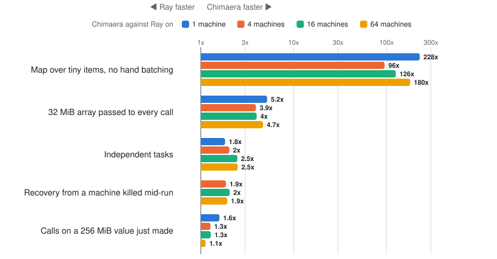

# Benchmarks

Chimaera against Ray, measured on AWS through Anyscale on 2026-11-24 and
2026-11-25. Both runtimes ran with their defaults, on the same machines, one
after the other, and every program is written the way its own docs show it.
This page shows where Chimaera wins. Every run, including the workloads
where Ray wins, is in the raw results named under each section.

## At a glance

| Result | Chimaera | Ray | Speedup |
|---|---:|---:|---:|
| Independent tasks a second, 64 machines | 11,235/s | 4,502/s | **2.5x** |
| 4,096 one-second calls, a machine killed 2 s in, 64 machines | 9.59 s | 18.5 s | **1.9x** |
| A 32 MiB array passed to 2,048 calls, 64 machines | 0.91 s | 4.26 s | **4.7x** |
| Put a 16 GiB NumPy array and read it in a call | 0.31 s | 2.16 s | **6.9x** |

On independent tasks Chimaera leads by 1.8x or more at every size, from
one machine to 64. The 16 GiB array is born in shared memory, so its put is
a link, not a copy.

## On a cluster

<picture>
  <source media="(prefers-color-scheme: dark)" srcset="assets/vs-ray-dark.svg">
  
</picture>

Five workloads Chimaera leads at every cluster size, on c7i.4xlarge
machines (16 vCPU each). Each cell is Chimaera's speedup, then Chimaera's
median against Ray's, over at least 60 seconds of repetitions (35 at 64
machines); the machine-loss row is one run per size.

| Workload | 1 machine | 4 machines | 16 machines | 64 machines |
|---|---:|---:|---:|---:|
| Independent no-op tasks | **1.8x**<br>11,716/s vs 6,409/s | **2.0x**<br>14,067/s vs 6,930/s | **2.5x**<br>14,534/s vs 5,865/s | **2.5x**<br>11,235/s vs 4,502/s |
| Map over tiny items (4M), no hand batching | **228x**<br>1,462,118/s vs 6,419/s | **96x**<br>706,537/s vs 7,398/s | **126x**<br>785,502/s vs 6,245/s | **180x**<br>789,192/s vs 4,394/s |
| A 32 MiB array passed to 2 calls per CPU | **5.2x**<br>11 ms vs 57 ms | **3.9x**<br>53 ms vs 0.21 s | **4.0x**<br>0.22 s vs 0.90 s | **4.7x**<br>0.91 s vs 4.26 s |
| Last result after a machine is killed | – | **1.9x**<br>9.84 s vs 18.4 s | **2.0x**<br>9.24 s vs 18.9 s | **1.9x**<br>9.59 s vs 18.5 s |
| 10 calls on a 256 MiB value just made | **1.6x**<br>0.14 s vs 0.22 s | **1.3x**<br>0.17 s vs 0.21 s | **1.3x**<br>0.18 s vs 0.23 s | **1.1x**<br>0.23 s vs 0.26 s |

The map runs `double.map(range(4_000_000))` on Chimaera and one task per
item on Ray, whose core API has no map. Neither is batched by hand; Chimaera
sizes its batches itself.

The 32 MiB array goes straight into each call, with no `put`. Chimaera
stores it once, by its content. Ray stores a copy per call.

In the machine-loss row, 4 one-second calls per CPU start, and 2 s later one
worker machine's runtime is killed with SIGKILL. The time runs from the
first call to the last result.

Raw results: `bench/evals/results/ray-cluster-{1,4,16,64}-2026-11-24.json`
(Chimaera at commit 933f9a2, Ray 2.59.0).

## Ray's own benchmarks

Ray keeps a suite of release tests and microbenchmarks to track its own
performance. Each test here is written for both runtimes.

### Release tests

Ray's single-node release test for a large object (`release/benchmarks/single_node`), on one
c7i.16xlarge (64 vCPU), four runs per runtime:

| Test | Chimaera | Ray | Speedup |
|---|---:|---:|---:|
| Put a 16 GiB NumPy array and read it in a call (64 vCPU) | 0.31 s | 2.16 s | **6.9x** |

Ray's actor-creation test (`test_many_actors`, two actors per CPU, each
answering one call) on clusters of c7i.4xlarge machines, one run each:

| Cluster | Chimaera | Ray | Speedup |
|---|---:|---:|---:|
| 16 machines, 512 actors | 145/s | 79/s | **1.8x** |
| 64 machines, 2,048 actors | 184/s | 145/s | **1.3x** |

### Microbenchmarks

Ray's `ray microbenchmark` suite and its Chimaera port
(`bench/microbench`), on the machine type Ray publishes its numbers for
(m5.16xlarge, 64 vCPU), two alternating rounds per runtime. Each figure is
operations per second; shown where Chimaera's slower round beats Ray's
faster one.

| Benchmark | Chimaera | Ray | Speedup | Note |
|---|---:|---:|---:|---|
| single client put calls | 98,293/s | 4,589/s | **21x** | a small value is kept in its handle: no round trip to a store |
| multi client put calls | 261,225/s | 13,854/s | **19x** | as above, from 10 tasks at once |
| n:n actor calls with arg async | 91,150/s | 12,801/s | **7.1x** | the small argument rides in its handle |
| single client get object containing 10k refs | 32.0/s | 11.1/s | **2.9x** | a fresh handle each time: nothing cached |
| single client tasks sync | 1,453/s | 772/s | **1.9x** |  |
| 1:1 actor calls sync | 3,049/s | 1,858/s | **1.6x** |  |
| 1:1 async-actor calls sync | 2,184/s | 1,347/s | **1.6x** |  |
| single client tasks and get batch | 7.9/s | 5.0/s | **1.6x** | one unit: 1,000 calls made and their results read |
| single client wait 1k refs | 7.6/s | 5.1/s | **1.5x** | one unit: waiting on 1,000 refs (Chimaera: `as_completed`) |
| single client tasks async | 7,326/s | 6,619/s | **1.1x** |  |

Raw results: `bench/microbench/results-2026-11-24-m5.16xlarge.json`,
`bench/evals/results/release-suite-c7i.16xlarge-2026-11-24.json`,
`bench/evals/results/compare-c7i.16xlarge-2026-11-24.json` and
`bench/evals/results/ray-release-scale-{16,64}-2026-11-24.json`.

## Moving data

From the object-store comparison in
[bench/objects/RESULTS.md](../bench/objects/RESULTS.md) (three
m6id.8xlarge machines, Ray 2.59 as Anyscale runs it):

| What | Speedup | Why |
|---|---:|---|
| `put` of a NumPy array, 256 MB to 1 GB | **134–1,010x** | the array is born in shared memory, so a put is a hard link: about 40 µs at any size |
| put, then get in another process, NumPy 1 GB | **152–240x** | the reader maps the same pages |
| `get` of a torch tensor, 256 MB to 1 GB | **2,000–8,000x** | Chimaera maps the tensor; Ray copies it |
| first get of a spilled 256 MB object | **360–1,080x** | restoring is mapping the file on disk |
| `get` of a 1 to 64 KB value on another machine | **17–137x** | the value travels inside its handle |
| a value whose machine died | **90–70,000x** | a replica waits on the next peer |

Over every data type and size measured, the geometric-mean speedup is
4.2x for `put`, 1.9x for `get` in another process and 1.7x for returning a
value from a call.

## When things go wrong

| What happens | Chimaera | Ray |
|---|---|---|
| A machine is killed 2 s into 4,096 one-second calls (64 machines) | all done in 9.6 s | 18.5 s |
| 12 memory-heavy calls in a 4-CPU, 3 GiB container | 12 of 12 finish, no OOM kills | 3 of 12, 43 OOM kills |
| A function that charges a card loses its worker after it starts | charged once; the caller gets `ch.OutcomeUnknown` | charged 4 times with default retries |

The memory row is from
[bench/evals/gotchas](../bench/evals/gotchas/results/report.md) and the last
from [qualification.md](qualification.md#ray-comparison-cluster-single-node).
[ray-gotchas.md](ray-gotchas.md) lists what Chimaera does about each Ray
failure mode.

## How these were measured

**Code.** Ray 2.59.0 and Python 3.11 from Anyscale's image
(`anyscale/ray:2.59.0-py311`), the same on every machine. Chimaera built
from source on each machine with `cargo build --release` and
`maturin build --release`:

| Section | Chimaera | Machines |
|---|---|---|
| On a cluster; Ray's actor-creation test | commit 933f9a2 | c7i.4xlarge (16 vCPU), 1 to 64 of them |
| The 16 GiB object | commit 933f9a2 | one c7i.16xlarge (64 vCPU) |
| Microbenchmarks | commit 933f9a2 | one m5.16xlarge (64 vCPU) |

**Clusters.** `bench/evals/multi_node.py` through
`deploy/anyscale/eval-{1,4,16,64}node.job.yaml`. Anyscale's Ray starts one
Chimaera peer per machine and every peer joins one cluster. Each workload
runs in a fresh driver against Chimaera and then against Ray, repeated
after a warm-up until 60 seconds have passed (35 at 64 machines). A cell is
the median of those repetitions; the stored results keep each cell's median,
10th and 90th percentiles and number of repetitions.

**One machine.** `bench/compare/run.py`. Ray and Chimaera each keep one
runtime up for the whole run, and each trial runs every workload once per
runtime, the workloads and the runtime that goes first in a random order
from a recorded seed. Before each run the harness waits until the last
run's processes have exited. A cell is the median of every timed run; Ray's
release tests run once per trial, cold, as Ray runs them. `startup` starts
a new runtime every time.

**Durability.** A Chimaera cluster replicates the record of every call to
three peers with Raft. At commit 933f9a2, a peer whose disk took a
millisecond or more per fsync (these EBS volumes took about 3.5 ms) kept
each call's record in memory on those three machines instead of syncing it;
Ray's control plane does not fsync either. Later commits sync every record
by default: set `CHIMAERA_RAFT_SYNC=none` to measure them the same way. The
one-machine runs use the default of their commit.

**Raw data.** Every result named on this page is in
`bench/evals/results/` and `bench/microbench/`, including the workloads
where Ray is ahead.

## Reproduce

```bash
# one machine: Chimaera against Ray (add dask, multiprocessing, joblib)
cargo build --release -p chimaera-peer
maturin develop --release
pip install "ray==2.59.0"
python bench/compare/run.py --out results/ --runtimes chimaera,ray

# on Anyscale: clusters, Ray's release tests at scale, Ray's microbenchmarks
anyscale job submit -f deploy/anyscale/eval-64node.job.yaml
anyscale job submit -f deploy/anyscale/release-64node.job.yaml
anyscale job submit -f deploy/anyscale/microbench.job.yaml
```

`COMPARE_SCALE=0.1` shrinks every one-machine workload for a quick look.
