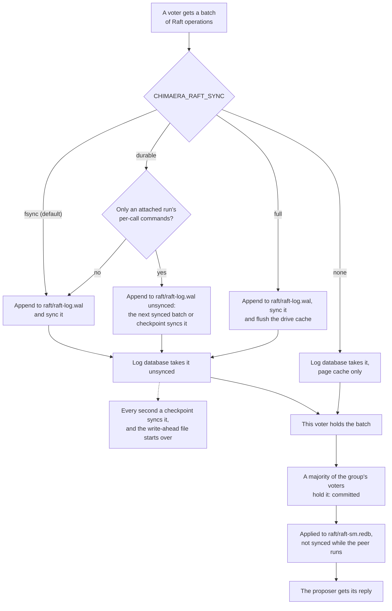

# Running Chimaera anywhere

Every machine in a Chimaera cluster runs the same `chimaera` binary. There is
no head node to place, size or protect. Getting a cluster running anywhere
therefore comes down to two questions: how the binary starts on each host,
and how each peer learns who the founders are and what its own address is.
This page covers both, then how a laptop selects and reaches a cluster, how
accelerators are discovered and isolated, and how your Python environment
reaches the peers.

Status, honestly:

| Piece | State |
|---|---|
| Local peer, started on demand | Works today |
| `peer start --listen/--advertise/--seeds/--bootstrap-expect` | Works; tested with several peer processes on one machine (`python/tests/test_cluster.py`) |
| Provider discovery from each platform's environment (`chimaera-core/src/provider.rs`) | Unit-tested, and used by `peer start --provider` (default `auto`) |
| Launchers: `chimaera k8s render`, `chimaera slurm-launch`, `chimaera up`/`down` over SSH | In the tree. `slurm-launch` and `up`/`down` were run on one machine with stand-ins for `srun` and `ssh`. The container gates (`make kind-test`, `make slurm-test`, `make ssh-test`) are written but have not passed yet |
| Cluster profiles, `ch.init(cluster=)`, cluster tokens, TLS for peers and clients | In the tree; tested on one machine |
| Device discovery and isolation rules (`chimaera-core/src/devices.rs`) | Written and tested against fixture trees for CUDA, ROCm, TPU and Apple; assignment wired in P5 |
| Shipped environments (`env=`), `run`/`submit --cluster`, SkyPilot launch from `chimaera up` | P3 |
| Autoscaling (`chimaera provisioner`), preemption notices | P6 |

## Providers

A provider answers "who are the seeds, and who am I" from what the platform
already tells every process. `chimaera peer start --provider auto` picks one
by checking, in order:

| First set | Provider | Hosts come from | This host is |
|---|---|---|---|
| `KUBERNETES_SERVICE_HOST` | `k8s` | StatefulSet pod names `<sts>-0 … <sts>-(k-1)` under the headless service | `HOSTNAME` |
| `SLURM_JOB_ID` | `slurm` | `SLURM_JOB_NODELIST` (Slurm host-list syntax, e.g. `gpu[01-08]`) | `SLURMD_NODENAME` |
| `PBS_NODEFILE` or `LSB_MCPU_HOSTS` | `hpc` | the PBS nodefile, or LSF's host list | `hostname` |
| `SKYPILOT_NODE_IPS` | `sky` | SkyPilot's node IPs, in rank order | entry `SKYPILOT_NODE_RANK` |
| `--seeds` given | `static` | the flag | `--advertise` |
| nothing | `local` | — | — |

The founders are the first five hosts (fewer if the cluster is smaller), so
every host derives the same list without talking to the others. Later hosts
join as spares. A host that can't find itself in the list stops with an error
instead of waiting forever. Short and fully qualified names match each other
when the match is unique; IP addresses only match exactly.

Ports: 7700, or `CHIMAERA_PORT`. Under Slurm the default is
`7700 + SLURM_JOB_ID % 1000`, so two jobs sharing a node don't collide.

> *Replication is not paranoia when the machines really are out to fail you.*

Raft durability: by default (`CHIMAERA_RAFT_SYNC=fsync`) a cluster peer
syncs each Raft commit to its disk before acknowledging it. With
`CHIMAERA_RAFT_SYNC=durable` it does so for every commit except an attached
run's per-call commits: its calls' submissions, grants and results. Those are
acknowledged once a majority of the group's voters hold them in memory. They
survive the peers' processes dying and the restart or loss of machines holding
fewer than half of a group's voters; the last of them are lost if machines
holding a majority of a group's voters lose power together. The calls of an
attached run that must survive anyway are synced: those with
`effects="external"`, a durable actor's calls, durable workflows and their
steps, gang ranks and reservation hosts, and calls that return a `retained`
value. So is everything else: detached runs, the store, leases, quotas and
membership. A driver older than the release that added `durable` does not
mark its durable workflow's root call, so under `durable` that one commit (not
its steps) is acknowledged from memory. `CHIMAERA_RAFT_SYNC=none` keeps every
commit in the page cache only, and only when set: a commit then survives the
peers' processes dying, not a majority of their machines restarting together.
It buys throughput on slow volumes (on 4 cloud machines with EBS, about 3.5 ms
per fsync: 2,681 no-op calls/s synced, 17,547/s with `none`, measured before
commits were batched as below). A slow disk never lowers the setting. While
its commits keep taking a millisecond or more, a peer holds each one open for
a quarter of a recent commit (at most `CHIMAERA_RAFT_MAX_COMMIT_DELAY_US`,
2 ms) so more entries share its fsync, and `chimaera status` lists the slow disk
as degraded service. `full` also flushes the drive cache (very slow on macOS).

What is synced, and how often:
- **The log.** A syncing peer appends each batch of Raft operations to a
  write-ahead file (`raft/raft-log.wal`) and syncs that: one sequential write.
  Its database takes the batch unsynced and is synced by a checkpoint every
  second, after which the file starts over; at start, what the file holds is
  applied again. Under `durable`, a batch made only of attached runs'
  per-call commands is written there without a sync, and the next synced
  batch or checkpoint makes it durable; every other batch is synced before
  it is acknowledged. Under `none` the log's database is never synced, except
  after a vote, so a restarted voter cannot vote twice in one term.
- **The state.** The state machine's database (`raft/raft-sm.redb`) is not
  synced as the peer runs: it is the log applied, and the log and snapshot
  files are synced. After the machine restarts without a clean stop, the peer
  rebuilds it from each group's newest snapshot file and replays the log
  after it (a process that died within the same boot left it whole). A clean
  stop syncs it.

Network volumes are why. On EBS gp3 a sync is cheap but an IO is not: each
synced redb commit rewrote about twenty pages, and the volume's 3,000 IOPS
then held one c7i.4xlarge peer to about 1,050 no-op calls/s. With the log
and state written this way the same peer, still syncing every commit, ran
13,066/s (13,486/s with `none`).

What a cluster voter does with each batch under each `CHIMAERA_RAFT_SYNC`
setting, up to the reply its proposer waits for:



`chimaera status` shows the guarantee asked for next to the one the groups
give: `machine` (every voter syncs and no machine holds a majority of a
group's voters, so a commit survives the loss of any one machine and every
machine restarting at once), `reboot` (every voter syncs, but one machine
holds a majority: restarts are survived, that machine's loss is not) or
`process` (some voter does not sync). Next to it, `calls` is what an attached
run's per-call commits survive: the same where every voter syncs every commit,
`replicated-memory` where a `durable` voter acknowledges them from memory
(fewer than half of a group's voters restarting or lost is survived, a
majority restarting together is not), and `process` where in addition one
machine holds a majority of a group's voters. A group is only as strong as its
weakest voter, since a majority that includes it can acknowledge a commit, and
status names the voter that holds a group back. Dead voters are replaced, and
seats moved, only with peers that sync as the leader asks.

A peer whose logs were not all synced (`durable` or `none`) and whose machine
rebooted without a clean shutdown first asks the other voters of its groups
whether they still lead them (for up to 10 seconds). If they do, it discards
its raft identity and joins as a new member, so it can never vote with a log
it may have lost. If some group has no leader (most of its machines went down
together), it keeps its state instead, so the group comes back when enough of
its voters return, possibly without its last moments of commits. A peer whose
groups have no majority yet still starts and serves the groups that do; the
others are retried in the background. Local peers never sync, except that the
record of an `effects="external"` call starting is synced before the call
runs, so a power loss cannot make it run twice.

Recovering a group whose other voters are gone for good (their disks lost):
stop the surviving peer, then run
`chimaera --dir DIR cluster recover --group G --force-new-quorum` for each
such group. That peer becomes the group's only voter, keeping every commit it
holds; commits it never received are lost. Start it again: the cluster adds
live peers back as voters. Use it only when the other voters will not return,
and on the surviving replica that holds the most of the group's log.

Upgrading: `chimaera --version` prints the release and its peer level, for
example `chimaera 0.1.0 (peer level 1, wire 1, build dev-487df68cf4ccb0f2)`.
Every replica of a group must apply its log with the same code, so peers at
different levels refuse each other's calls (the refused peer logs "every peer
of a cluster must run the same release"). A release that keeps the level can
replace peers one at a time: restart a peer, wait for `chimaera status` to
list it, then the next. A peer still on a release that does not say whether it
syncs its raft log counts as not syncing, so until the last one is replaced,
upgraded peers that sync give it no voter seat and may move its seats to each
other, and each group it votes in reports `process` durability with a degraded
line. A `durable` peer tells the others it syncs, which holds for every commit
that must survive, plus that it acknowledges an attached run's calls from
memory, which an older peer does not read: an older leader seats it as a
voter, and an older peer's status shows no `calls` class. Likewise, while a
peer on a release too old to say which stored layouts it reads is live,
shuffles store their buckets in the layout every release reads, so any peer
can run any gather. Under Kubernetes, `kubectl apply` the new image, then
`kubectl delete pod NAME-N` one pod at a time, since the StatefulSet only
replaces pods you delete. A release that raises the level needs every peer
stopped before any starts again on the new release
(`kubectl scale --replicas=0`, then back). Raft state and peer identities stay on disk across
a clean stop, so detached runs and named actors' records survive; calls
running at the stop are interrupted as in any whole-cluster restart. Drivers
are checked separately: a peer refuses a driver whose wire version is newer
than its own, so upgrade peers before drivers.

Under `auto`, two flags keep the meaning they had before providers existed:
`--listen` means a hand-configured (`static`) peer, and `--idle-timeout`
means a local one. Drivers start their local peer on demand with
`--idle-timeout`, so a notebook in a Kubernetes pod or a script inside a Slurm
job still gets a local peer. Pass `--provider` to choose explicitly.

Under `k8s`, `slurm`, `hpc` and `sky` the peer listens on `0.0.0.0:<port>`,
advertises the discovered address, and uses the discovered founders as its
seeds. `--listen`, `--advertise` and `--seeds` override each of these. Such a
peer also accepts drivers from other machines, with the cluster token, on
`--client-listen`. Without that flag it uses `0.0.0.0:<client port>`, where
the client port is `--client-port`, else `CHIMAERA_CLIENT_PORT`, else the peer
port + 10. The token comes from `--token-file` or `CHIMAERA_CLUSTER_TOKEN`, as
for any cluster peer. The discovered pool and labels are logged at start but
not used for placement yet.

### Kubernetes

> *Guesswork dressed in YAML is still guesswork.*

A StatefulSet, a headless Service for the peers, a Service for drivers and a
PodDisruptionBudget, printed by `chimaera k8s render`. There is no operator
and no custom resource: peers already replace failed voters themselves, and
the only thing to reconcile is the replica count.

```sh
chimaera cluster init --out ca     # the cluster CA and token; keep this directory safe
kubectl create secret generic chimaera-token --from-file=token=ca/token
kubectl create secret generic chimaera-tls --from-file=ca/ca.pem --from-file=ca/ca.key
chimaera k8s render --image registry.example.com/chimaera:0.1 --replicas 5 | kubectl apply -f -
```

`--image` is required and should be built from `deploy/images/Dockerfile` (or
`FROM` it): `chimaera` on `PATH`, the chimaera wheel installed, and uid 1000.
The other flags are `--name` (default `chimaera`; pods are `NAME-0`,
`NAME-1`, ...), `--namespace`, `--replicas` (3), `--founders` (min(3,
replicas)), `--port` (7700), `--client-port` (7710), `--cpus` and `--memory`
(each set as both request and limit, so the peer offers what the pod may
use), `--storage` (10Gi per pod), `--token-secret` (default
`NAME-token`, key `token`) and `--tls-secret` (default `NAME-tls`, keys
`ca.pem` and `ca.key`). `deploy/k8s/example.yaml` is the output of
`chimaera k8s render --image chimaera:dev`.

Each pod runs `chimaera --dir /data peer start --provider k8s --tls-ca
/etc/chimaera/tls`, with the TLS Secret mounted read-only there: the peer
issues itself a certificate from the CA, so peers talk mutual TLS and drivers
reach the client port over TLS (outside the cluster, with
`CHIMAERA_CA=ca/ca.pem`). The provisioner Deployment (`--provisioner`) gets
only `ca.pem` from that Secret, never the key. The manifest
sets the variables the `k8s` provider reads (`CHIMAERA_K8S_SERVICE`,
`POD_NAMESPACE`, `CHIMAERA_FOUNDERS`, `CHIMAERA_PORT`, `CHIMAERA_POOL`), plus
`CHIMAERA_CLIENT_PORT`, and `CHIMAERA_CLUSTER_TOKEN` from the Secret. It also
sets these, each for a reason:

| Setting | Why |
|---|---|
| `podManagementPolicy: Parallel` | `OrderedReady` deadlocks formation: pod 0 can't be ready until the other founders exist |
| `updateStrategy: OnDelete` | a release that raises the peer level must replace every pod together; see Upgrading |
| `publishNotReadyAddresses: true` | founders must resolve each other before they are ready |
| a readiness probe on the client port | the port opens only once the cluster has formed |
| a volume claim per pod, mounted at `/data` | Raft logs and the peer's identity survive pod restarts |
| a memory-backed `/dev/shm` | large values are shared through it |
| `terminationGracePeriodSeconds: 45` | SIGTERM drains for up to 30 s first |
| a PodDisruptionBudget with `maxUnavailable: 1` | voluntary evictions never take a quorum |
| no service-account token on peers | only the provisioner needs API access |
| uid 1000, never root | |

A driver in a pod talks to that pod's peer:
`kubectl exec chimaera-0 -- env CHIMAERA_HOME=/data python3 app.py`. A driver
elsewhere connects to the `NAME` Service on the client port with the token.

### Slurm

Inside an allocation, `chimaera slurm-launch -- python3 app.py` does this:

1. It runs `srun --nodes=N --ntasks=N --ntasks-per-node=1 --kill-on-bad-exit=1 --overlap chimaera --dir DIR peer start --provider slurm` in the background, with a new cluster token and CA for the job (or `CHIMAERA_CLUSTER_TOKEN`, and `CHIMAERA_TLS_CA_PEM` with `CHIMAERA_TLS_CA_KEY`, if set). Both travel in srun's environment, since each node's data directory is its own; each peer issues itself a certificate from the CA, so the peers talk mutual TLS. Your command gets the CA variables too, so spares it starts (`--slurm`, below) join with it. Each peer takes them out of its own environment at start, so calls never see them. Slurm itself keeps a job's exported environment, token and CA key included, in its state (`scontrol show job -dd` shows it to administrators): on a cluster whose administrators you do not trust with the cluster, run peers with `--tls-dir` certificates you issue instead.
2. It waits until the peer on this node is serving.
3. It runs your command with `CHIMAERA_HOME=DIR`, so the driver uses this node's peer.
4. When the command exits, it sends SIGUSR1 to `srun`, which forwards it to the peers (they drain, then exit), and returns the command's exit code. Not SIGTERM: `srun` answers SIGTERM by killing its tasks outright.
5. If the launcher itself gets SIGTERM (`scancel`, preemption) or SIGUSR1 before the command ends, it passes SIGTERM to the command, waits for it, then drains the peers.

`DIR` is `$TMPDIR/chimaera-$SLURM_JOB_ID` (`/tmp` when `TMPDIR` is unset) on
each node. It must be node-local, so a shared `TMPDIR` needs `--dir`. Data
directories too deep for a socket path keep their socket under
`/tmp/chimaera-<uid>/`. The command must start on a node of the allocation,
as an `sbatch` script does. A shell from `salloc` on a login node is not on
such a node, so the launcher refuses to run there. Starting it on a node
with `srun --pty` should work but is untested. `--port` sets the peer port. The
client port defaults to the peer port + 1000, so jobs sharing a node never
collide.

`deploy/slurm/chimaera.sbatch` is a complete job script:
`sbatch --nodes=4 chimaera.sbatch python3 app.py`. It asks for whole nodes
(`--exclusive`), because each peer schedules its node's CPUs itself. It also
sets `--signal=B:USR1@120`: two minutes before the time limit the launcher
stops your command, then drains the peers. Slurm sets `CUDA_VISIBLE_DEVICES` for the GPUs it granted, and the peer
narrows its device list to that (P5).

### SSH and plain VMs

`chimaera up NAME` starts a peer on every host of an SSH profile in
`~/.config/chimaera/clusters.toml` (or `$CHIMAERA_CLUSTERS`):

```toml
[clusters.lab]
provider = "ssh"
hosts = ["gpu1", "gpu2", "gpu3"]                  # ssh destinations; peers dial each other by these names
peers = ["gpu1:7710", "gpu2:7710", "gpu3:7710"]   # client addresses, for ch.init(cluster="lab")
# optional: dir = "~/.chimaera/peers/lab", port = 7700, client_port = port + 10,
#           ssh_user, remote_bin, token_file
```

`up` uses the system `ssh` and `scp` (with `BatchMode=yes`), so
`~/.ssh/config` applies. For each host that isn't already running a peer, it
does the following:

1. Unless `remote_bin` names a `chimaera` already installed there, it copies this binary to `~/.chimaera/bin/chimaera`. That binary has to be built for the hosts' OS and CPU.
2. It writes the cluster token to `DIR/token` (mode 0600).
3. It starts `chimaera peer start --provider static` in the background, logging to `DIR/peer.log`.

The founders are the first min(5, n) hosts. `up` then waits until every peer
serves, and shows a peer's log if it stops. The token is
`~/.chimaera/clusters/NAME/token` (or the profile's `token_file`), created
on the first `up`. The Python client reads the same file. The first `up` also
makes the cluster CA there (`ca.pem`, `ca.key`), copies it with the token to
each host (`DIR/tls-ca`, mode 0600), and starts each peer with `--tls-ca`, so
peers talk mutual TLS and drivers verify the peers with `ca.pem` from the same
directory. A cluster that ran before it had a CA must be restarted (`down`,
then `up`), and `up` says so. `chimaera down NAME` stops the peers and keeps
their data directories, so the next `up` resumes the same cluster.

If you already provision VMs with something else, start the peer with
`--listen … --seeds …` (or `--provider static`) from your own tooling.

### Clouds

Through SkyPilot, not code for each cloud: a SkyPilot task whose `run`
command is `chimaera peer start --provider sky` gets its founders and address
from `SKYPILOT_NODE_IPS` and `SKYPILOT_NODE_RANK`. SkyPilot handles instances,
quotas, spot fallback, and the TPU, Trainium and Gaudi catalogs across its
clouds. `chimaera up` doesn't write that task yet. Real cloud launches are
unverified.

### Draining and preemption

SIGTERM (or SIGUSR1) drains a peer: it stops taking new work, other peers stop sending it
any, and it waits up to `CHIMAERA_DRAIN_SECONDS` (default 30) for queued and
running calls before it shuts down. Within the same period it hands on what
would otherwise go with it: groups it leads move to another voter, the
groups' leaders replace it as a voter with a live peer that is not one (if
there is such a peer), and once its calls are done it copies every value it
stores to the peer readers ask next. The log says how many values were
copied and how many were left behind at the deadline. Actors it hosts that may
restart (`restart="fresh"` or `"checkpoint"`, or durable) move: each finishes
the calls it is running, stops, and starts on another peer without counting
against `max_restarts`. Calls waiting for it go to its new host, and every
handle keeps its order. A fresh actor starts over there; a durable one resumes
its committed state. Actors with `restart="never"` stay until the peer stops,
and then end. Kubernetes' grace period uses SIGTERM;
Slurm jobs use SIGUSR1, because `srun` forwards it to the peers and turns
SIGTERM into a kill (`--signal=B:USR1@120` in the job script).

On cloud VMs, `CHIMAERA_PREEMPTION_NOTICES=gce|aws|azure` makes the peer poll
its metadata server every 5 seconds and drain when the VM is about to go away:
a GCE preemption or `TERMINATE` maintenance event (not a live migration), an
AWS spot interruption (`spot/instance-action`, through an IMDSv2 token), or an
Azure scheduled `Preempt`, `Terminate`, `Reboot` or `Redeploy`. GCE gives 30
seconds' warning for a preemption, so set `CHIMAERA_DRAIN_SECONDS` below that
there. It is off by default, since only a cloud VM has the metadata address,
and it has not been run against a real cloud.

### Backing up and restoring a cell

A cell survives losing a minority of its peers. To survive losing all of them, back their groups up:
stop one peer, run `chimaera --dir <its dir> cluster backup --out <dir>`, and start it again. Back up one
peer at a time: while it is stopped, its groups run with one voter fewer, and another loss in that window
costs their quorum. In a cell of three peers, every peer votes in every group, so one backup covers the
cell; in a larger one, back up peers until `backup.json` lists every group. Copy the backup off the
machines.

To rebuild a lost cell, restore into a new directory and start that peer:

```
chimaera --dir /data/new cluster restore --from /backups/p0 --advertise 10.0.0.9:7700 --force-new-cell
chimaera --dir /data/new peer start --listen 10.0.0.9:7700 --seeds 10.0.0.9:7700 --data-groups 8
```

It serves every group alone, and the peers that join become voters. Runs, actors' records and the store
come back as they were at the backup. Calls the lost peers were running are retried; results stored only on
them are lost (values inline in an outcome, or spilled to `CHIMAERA_SPILL_URL`, are not).
`python/tests/test_restore.py` loses a whole cell of three and restores it this way.

### Tenants and quotas

A run belongs to a tenant: `ch.init(tenant="team-a")`, or `CHIMAERA_TENANT`,
else the tenant of the driver's credential, else `"default"`.

Drivers on other machines that hold the cluster token can do anything. Give
each team a driver credential instead:

```sh
chimaera cluster credential --tenant team-a --token-file token > team-a.cred
```

A driver presenting it (`CHIMAERA_TOKEN_FILE=team-a.cred`, or a profile's
`token_file`) runs as `team-a`. Over a peer's client port it can then reach
only that tenant's runs, actors, store namespaces, objects and logs, and the
same holds for `chimaera runs`, `logs`, `inspect`, `explain` and `cancel`.
Another tenant's run looks exactly like a missing one. A credential cannot
stop a peer or list every peer's object store, and it can't name another
tenant in a request. Peers check a credential against the cluster token
without a table, so changing the token revokes every credential. Drivers on a
peer's local socket are its owner and are not limited. Calls of a tenant's run
see `CHIMAERA_TENANT` and use it as their default tenant; it is a name the
driver chose, not an identity the peer checks.

A credential limits what a tenant's drivers can ask peers for over the
network. It does not sandbox the code a tenant runs, so it protects tenants
who trust each other from mistakes, not from each other. Calls run as the
peer's OS user. They can read whatever the peer can: its data directory,
other runs' values on that machine, the peer's own environment and token
file. They can also use the peer's local socket, which is not limited. So
anyone who can submit a call can become an administrator of the whole
cluster. Workers do not inherit the token in their own environment, which
keeps it out of logs and child processes, but that is not a barrier. Give
tenants that must not reach each other separate clusters, or run peers in
a container or as a user per tenant.

Start peers with `CHIMAERA_TENANT_QUOTAS="team-a=8,team-b=2"`
to cap each tenant's CPUs on that peer:
- **At the cap:** while a tenant's running calls hold its quota, its other calls wait, and other tenants' work goes ahead.
- **Over the cap:** a call that asks for more than the whole quota fails as infeasible, naming the quota.
- **Waiting calls:** a call waiting on its own calls lends its share, as it lends its CPU, so nested work never deadlocks a quota.
- **No quota:** tenants without a quota are not limited.
- **Bad setting:** a malformed setting stops the peer.

`CHIMAERA_TENANT_SHARES="team-a=64"` caps a tenant's CPUs across the whole
cluster in the same way. Set it on every peer:
- **How it counts:** each peer reports its tenants' CPUs in its load replies, and admits a call only if the tenant's CPUs here, plus what the other peers last reported, leave room.
- **Overshoot:** peers admitting in the same instant may overshoot a share briefly, until their next reports (a fraction of a second), never for long.
- **Combining:** a peer quota and a cluster share combine; a call must fit both.

A test runs 12 one-second calls under `ml=2` on two 4-CPU peers. They take
about 6 s (2 at a time), against about 2 s for a tenant without a share.

### Metrics

Set `CHIMAERA_METRICS_LISTEN=0.0.0.0:9700` and each peer serves Prometheus
metrics at `GET /metrics`. Gauges: calls queued and running, CPUs in use, busy
executors, object and memory bytes, connected drivers, shard proposals in
flight, dispatch latency (p50 and p99), live/dead peers, groups with no
leader, and per group this peer holds whether it leads it and, on the leader,
how many log entries its slowest voter lacks. Counters since the peer
started: proposals and proposals no leader accepted, peers declared dead,
worker deaths, OOM kills, cancelled calls' workers killed, and failed object
replicas. The endpoint
serves counts only, never run names or values, and takes no token, so bind it
where only your scraper can reach it. `chimaera k8s render` turns it on and
adds the `prometheus.io/scrape` annotations.

### Autoscaling (Kubernetes)

`python -m chimaera.provisioner --k8s-statefulset chimaera --min 1 --max 8`
grows and shrinks the StatefulSet. It is an ordinary remote driver
(`CHIMAERA_ADDRESS`, `CHIMAERA_TOKEN`) that reads `ch.runs.cluster().nodes()` and
keeps no state, so it can restart at any time, and losing it stops scaling,
never work. It runs outside the peers, so user code never sits next to the
credentials that scale the cluster.

- **Grow:** after calls have been queued for `--up-after` seconds (default 30), by as many peers as the queue needs at the current peers' size.
- **Shrink:** by one after the cluster has been mostly idle for `--down-after` seconds (default 300), and only once it knows what the unit that would go (the highest pod; under `--slurm` or `--sky`, the newest spare) holds. Its peer is the member that names it (a pod's `host` label is the pod's name; a spare's peer carries `slurm.job=<id>` or `chimaera.spare=<name>`), whatever address it advertises. It goes when that peer holds no calls, actors or stored values, or when the provider shows it never started (a Pending pod none of whose containers ran, a pending job, no such SkyPilot cluster). When neither can be shown (it started but no peer from it joined, or its peer stopped answering) the pool keeps its size and prints why, once. It checks again just before the change, and a Kubernetes change is made on top of the StatefulSet version it read, so it fails rather than undo another writer. Kubernetes removes the highest pod, and its SIGTERM drains it: it hands the groups it leads, and its voter seats, to other peers before it stops.
- **Hold:** while peers it asked for are still starting.

**Sizing by forecast.** With `--planner forecast`, growth is decided from what
each peer reports queued instead: its calls by CPUs, memory and expected run
time (a function's median call time; at least a second, or as long as its
calls have run so far, for one never measured), and when its running calls
free their cores. It simulates the queue on the peers there are, on those it
asked for that are still starting, and on each number of new ones, and asks
for the fewest that start every queued call within `--target-start` seconds
(default 60; with `--target-finish`, also end them in time). A backlog that
clears before a new peer could start buys nothing, and when no size meets the
target it says which target and what binds it (the calls' own length, the
provider's startup, `--max`). New peers count as usable after the 90th
percentile of the startups it has seen, or `--startup-estimate` until it has
seen three: set that to a slow startup, not a typical one. A new peer is
assumed as large as the first one it adds, and until one has joined as the
smallest peer there is; when the pool's peers differ from the ones already
there (a larger first node), say so with `--peer-cpus` and `--peer-memory`.
Shrinking is the
rule above, never while peers it asked for are starting. Only one forecast
provisioner per pool acts: it holds a lease in the cluster's store, and a
second waits to take over, starting from the startup times the first kept
there. `--dry-run` changes nothing and `--explain` prints every plan. While a
call waits, its `future.explain()["capacity"]` holds each pool's latest plan.
On `bench/autoscale/replay.py`'s burst traces it uses 90% fewer peer-seconds
than the queue rule for the same completions, and it never grows for a
backlog that clears on its own. On one of its ten persistent-load replays it
finishes later than the queue rule (completion p99 76 s against 60 s).

Each change, each failed look and each new reason a shrink is held prints one JSON line, with the peers asked for, up and usable. In the cluster,
`chimaera k8s render --namespace NS --provisioner MAX` adds it as a
one-replica Deployment that scales between `--replicas` and `MAX`, with a
ServiceAccount whose Role may only read this StatefulSet and patch its
`scale`, and read (never change) its own pods (the peers still get no
service-account token). Run by hand, it drives
`kubectl` with your current context.

Inside a `slurm-launch` job, `--slurm` grows the cluster with spare one-node
jobs instead. Each spare `sbatch` job, named `chimaera-spare-<the cluster's job id>`,
runs a peer that joins the running cluster; only this user's jobs of that
name count, so clusters sharing an account never cancel each other's
spares. Shrinking cancels the newest spare job, whose peer drains on the
SIGTERM `scancel` sends. Spares join with the cluster's token, so submit the
job with `CHIMAERA_CLUSTER_TOKEN` set (`slurm-launch` then uses it too).
`deploy/slurm/slurm-autoscale-test.sh` checks this.

On clouds, `--sky "LAUNCH ARGS"` grows the cluster with one-node SkyPilot
clusters, `chimaera-spare-1`, `-2`, and so on. Each runs `sky launch` with
your arguments (where and on what, e.g. `--infra aws --gpus H100:8 --use-spot
--image-id ...`; the node needs `chimaera` on its PATH) and a peer that joins
the running cluster. Shrinking sends the newest spare's peer SIGUSR1 over
`ssh` (SkyPilot writes a host alias per cluster), waits for it to drain, then
runs `sky down`. `--base N` counts the peers that are not spares (default 1),
and the spares' names are kept in the cluster's store, so a restarted
provisioner knows them. Run it with `CHIMAERA_CLUSTER_TOKEN` set; it goes to
SkyPilot with `--secret`, so SkyPilot keeps it out of its logs. With
`CHIMAERA_TLS_CA` set to the cluster's `chimaera cluster init` directory, each
spare gets a certificate of its own, issued where the provisioner runs: a task
file uploads that certificate, its key and `ca.pem` (never the CA's key) and
starts the spare's peer with `--tls-dir`. Without it, spares join a cluster
that does not use TLS. The calls it makes are checked against stand-in `sky`
and `ssh` commands; it has not run against a real SkyPilot install, so TLS
stays opt-in for spares until one has.

### Several clusters (federation)

Clusters (cells) can lend each other capacity. Start a cell's peers with the
cell's name, the other cells' client endpoints and a token those cells accept:

```
CHIMAERA_CELL=a CHIMAERA_FLEET="b=10.0.1.5:7710" CHIMAERA_FLEET_TOKEN_FILE=/etc/chimaera/fleet chimaera peer start ...
```

When every peer of a cell is full, a queued call that carries everything it
needs may run in another cell with room:
- **Eligible:** plain function calls with inline arguments, no dependencies and no effects.
- **Ownership:** it stays a call of its home cell, which publishes its result.
- **Failure:** losing the other cell costs only a retry of what it held.

Details, limits and the test are in [federation.md](federation.md).

## Selecting and reaching a cluster (P3)

Where `ch.init` and `chimaera run` send work, in order of precedence:

1. `ch.init(cluster="name")`
2. `CHIMAERA_CLUSTER`
3. `CHIMAERA_ADDRESS` and `CHIMAERA_TOKEN`, for one-off use
4. the `default` in your profile file
5. a local peer

```toml
# ~/.config/chimaera/clusters.toml
# Credentials live in ~/.chimaera/clusters/<name>/ (mode 0600), never in this file.
default = "dev"

[clusters.dev]
provider = "static"
peers = ["10.0.0.1:7710", "10.0.0.2:7710", "10.0.0.3:7710"]   # the peers' client addresses
env = "shared"

[clusters.lab]
provider = "ssh"
hosts = ["gpu1", "gpu2"]
peers = ["gpu1:7710", "gpu2:7710"]
env = "uv"

[clusters.prod]
provider = "k8s"
context = "gke-prod"
namespace = "ml"
image = "ghcr.io/acme/app@sha256:..."
pools = [
  { name = "cpu",  replicas = 5, cpus = 16, memory = "64 GiB" },
  { name = "h100", replicas = 0, max = 8, gpus = 8, device = "cuda:H100" },
]

[clusters.hpc]
provider = "slurm"
login = "login.hpc.example.edu"
partition = "gpu"
nodes = 4
time = "04:00:00"

[clusters.cloud]
provider = "sky"
accelerators = "A100:8"
nodes = 2
use_spot = true
```

- `chimaera run --cluster NAME -- python app.py` keeps the driver on your machine.
- `chimaera submit --cluster NAME -- python app.py` runs the driver on the cluster, detached, and prints the run id. `logs`, `inspect`, `attach` and `cancel` take `--cluster` too.
- Run history lives in the long-lived cluster, so it is still there after the job ends.

A peer uses two ports: the peer port (7700) for other peers, and the client
port (`--client-listen`; 7710 under the k8s, slurm, hpc and sky providers
and with `chimaera up`) for drivers on other machines. Both demand the cluster
token (unless `--insecure`). TLS uses the cluster's CA: `chimaera cluster
init --out DIR` creates the CA and a token. Give every peer the same `DIR` with
`--tls-ca DIR`, and each issues itself a certificate from it at start and reads
the token from `DIR/token`. Or issue a certificate per peer with `chimaera
cluster cert` and start each with `--tls-dir`. Either way, both ports then use
TLS, and a peer whose certificate another CA signed is refused. Drivers need
just `ca.pem` (`CHIMAERA_CA`). The trade-off: `--tls-ca` puts the CA's
private key on every peer, so any one peer can mint certificates until the CA
is replaced. That adds little to what the cluster token already lets a peer
do, but where nodes are less trusted (spot machines on other clouds, shared
hosts), keep the key where you provision and issue each node its own
certificate with `chimaera cluster cert`, shipping only that pair and
`ca.pem`. A profile's `peers` lists client addresses, and
the client tries them in order.

## Accelerators

### Asking for them

- `gpus=N` counts accelerator units of any vendor.
- `device="KIND[:MODEL]"` narrows the request. `KIND` is one of `cuda`, `rocm`, `tpu`, `neuron`, `hpu`, `xpu`, `mps`. `MODEL` is a case-insensitive prefix of the normalized model name, such as `H100`, `MI300X`, `v5e`, `trn2`, `gaudi3` or `M3`.
- `device` alone means one unit; `gpus=8, device="cuda:H100"` means eight H100s.
- Driver versions and compute capability are peer labels, matched with `Placement(require=...)`.

A misspelled kind fails with the valid list and a suggestion (`cdua` → "did
you mean cuda?").

### What a call sees

Each call sees only the devices it was granted. The peer sets these variables
for the executor and removes conflicting ones it inherited:

| Kind | Unit | Variables | Collective backend |
|---|---|---|---|
| `cuda` | GPU | `CUDA_VISIBLE_DEVICES=<GPU UUIDs>` | `nccl` |
| `rocm` | GPU or partition | `HIP_VISIBLE_DEVICES=<indices>`; removes `CUDA_VISIBLE_DEVICES`, `GPU_DEVICE_ORDINAL`; keeps an inherited `ROCR_VISIBLE_DEVICES` | `nccl` (RCCL) |
| `tpu` | chip | `TPU_VISIBLE_CHIPS`; for 1 or 2 chips also `TPU_CHIPS_PER_HOST_BOUNDS` and `TPU_HOST_BOUNDS=1,1,1`; a whole host gets the framework defaults | `xla` |
| `neuron` | NeuronCore (logical: two physical cores on Trn2 and Trn3 by default) | `NEURON_RT_VISIBLE_CORES` | `xla` |
| `hpu` | module | `HABANA_VISIBLE_MODULES=<module ids>` | `hccl` |
| `xpu` | card (a two-tile Max 1550 is one) | `ZE_AFFINITY_MASK` in PCI order, with `ZE_ENABLE_PCI_ID_DEVICE_ORDER=1` and `ZE_FLAT_DEVICE_HIERARCHY=COMPOSITE`; removes `ONEAPI_DEVICE_SELECTOR` | `xccl` |
| `mps` | the one Apple GPU | none: it can't be hidden | `gloo` |

A call granted none of a kind the host has gets an empty list, so it sees no
devices of that kind. UUIDs are used for CUDA so device ordinals never matter.
The TPU rules follow Ray 2.60's accelerator managers. Intel differs from Ray,
which leaves Level Zero's device order and hierarchy at their defaults: here
both are pinned, so a mask names the card the peer chose.
`ch.dist.device()` returns the framework device string (`"cuda:0"`, `"xla:0"`,
`"hpu"`, `"xpu:0"`, `"mps"` or `"cpu"`) without importing a framework.

### How peers discover them

Discovery reads files, then shared libraries, and runs vendor tools last:

1. A device must be listed by the driver: `/proc/driver/nvidia/gpus` for NVIDIA, the KFD topology for AMD, `/dev/accel*` or Google VFIO groups for TPU, `/sys/devices/virtual/neuron_device` for Neuron, Habana (PCI vendor 0x1da3) entries in `/sys/class/accel` for Gaudi (an "operational" one), and Intel (0x8086) DRM render nodes for `xpu`. An Intel integrated GPU is not counted, so `gpus=1` never lands on it.
2. Its `/dev` node must exist. A Kubernetes device plugin mounts only the nodes it granted, while procfs still lists every GPU on the host.
3. A visibility variable the peer itself inherited narrows it further, as Slurm's `CUDA_VISIBLE_DEVICES` does.

NVIDIA memory, MIG instances and NVLink come from NVML, loaded at run time so
one binary works on every host (P5). Ray reads Neuron, Gaudi and Intel from
their vendor tools; Chimaera reads the files their drivers document, with
no tool installed. Models come from the PCI id (`gaudi3`, `Max 1550`) or the
Neuron instance family (`trn2`).

Only CUDA's `CUDA_VISIBLE_DEVICES=""` behavior is documented by its vendor
and relied on as fact. Every other vendor detail here is unverified on
hardware, and the fixtures in `tests/fixtures/topology/` are hand-written.

`deploy/anyscale/gpu-check.job.yaml` is the first hardware check: one node
with 4 NVIDIA A10Gs, running `bench/evals/gpu_check.py`. That script checks:
- the peer finds every GPU `nvidia-smi` lists;
- a `gpus=1` call sees exactly one GPU, as torch counts them, named by its UUID;
- concurrent calls get different GPUs, and a CPU call sees none;
- a 2-rank gang all-reduces over NCCL.

It also copies the node's driver files to `OUT/fixture`, a real tree to
replace the hand-written CUDA ones.

It ran on 2026-11-21:
- **Passed (7 of 8):**
  - each `gpus=1` call saw exactly one GPU by UUID (torch counted 1, `ch.dist.device()` was `cuda:0`);
  - four concurrent calls got four different GPUs;
  - a CPU call saw none;
  - a 2-rank gang all-reduced over NCCL;
  - the driver files were captured.
- **Failed (1):** a lone peer listed no GPUs in `ch.runs.cluster().nodes()`, though it granted all four. That was a bug in how a peer without a mesh reports itself. It is fixed and covered by `test_devices.py`, but the fix hasn't been rerun on that node.

So CUDA discovery, grants and NCCL gangs are verified on NVIDIA A10Gs. ROCm,
TPU, Neuron, Gaudi and Intel are not.

## Your environment on remote peers (P3)

Planned: three modes, chosen automatically. What works now is under **Today** below.

| Mode | What ships | Python the executor runs | Default for |
|---|---|---|---|
| `shared` | paths only | your interpreter's path | local runs, Slurm and HPC on a shared filesystem |
| `image` | your project's local code | the image's Python; a peer refuses a run built for another image | Kubernetes, SkyPilot with a container |
| `uv` | `uv.lock` and `pyproject.toml` (or a lock built from what you have installed), plus local code | an environment built once per digest on each peer | SSH, VMs, SkyPilot |

Chimaera will pick the first that applies: an explicit `env=`, running inside
the cluster's image, a peer that already has an identical environment, a
`uv.lock` in your project, then a lock built from your installed packages,
and otherwise fail with an error naming the fixes. None of that selection,
the image check or the built lock exists yet.

**Today:** a driver connected to a remote cluster (`CHIMAERA_ADDRESS` or a
profile) ships its project's own modules. These are the `sys.path`
directories that aren't the interpreter's, a virtualenv's or Chimaera's, as
one archive named by its content, at most `CHIMAERA_PROJECT_MAX_BYTES`
(100 MiB). Inside a git work tree it holds only what git would track, so
files your `.gitignore` excludes (data, checkpoints, `.env`) stay home. A
directory git ignores as a whole ships nothing, even when it holds the
script; warning CH126 says so when the script imported modules from it.
`CHIMAERA_PROJECT_INCLUDE` names files or directories to ship anyway (an
extension module built in place, say), and `CHIMAERA_PROJECT_GITIGNORE=0`
ships every ignored file. If git can't list a work tree's files (it isn't
installed, or it refuses the directory), `ch.init` fails and says why rather
than ship every file. `chimaera submit -- python app.py` always ships
`app.py`. A directory holding a copy of Chimaera (a source checkout on the
path) is never shipped: the peers use their own.
Each peer unpacks it once and puts it on the workers' `sys.path`.
When the project has a `uv.lock`, each peer also installs the locked packages
once, with its own Python (`uv sync --frozen`), and the workers put them
ahead of the peer's own. An install that takes longer than
`CHIMAERA_ENV_BUILD_TIMEOUT` seconds (set on the peers; default 900) fails
the call that needed it, naming the setting. `uv` must be on the peers' PATH;
the runtime image includes it. Without a lock, third-party packages must already be on the
peers (the `image` mode).

Only an allowlist of environment variables ships with a run: locale settings,
`PYTHONHASHSEED`, whatever `ch.init(env=...)` adds, and names matching
`CHIMAERA_ENV_PASSTHROUGH`. Secrets come from each peer's own environment (a
Kubernetes Secret, the Slurm job's environment), never from your laptop and
never through the replicated run record.

## What is tested where

| Area | Tested here | Unverified until real hardware or clouds |
|---|---|---|
| Multi-peer clusters | several peer processes on one machine | real networks |
| Kubernetes | `deploy/k8s/kind-test.sh` passes: 3 pods form, a map runs across them (20/20/20), and again after founder pod `chimaera-0` is deleted and comes back. `deploy/k8s/autoscale-test.sh` passes: the in-cluster provisioner (`render --provisioner`) grows a 1-pod pool to 3 under a backlog, queued calls move to the new pods (22/18), and after a quiet period it shrinks 3→2→1. A pod that cannot be scheduled is given up after `--start-grace` | managed clusters, node autoscalers, GPU device plugins |
| Slurm | `deploy/slurm/slurm-test.sh` passes: `sbatch` on slurmctld and three slurmd in containers runs a map on all 3 nodes, and the peers drain on SIGUSR1 at the end with none killed. `deploy/slurm/slurm-autoscale-test.sh` passes: a one-node job grows to 3 with spare jobs, work spreads 6/5/5, and the spares are cancelled after a quiet period | GRES binding, PBS and LSF (their parsers are unit-tested) |
| SSH | `deploy/compose/ssh-test.sh` passes: `chimaera up` from a fourth container starts peers on three sshd hosts, a TCP driver maps across them, `chimaera down` stops them | real hosts |
| Clouds | discovery from SkyPilot's variables is unit-tested | real launches and preemption |
| Devices | Apple MPS on a Mac, for real: torch runs on `mps:0` inside a `gpus=1` call. Grants, holds and per-grant environments against fixture trees for DGX-H100, MI300X (SPX and CPX), TPU v5e and v6e. A 2-rank gloo gang that loses a rank resumes from its checkpoint | every other plugin, and NCCL, RCCL, HCCL and XLA collectives |
