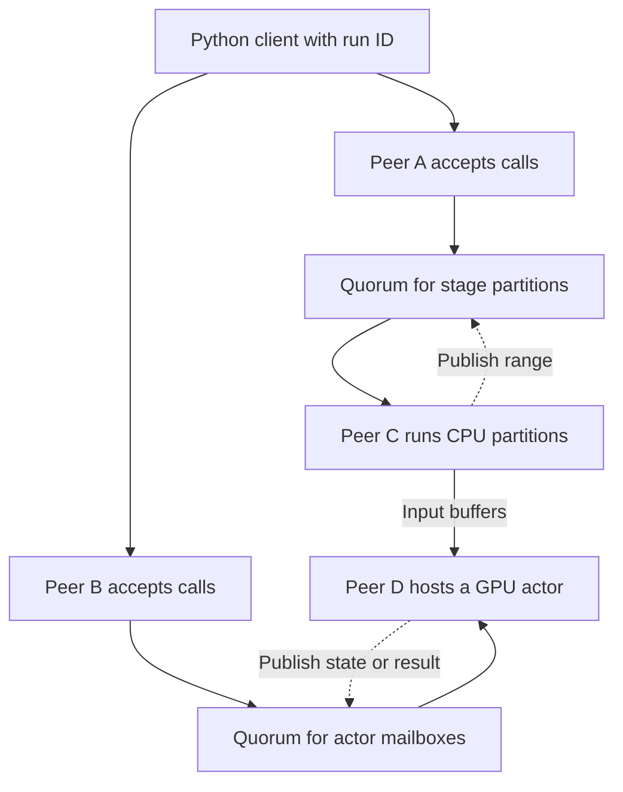
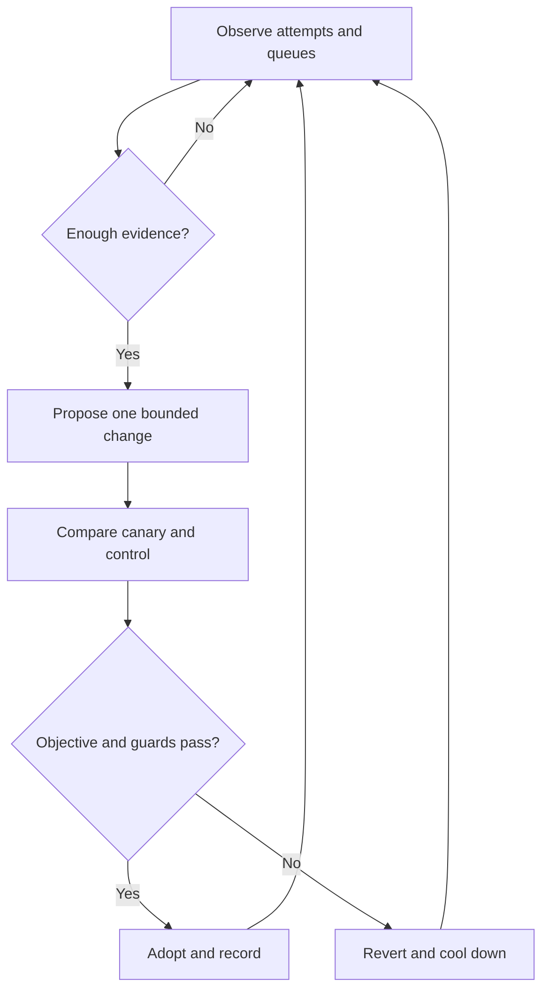

# Chimaera

## A Rust runtime for large CPU and AI applications, with one Python decorator

**Engineering design proposal · 20 November 2026**  
**Status** The public API and Rust cluster runtime are proposed. The companion exercises selected API, recovery, accounting, and CPU data-path contracts locally.

> **Amendments from the 20 November 2026 implementation review.** The text below is the original proposal with
> the API examples corrected in place. These decisions supersede it where they differ:
>
> 1. **Effects lattice replaces `retry="pure"`.** `effects="none"` (default, replayable, up to 3 attempts on
>    infrastructure loss) < `"idempotent"` (replayable, never speculated) < `"external"` (at-most-once start,
>    `OutcomeUnknown` after a possible start). Scopes and `.options()` may only make a call stricter. User
>    exceptions are never retried unless listed in `retry_exceptions`; a second identical exception fingerprint stops.
> 2. **Raft:** openraft 0.10 with redb storage, cross-group group commit, AppendEntries batched per target peer.
> 3. **Shard key:** a run's calls go to a few vshards it names, not to a hash of each call (ids embed
>    `cell | vshard | hash`, so any peer routes them). Hashing every call scattered small runs and turned each
>    chain into a cross-group notification. In a cluster a run is spread over up to 16 vshards in groups led
>    by other peers (`CHIMAERA_RUN_SPREAD`), because one group leader commits roughly 10,000 calls a second.
>    A driver's call goes to the vshard its inputs share, to the run's own vshard when they span several, and
>    otherwise round robin. A call's children stay in its vshard, and actor and generator calls stay in the
>    run's own.
> 4. **Local mode** spawns a local peer process (the same binary, single-voter groups) on first submission. It
>    is not embedded in the driver: user code never shares a process with control-plane state, `fork` stays safe,
>    and `chimaera inspect` works after the script exits.
> 5. **Pools:** `Class.options(replicas="auto").pool(*ctor_args)`, and `pool.method.map(items)` instead of a
>    method name string.
> 6. **Durable state:** schema on the decorator (`state=ch.durable.State(codec=..., checkpoint_every=...)`), identity via
>    `.options(name=...)`; 1 MiB inline limit.
> 7. **§5 worked example:** 2 GiB + 3 × 896 MiB = 4,736 MiB fits under 5 GiB, so "clamp to 2" requires two stated
>    rules: depths move on a power-of-two ladder, and the guard keeps 10% headroom. A regression test pins it.
> 8. **Deadlines** in `ch.defaults(deadline="30s")` are relative and resolved per submission; children inherit the
>    earliest absolute deadline; a `datetime` is absolute.
> 9. **Decorator-only fields:** `workflow=`, `state=` and `batch=`. `workflow="durable"` requires `async def`;
>    replay pins `PYTHONHASHSEED`.
> 10. **Gang coordinator** is the leader of the gang's Raft group.
> 11. **Telemetry:** attempt records stay on peers with bounded retention and `explain` pulls them; replicated
>     telemetry partitions are deferred. OTLP and columnar export come later.
> 12. **Rolling upgrades:** a new log command type is proposed only after the cluster commits a `feature_level`
>     every voter supports.
> 13. **Headless bootstrap:** `--seeds a,b,c --bootstrap-expect N`.
> 14. **Object lifetime:** a result slot's pins live in the slot's own shard (client handles and pending
>     dependents). A pickled `Future` pins its slot for the run's lifetime. Run end reclaims in bulk. No
>     distributed reference counting across owners.
> 15. **`fn.partial(...)`** passes constants once; `fn.map(*sources)` zips like builtin `map`.
> 16. **Memory strings** require a byte unit (`MB`, `MiB`): `"512m"` means MiB to Docker and millibytes to Kubernetes.
> 17a. **Adoption rule.** A canary is adopted when its mean gain clears the threshold (8%) *and* the one-sided
>     95% Student-t lower bound clears half of it; "mean − 2·SE > 0" adopted 11.5% of no-gain changes under ±15%
>     window noise because it re-checks after every pair with a normal quantile. The t rule adopts 3.7% of null
>     changes and 93% of real 20% gains (`crates/chimaera-core/src/adapt.rs` tests).
> 17. **Controllers identify the binding stage first.** The same knob can speed up one pipeline and slow down
>     another; only the binding stage's knobs move.
> 18. **`accounting="isolated"`** fails preflight on hosts without cgroup v2 delegation (including macOS) with
>     `Unsupported{cgroup2_delegation}`.
>
> Requirements gathered from Ray's documented failures and the problems Ray users report most often
> are in [requirements.md](requirements.md); Ray's architecture lessons are in [ray-lessons.md](ray-lessons.md).

The first thing a Python user learns is `@chimaera.remote`. Put it on a function or class. Call `.remote()` to run work through the runtime, pass the resulting future to the next call, and retrieve an ordinary Python value when the application needs one. Direct calls still work in a debugger or unit test. This preserves one of Ray’s best design choices. [Ray remote functions and classes][rayremote]

**Chimaera is multiheaded.** Many peers can accept work and advance different parts of the same application at the same time. A job partition, stateful actor, or GPU reservation has one current authority backed by a small replicated group. Losing one authority briefly affects the keys it owns. Other groups continue, and a surviving quorum can take over the affected keys. The machine that received a durable job is free to disappear.

Two applications qualify the first cluster release together. One is a CPU-only shuffle and aggregation larger than cluster memory. The other feeds CPU preprocessing into warm GPU inference while respecting a tail-latency target. Both exercise the same Python objects, Rust peer scheduler, byte-credit accounting, result-publication protocol, and diagnostic interface. Frontline acceptance depends on simplicity, useful work completed, and recovery behavior. Fleet size is an additional qualification.

| What a user wants to know | What the runtime owes them |
|---|---|
| “Can I use the function I already tested?” | One decorator, ordinary local calls, explicit distributed calls, bounded bulk execution, and the same script on a laptop and a cluster. |
| “Why did my GPU job slow down?” | One timeline with input wait, host staging, transfer, GPU execution, collective wait, and the provenance of each measurement. |
| “Do I have to tune this?” | A safe initial plan, a controlled change with a comparison group, an observable outcome, and automatic rollback when the change fails. |
| “What happened to my write after the machine died?” | A committed result, an explicit failure before start, or an honest unknown outcome with the information needed to reconcile it. |
| “Can the machine that submitted my job disappear?” | An acknowledged execution manifest, recoverable progress, and a run ID usable from another peer. A live Python input generator has a separately documented lifetime. |

### 1. What Ray already does, and where the redesign starts

Ray 2.60.0 was released on November 4, 2026. Its distributed task scheduler, actor model, placement groups, data locality, and GPU capabilities are substantive baselines. In an August 2026 engineering report, Anyscale described launching 40,000 actors on a 10,000-node cluster with the nightly build under test. It also documented driver contention, metadata propagation, and placement-group improvements. The comparison below is with documented Ray Core behavior. Ray Data, Ray Train and Ray Serve supply additional workload-specific capabilities. [Ray release][release] · [Tagged release notes][raytag] · [Anyscale scale study][anyscale]

| Area | Ray baseline at review | Chimaera design decision |
|---|---|---|
| First Python program | Tasks use `@ray.remote`, `.remote()` and object references. Actors have explicit remote methods. Local execution and automatic scheduling already work. | Keep the single decorator for both functions and classes. Support direct local calls and composable remote futures. Bulk maps use the same callable. [Ray decorator][rayremote] · [Ray tasks][raytasks] · [Actors][rayactors] |
| Coordination | Ray uses distributed scheduling and node-local raylets. Its head hosts the GCS. Anyscale describes distinct paths for ordinary task placement, actor lifecycle, and placement groups. | Peer-local placement, a sharded job log, and temporary coordinators for gangs. A peer starting an ordinary task needs no fleet-wide resource view. [Ray scheduling][raysched] · [Anyscale engineering report][anyscale] |
| CPU and memory | Requests such as `num_cpus` are logical admission quantities. The dashboard already has physical CPU/memory and per-component graphs. Ray Data also reports task heap statistics. Ray can reserve system capacity with cgroup v2. | For each attempt, show requested, granted, observed, measurement scope, and coverage. Use the observations in admission and correction. [Resources][rayres] · [Dashboard][raydash] · [Memory debugging][raymemdebug] · [Ray Data statistics][raydatamon] · [System isolation][rayisolation] |
| Tuning and backpressure | Ray’s cluster autoscaler uses logical demand. Ray documents limiting pending tasks with `ray.wait` and batching overly fine-grained calls. | Make bounded submission and streaming results the default. Tune prefetch, execution concurrency, and placement before buying extra machines. [Autoscaling][rayauto] · [Pending work][raypending] · [Fine-grained tasks][rayfine] |
| Hardware placement | Ray supports node labels, affinity, locality, and gang placement. Its alpha topology strategy supports one topology label with strict packing plus node-level strategy. | Discover a multilevel hardware graph. Express requirements in terms of devices, locality, and measured transport capability. [Placement groups][raypg] |
| GPU communication | Ray Direct Transport supports tensor transports including NCCL and NIXL. It is alpha. Compiled Graph also supports direct GPU communication. | Select a verified transport in the ordinary execution path, expose host staging when it occurs, and keep hard GPU requirements enforceable. [Direct Transport][rayrdt] · [Compiled Graph][raycg] |
| Object and job recovery | Ray can spill objects and reconstruct eligible lost data using lineage. Its object-fault-tolerance guide documents owner-failure limits. GCS recovery supports external Redis and an alpha embedded RocksDB option on persistent storage. | Durable output names belong to a run partition. Publication, actor state, and the lifetime of an ephemeral buffer each get an explicit contract. [Object fault tolerance][rayobj] · [Spilling][rayspill] · [GCS recovery][raygcs] |
| Scale and speed | Ray has published high task throughput and recent large-cluster results. Workload, release, actor startup, and sustained task throughput describe different experiments. | Compare end-to-end useful work, p99 latency, interference, recovery, and operator effort on matched inputs. Preserve separate fleet and single-job scale gates. [Original Ray paper][raypaper] · [2026 engineering report][anyscale] |

**Prior art worth adopting.** Dask’s futures fit ordinary Python and its scheduler accounts for data movement when stealing work. Sparrow supplies a practical basis for sampling candidate machines. Flux demonstrates hierarchical delegation, HyperQueue is a relevant Rust/HPC comparison, and Slurm and Kueue already express placement topology. Chimaera’s engineering bet is that per-attempt accounting, peer ownership, and a bounded correction loop can operate together through one small API. [Dask work stealing][dask] · [Sparrow][sparrow] · [Flux][flux] · [HyperQueue][hq] · [Slurm topology][slurm] · [Kueue topology][kueue]

### 2. One decorator for functions and classes

```python
import chimaera as ch

@ch.remote
def word_count(text: str) -> int:
    return len(text.split())

assert word_count("blue sky") == 2             # ordinary local call
print(word_count.remote("blue sky").result())  # scheduled call, prints 2
```

`@ch.remote` and `@ch.remote()` are equivalent. Decoration records the callable, signature, and default policy. The first submission starts or connects to the selected runtime. `python counts.py` uses local execution. `chimaera run --cluster research -- python counts.py` selects a configured cluster for the same file. A run produces an ID that `chimaera inspect RUN` can reopen. `chimaera explain RUN --item 17` shows what happened to a particular invocation. A production submission can use `--detach` with a durable input manifest.

**Build a small application by composing Python calls.** This example launches two independent functions and feeds both outputs to one actor. The client makes a single result fetch. In a remote run the consumers receive dependency handles, and payloads can travel directly between the producing and consuming peers.

```python
@ch.remote
def add(left: int, right: int) -> int:
    return left + right

@ch.remote
class Counter:
    def __init__(self):
        self.value = 0

    def increment(self, amount: int) -> int:
        self.value += amount
        return self.value

left = word_count.remote("ordinary Python")
right = word_count.remote("across several machines")
counter = Counter.remote()
answer = counter.increment.remote(add.remote(left, right))
print(answer.result())  # 5
```

A direct `Counter()` creates a local instance. `Counter.remote()` immediately returns an actor handle. The runtime waits for successful construction before invoking queued methods. A function or actor **method** returns an awaitable `Future[T]`. In async application code, `await answer` retrieves the value without blocking the event loop. Passing a future as a direct positional or keyword argument declares an edge in the graph. A call occupies execution capacity only when its inputs are ready. For a small variable fan-in, use `combine.remote(*futures)`. For a large fan-in, a distributed reduction builds a bounded tree. An embedded future inside an arbitrary user object is an explicit handle and is never recursively searched for work.

| Common operation | Contract |
|---|---|
| `fn(x)` / `fn.remote(x)` | Both accept the original Python signature. The direct form returns the value or raises locally. The scheduled form returns a typed future. A failed prerequisite completes downstream futures with its causal error before their bodies start. |
| `Actor.remote(...)` / `actor.method.remote(...)` | One handle represents one live actor generation. Calls submitted through one handle are processed in submission order by default, including when an earlier call awaits data. Across independent submitters the mailbox assigns the accepted order. A method exception can leave a live Python object mutated. A transactional actor has the stronger contract in section 8. |
| `fn.map(source)` | Produces a single-pass `Results[T]` with item and byte backpressure. Iteration or `async for` yields ordinary values. `ordered=False` yields completion order. Chaining a compatible consumer or sink transfers handles directly. `close()` or a context manager releases upstream credits on early exit. |
| `future.result(timeout=…)` / `await future` / `future.cancel()` | A wait timeout leaves the job running. Cancellation races with commit and reports the winner. A traceback includes the original exception information, upstream dependency, input index, and attempt. |
| `ch.map(fn, items)` / `ch.submit(fn, …)` | Convenience adapters for existing undecorated functions. They use the same scheduler, future, and error contracts as their decorated equivalents. |
| `Class.options(replicas="auto").pool(*args)` | A set of independent warm instances for model loading or connection reuse, suitable for independent calls. Constructor arguments go to `.pool(...)`; `pool.method.map(items)` streams through it. A single mutable identity uses `Class.remote()`. |
| `ch.torch.run(train, workers=16, gpus_per_worker=1)` | An optional training adapter acquires a rank group, supplies bindings and rendezvous, and resumes from an application checkpoint under the selected failure policy. [PyTorch Elastic][torchrun] |

**An AI service uses the same primitives.** In this sketch `load_encoder` and `tokenize` are application code, and `tokenize` is a decorated CPU function. The device constraint is declared once on the class. The model loads once per actor generation. A cluster with no feasible CUDA placement explains the unsatisfied request.

```python
@ch.remote(device="cuda")
class Encoder:
    def __init__(self, model_uri):
        self.model = load_encoder(model_uri)

    def encode(self, tokens):
        return self.model.encode(tokens)

encoder = Encoder.remote(model_uri)
embedding = encoder.encode.remote(tokenize.remote("blue sky"))
```

For a stream, `with Encoder.options(replicas="auto").pool(model_uri) as replicas` gives independent instances inheriting the class device requirement. `replicas.encode.map(token_batches)` applies byte and memory limits at the stage boundary. A checkpointed fixed-world training job restores the same world size. An elastic job must supply a compatible checkpoint and explicitly support repartitioning.

#### Dynamic applications and durable control flow

Ordinary Python can submit futures in a loop or choose the next call after inspecting a small result. A branch decision that must survive loss of the orchestration process uses the same decorator with an explicit durable workflow mode. The example assumes three application-defined decorated functions. Each can run on a different peer.

```python
@ch.remote(workflow="durable")
async def analyze(uri):
    metadata = await inspect_asset.remote(uri)
    if metadata.requires_gpu:
        return await gpu_analyze.remote(uri)
    return await cpu_analyze.remote(uri)
```

The shard durably records child-submission intent, a stable command ID, and the code digest before dispatch. A ready notification carries the child’s committed result reference. The workflow yields its execution slot while awaiting it. A successor replays the recorded decisions and resumes at the outstanding await. It reuses a previously accepted child ID even when the original caller died between submission and acknowledgment. Pin workflow code versions until completion or an explicit compatible migration. Keep large buffers as references and partition extremely wide fan-out across child workflows.

Replayable orchestration uses deterministic control flow. Read external state, current time, or randomness through a recorded activity or supported workflow timer when it affects branching. Publish a clear divergence error if replay produces a different command sequence. Arbitrary process globals, open sockets, and ordinary driver iterators cannot be reconstructed automatically. External effects retain their own retry contract. Event-history replay is established prior art for this optional mode. [Temporal event history][workflowhistory]

#### Power-user controls and their precedence

`.options(...)` makes an immutable configured view of a decorated function or class. A one-off placement or resource change cannot leak into another caller using the original object. A scope applies to work submitted within it. Python keyword arguments after `.remote(…)` always belong to the user’s function, even if their names match configuration fields.

```python
@ch.remote(effects="idempotent")
def summarize(partition):
    return partition.summary()

large = summarize.options(cpus=8, memory="32 GiB")
with ch.defaults(accounting="isolated"):
    result = large.remote(partition)
```

| Control | Proposed surface | What Chimaera enforces or explains |
|---|---|---|
| Reservation and isolation | `cpus=8`, `memory="32 GiB"`, `accounting="isolated"` | Reserve eight core equivalents at admission. Apply the advertised memory ceiling to the isolated subtree. Show actual CPU time, throttling, charged peak, shared charges, and scope independently. |
| Topology and affinity | `placement=ch.dist.Placement(require={"fabric": "rdma"}, prefer=("input_local", "same_numa"))` | Hard predicates filter candidates. Preferences rank feasible peers. An unmet requirement reports the requested shape, candidate count, constraint, and available alternatives. |
| Recovery and effects | `effects="none"` (default) / `"idempotent"` / `"external"`, `max_attempts=3`, a participating sink’s `idempotency_key` | Retry infrastructure losses only within the declared effect contract, deadline, and attempt budget (three attempts include the original; user exceptions are never retried unless listed in `retry_exceptions`). `"external"` gets an at-most-once start and `OutcomeUnknown`. Scopes and `.options()` may only make effects stricter. |
| Bulk throughput and latency | `fn.map(items, ordered=False)`, `ch.defaults(max_in_flight_bytes="2 GiB")` | Bound retained and admitted bytes. Shrink credits under pressure. Honor ordered output when requested. A single input exceeding a hard cap gets a size error or an eligible streaming path. |
| Observability and tuning | `accounting="isolated"`, `adaptive="observe"`, `adaptive="frozen"` | Observe records proposed changes. Frozen pins heuristic settings and retains hard admission guards. A decision record shows the effective setting, source, evidence, and rollback. |
| Deadlines and quotas | `ch.defaults(deadline="30s")` (relative, resolved per submission; a `datetime` is absolute) plus operator CPU-second/GPU-second envelopes | Child deadlines inherit the earliest ancestor deadline. Spend reservations require a known price basis and account for unavoidable in-flight spend. Show deadline expiry, wait timeout, and cancellation separately. |

For soft settings the order is explicit call view, innermost submission scope, decorator defaults, learned profile, then framework defaults. Hard node, tenant, parent, and job limits intersect. A call can narrow those limits. An empty intersection or contradictory hard request fails with the field names and policy sources. An adaptive change can operate only inside the resulting envelope. A generic override cannot promote an arbitrary side effect to replay-safe work. The frozen effective policy is attached to each attempt.

**Large inputs and large results.** A Python generator that reads a local file is produced by that Python process. Chimaera consumes it under credit and documents which prefix was accepted before disconnection. A fleet-sized run instead passes `chimaera.data.partitions(manifest_uri)`, an immutable, sharded index of input ranges that peers read independently. A partitioned sink writes results directly from peers and returns a small manifest. A notebook can iterate a sample. Calling `list(...)` remains an explicit decision to bring the entire result into client memory.

**Packaging and error behavior.** Local scripts run with their current environment. A wheel-provided supervisor launches the local executor entry point directly, so process spawning does not execute the user’s top-level script a second time. Remote preflight captures an importable module, a lock or image digest, Python ABI, declared files, and required device libraries. Small notebook functions can be snapshotted within an authenticated project. Captured file handles, live sockets, and oversized closures fail before submission with the captured variable name and a repair example. Replicas fetch the same content-addressed environment through cell caches. A mismatched CUDA driver is a placement error. A Python exception keeps its original type when safely reconstructable, traceback, input index, attempt ID, and cause chain. Otherwise a `RemoteError` retains that information. Unknown effects have their own exception. Type stubs use `ParamSpec` and generic futures so editor completion remains useful.

### 3. Peers, ownership, and the path of a single task

A **peer** is one allocatable machine or VM running a Rust agent. A **cell** is a bounded placement and failure neighborhood, initially up to 512 peers. Cell boundaries follow network and operational failure domains. A cell has no permanent head. Every eligible peer runs the same binary and can host any of its roles. Operator policy can reserve cores or restrict voting replicas to hosts with reliable storage. Python code runs in supervised child processes or tenant sandboxes.



The diagram follows two active authorities within one application. A submission through either peer locates the authoritative shard by key. The two quorums can have different leaders and voting sets. They coordinate across a dependency by a durable notification with an idempotent ID. In steady state each advances its own work. If peer A also led the stage shard and fails, that shard elects a successor while the actor shard on another healthy majority continues. Bulk payloads bypass both quorums. A single hot state key still has a serialization cost, which the runtime exposes.

| Role | Authority and placement | What happens when its host disappears |
|---|---|---|
| Ingress and run discovery | Any peer or stateless gateway authenticates a client. An idempotency key maps submission to a durable run ID. Bootstrap uses several seed addresses or DNS discovery. | Another endpoint attaches using the run ID or repeats the submission key. Acknowledgment requires the job manifest to have reached its specified durability. |
| Job and stage partition | Hash `(tenant, run, stage, partition)` into many virtual shards. A shard uses three voting replicas across eligible independent failure domains and a current leader. A large job spreads across shards. | A surviving majority elects a leader and replays snapshots plus log. A minority stops issuing or accepting exclusive commits. Other shards continue. |
| Local resource ownership | Each peer owns its CPU sets, byte credits, device IDs, and actual admission decisions. Remote bids are advisory and can expire. | Its incarnation is retired. Stale reservations and result attempts cannot overwrite newer ones. Replay eligibility is checked per item. |
| Cell discovery and routing | Peer agents exchange bounded, versioned summaries. A small replicated directory shard stores cell ownership and shape summaries. Hot shape indexes are replicated caches. | Stale summaries can cause a rejected bid. The local owner remains authoritative. Existing grants can drain while directory service recovers. |
| Gang coordination | A coordinator chosen by job key drives a replicated reservation decision for that gang. Each resource owner has a durable vote. | Another peer reads the decision. Undecided participants retain their hold until a quorum records a resolution. |
| Telemetry and data | Agents record attempts locally. Telemetry partitions, payload replicas, and durable storage have separate budgets and failure policies. | Missing samples are marked incomplete. Committed durable outputs remain reachable through the job partition and storage contract. |

**On the ordinary path.** The accepting peer persists a code/environment reference and a compact stage manifest. Ready work goes to a node with a compatible grant, warm environment, and available byte credits. The receiving peer validates its resource epoch, reserves locally, and launches on a warm Python executor. A replayable map can assign a range of indices at once. Every item still has a stable ID. The executor stages output bytes, then publishes a result handle through the partition authority. A downstream stage receives the handle and fetches directly. A run coordinator observes range and stage progress through a bounded fan-in tree. It never needs a Python future or a globally synchronized row for every item.

**Who advances the run after submission.** A shard owns a durable ready-work cursor, outstanding grants, and a completion bitmap or range manifest. Any eligible peer can pull a grant. Finishing a partition commits its output and a dependency notification in the same local transaction. The receiver deduplicates notifications by producer partition and generation, advances its dependency counter once, and persists newly ready work. After failover the successor resumes from the cursor and resends unacknowledged notifications. Dynamic fan-out uses child manifests, and large fan-in uses a reduction tree. Once a durable input manifest is accepted, driving progress needs no client process. A cross-cell move transfers a bounded range of ready work to a compatible domain, preserving its publication authority and deduplicated grant ID.

**Where consensus pays for itself.** Run creation, range ownership, user-visible durable publication, externally exposed start grants, actor generations, and gang decisions need strong order. Utilization estimates, queue estimates, cache locations, and trace delivery tolerate staleness. Lease expiry is a hint to investigate or stop issuing work. Epoch checks and a single authoritative commit establish safety. Moving ownership between cells requires sealing the old shard and transferring by quorum-backed reconfiguration. An isolated old majority that cannot be sealed blocks reassignment of that range. The design intentionally spends availability at that boundary to protect the user’s result. Within a cell, replicas occupy separate racks when the topology supports it. A durability class that promises availability through whole-cell loss places a voting majority and durable payloads outside the failed domain. That class pays the corresponding cross-domain latency and capacity cost. [Raft consensus][raft]

**No hidden head through infrastructure.** A single Kubernetes API server, object bucket prefix, global job coordinator, DNS name backed by one machine, or registry serving every environment download can recreate the same bottleneck. The deployment splits those services by failure domain, shards object prefixes, mirrors immutable environment layers, and uses multiple ingress endpoints. A chaos test kills the accepting peer, a shard leader, one telemetry collector, and a directory replica independently while unrelated partitions run. The small local implementation can co-locate these roles. Cluster behavior must also pass with each role failing independently.

### 4. Fast scheduling with an explicit hardware cost

1. **Enforce constraints first.** Tenant and data residency, ABI, device type and count, minimum memory, hardware isolation, and gang requirements filter eligible peers. Tiny eligible sets or rare GPU shapes have an exact cell index. A stale approximate index may trigger a bounded exact lookup. It cannot authorize a placement.
2. **Prefer a warm local grant.** The peer has a queue per workload class and grants bounded CPU, memory, and device credits. Dispatch by local IPC without a network placement exchange when work fits. Thread-pool controls and cpusets prevent a Python process from multiplying BLAS threads across all cores. Interpreters and cached models are reused only within compatible ownership and accounting policies.
3. **Sample before searching.** On local pressure, sample two to four eligible peers in the nearest domain, using an indexed candidate set. Choose the lowest predicted finish time. Request a short-lived offer that the receiver revalidates at admission. Bound retries and fall back to a cell-level search for rare or aged requests. A pull-based steal moves only unstarted replay-eligible work or an unconsumed fenced grant. Preserve queue age across moves. [Sparrow][sparrow] · [Dask work stealing][dask]
4. **Put costs in the same unit.** Estimate queue delay + setup + input bytes / effective bandwidth + predicted compute + expected recovery cost, all in seconds. Score uncertain paths pessimistically. For overlapping operations use the stage’s critical path to avoid double-counting overlapping intervals. Include shared bottleneck and NUMA penalties where measured. Fair-share allocation and hard budgets constrain the choice before this score is considered.
5. **Keep tiny calls cheap.** Chunk already-known partitions into ranges. Flush partial ranges by deadline, bound bytes and wall time per range, and keep independent failure records. Larger batches suit throughput and cost more tail latency. For latency-sensitive singletons, dispatch individually. A plain Python call remains the fastest path when distributing it buys nothing. Explicit retry, tracing, cancellation, and effect boundaries limit which operations can share a batch.
6. **Prevent a hot job from starving others.** Combine weighted dominant resource share across tenants with age-aware dispatch inside each class. Include GPU shape, memory, and NIC bandwidth constraints where available. Borrowed capacity is revocable at declared safe points. Cap outstanding offers, retries, and speculative duplicates. A job cannot acquire an unbounded nested fan-out or hold every CPU slot while waiting on children. During cooperative waits the runtime releases schedulable CPU, retains actual memory charges, and reserves capacity for children to make progress. [Dominant resource fairness][drf]

**A worked placement decision.** A warm local worker has a 180 ms queue and 40 ms of compute. A remote worker has a 5 ms queue, the same compute, and a measured effective path of 12.5 GiB/s. Moving 4 GiB puts its estimated finish at 365 ms. The local worker finishes in 220 ms. For a 4 MiB input the remote estimate is about 45.3 ms. The score changes the choice without making the user choose a scheduling strategy. Link congestion or an already-cached input changes the calculation again.

**Latency accounting.** Record submission-to-admission, ready-to-dispatch, dispatch-to-Python-entry, useful execution, and publication-to-first-consumer separately. Use a monotonic clock for spans on one peer and report clock uncertainty across peers. The p99 scheduling target applies to ready work with warm environments and available capacity. The user-facing latency includes queueing, data transfer, setup, and durability.

#### How scheduling cost stays below useful work

The decorator always produces the same logical invocation. The runtime chooses the cheapest legal execution path from its effect contract, input representation, and hardware needs.

| Path chosen from the call | Per-invocation or per-range work | What prevents a fast-path mistake |
|---|---|---|
| Interactive singleton | Validate ready dependencies, consume a start grant when required, hand off by local IPC to a warm executor, then publish according to the output class. | A user-visible or effectful start still requires a fenced grant. Report quorum time and user-code start separately. |
| Repeated pure CPU stage | Reuse a versioned execution template holding dependency layout, environment digest, partitioner, buffer schema, and eligible executor shape. Issue ranges to peers and resolve dependencies locally from a ready bitmap. | A changed code digest, schema, policy, shape, ownership epoch, or unavailable transport invalidates the affected binding. Rebind or fall back to normal placement. Keep per-item identity, errors, and cancellation. [Execution templates][templates] |
| Long-lived inference actor | Reserve resources and load weights once. Deliver calls to the current actor generation through a bounded mailbox. An inference engine can batch requests inside the replica. | A call to a stale generation gets redirected or fenced. Queue delay, GPU memory and downstream byte credits cap batching. Stateful mutations keep their specified order. |
| Rigid multi-rank job | Negotiate and commit one reservation for a complete rank group. Hand collective execution to the native library for the lifetime of that generation. | All ranks enter the same rendezvous generation. New membership requires a new reservation and the application’s recovery contract. |

**Why the unit of scheduling matters.** Assume a 2 ms CPU operation and 0.5 ms of serialized control cost per submitted unit, with no overlap. Singletons spend 80% of the slot’s time on useful work. Five independent operations sharing one dispatch reach about 95.2% under those assumptions. The application still sees five logical outcomes. Bundling also delays an early result and increases replay work, so the scheduler sizes ranges against a deadline, memory, and failure policy. This example is arithmetic. Actual cold and warm measurements determine whether a template, batching, placement or the transport saved time.

**Reducing coordination at fleet scale.** A peer samples from a bounded local candidate set for common work. A full, 512-peer cell advertises one compact shape and queue summary per reporting interval. A cross-cell stage exchanges range grants and aggregated ready cursors. Per-item counters and mutable actor commands stay with their owning shard. Scaling a single hot stage requires splitting its partition range or spreading independent actor keys. These choices bound common-case fan-out as peer count grows. The appendix models the cost when work requires individual commits.

**Behavior under overload.** Large CPU ranges cannot consume the last progress slot for actor mailboxes or collective recovery. Each peer holds bounded reserved progress capacity and weighted class queues, with explicit borrowing and aging. One tenant flooding a rack triggers backpressure at its ingress and queue, while healthy peers accept other work. Single hot keys, saturated links, and strictly ordered actors get specific explanations. More scheduler heads cannot parallelize their serial portion.

### 5. Autoadaptation and self-correction

The runtime ships one conservative default policy. Its first objective is to meet correctness, resource, and budget limits. Within those constraints it optimizes useful completions per second or a user-specified latency objective. It starts with a small sample of ordinary work, learns profiles per code version, input-size bucket, hardware class, and environment, and logs why it changed its mind. A data-dependent memory spike, noisy link, or new driver invalidates the affected profile.



| Decision owner | Evidence and proposed action | Guard and reversal |
|---|---|---|
| Peer admission, on each dispatch | Falling available bytes, memory pressure, or a growing spill queue reduces outstanding byte credits immediately. Preserve room for the agent, transfer buffers, and an in-flight result. | This guard may only reduce exposure. Reopen gradually after a low-water interval. A task exceeding its hard budget receives its actual termination reason. |
| Stage controller, seconds to minutes | High GPU input wait + empty ready queue + low host/IO pressure allows a small increase in read concurrency or prefetch bytes. GPU compute saturation favors leaving the input side alone. | Compare useful batches/s, p99 latency, and peak reserved bytes with a matched control. Undo the change if pressure rises or the improvement is within noise. |
| Stage controller, many completed examples | CPU time, wall time, runnable delay, throttling, and memory peaks refine future CPU and memory reservations. Size by input bucket and uncertainty. Censored or killed attempts count as lower bounds on resource demand. | Minimum samples, upper bounds, outlier reserve, and one-knob changes. A throttled process showing little CPU is evidence against shrinking its grant. |
| Transport controller, per path | Falling effective bandwidth, retransmit/error evidence, or repeated host staging triggers a verified alternate rail, chunk size, or placement for **new** transfers. | A short probe or canary confirms the alternate. Maintain versioned decisions. A hard high-speed-fabric requirement stays queued if no compliant path exists. |
| Runtime health, per peer or device | Repeated failures of unrelated jobs on one GPU plus a device-health event quarantine that device, drain the peer as needed, and restart eligible work elsewhere. | One user exception cannot quarantine hardware. Re-admit only after health probes and a low-risk probation workload pass. |
| Fleet capacity, tens of seconds to minutes | Persistent eligible backlog after local repair estimates new capacity from arrival rate, measured service time, type, availability, and provisioning lead time. | Provider quota, tenant cap, spending limit, warm minimum, and bin-packing feasibility bound requests. Scale down only after drain/checkpoint and cooldown. |

**Control mechanics.** Cold start from a conservative host profile with a small admission window. For a homogeneous stage with arrival rate λ, backlog Q, drain target T, mean service time S, and target busy fraction u, a first estimate is `ceil((λ + Q/T) × S / u)` slots. Then constrain by memory, accelerator shape, data supply, cost, and actual provisioning delay. The node guard owns admission. The stage controller owns batching and stage concurrency. The fleet controller owns machine count. They share an action log and react on different time scales, so the same slowdown cannot trigger three simultaneous capacity increases. A controller that loses quorum or telemetry confidence freezes changes and uses its last safe profile. Linux pressure stall information is one signal for identifying resource stalls. [Linux PSI][psi]

**How a correction gets permission.** Hard user or operator policy wins. Non-emergency changes begin on a small stratum of comparable work, for example 1–5% in the same input-size and device bucket. Use enough independent windows to estimate noise. Require a predeclared minimum useful improvement and no meaningful regression in tail latency, cost, or memory. Keep a holdout, cooldown, and per-stage action budget. Update a durable change record with hypothesis, evidence, scope, old value, new value, measured outcome, and rollback trigger. A canary must use naturally arriving work or explicitly replayable inputs. Freeze tuning during control-plane failover. An operator can inspect, pin, replay the decision history, or revert. Pinning a plan stabilizes runtime settings. Application randomness and GPU nondeterminism remain properties of the program.

**A worked correction.** The executable companion replays an ordered input pipeline with one device taking 10 ms per batch, input reads cycling through 14, 18, 12, and 16 ms, and 400 identical-index inputs per comparison. The model has a 2 GiB base, 160 MiB per input buffer, and a 5 GiB soft reservation budget. It uses paired windows and an 8% improvement threshold. It assumes independent reads and constant device time.

| Prefetch depth change | Synthetic batches/s | Decision |
|---|---:|---|
| 1 → 2 | 40.00 → 73.99 | Adopt. The device spent much of the baseline waiting for input. |
| 2 → 4 | 73.99 → 99.65 | Adopt. Device idle time falls to about 0.3%. |
| 4 → 8 | 99.65 → 99.65 | Revert the canary. Four more buffers consume 640 MiB and buy no throughput. |
| Inputs grow to 896 MiB per buffer | 4 slots would reserve 5,632 MiB. 2 reserve 3,840 MiB. | Clamp the next admission to 2 and freeze increases for the window. Accept lower throughput to respect the memory budget. |

A real rollout also measures reader contention, queue delay, memory already held by running work, GPU synchronization, and the incumbent workload. The worked example gives engineering a regression case for adoption, rollback, and pressure response. Its rates are synthetic.

**What self-correction does in production.**

| Symptom | Evidence that distinguishes the cause | Bounded response |
|---|---|---|
| GPU idle during inference | Empty input queue with read wait vs full input queue with host-to-device copy stalls | Increase bounded prefetch in the first case. In the second, test pinned staging or a closer CPU/NIC, subject to pinned-byte limits. |
| Slow all-reduce | Rank-level collective stalls and a degraded link, with healthy local compute | Avoid the link for new placements. A running fixed group restarts as a unit only through its checkpoint/restart policy. |
| Serial Python work advertised as many CPUs | CPU-seconds/wall near one, low throttle, low runnable delay, enough samples | Try a smaller future reservation or more independent processes. Preserve the process’s memory budget and user-specified thread semantics. |
| Several workers disappear after a large partition | Correlated OOM kills or hard-limit events, input-size outlier, spill saturation | Lower concurrency or split replayable input at declared partition boundaries. Cap retries. An indivisible oversized input fails with its size and the smallest feasible shape. |
| Throughput collapses during scale-out | Registry queue or cold environment time dominates useful execution | Stagger starts, seed the environment cache, and hold further scale-out until ready capacity rises. |
| The same Python exception occurs on healthy hosts | Matching traceback and code/input identity | Return the original failure. Repeated automatic attempts cannot repair the user’s code. |
| Telemetry disappears during a slowdown | Collector gap while agent queue ages continue advancing | Freeze speculative policy changes, record missing coverage, and continue within the last safe local envelope. |

#### Learned reservations and one memory pool (as built)

A call that sets no `cpus` or `memory` gets them from what earlier calls of the
same function used. Each peer keeps, per function, the last 64 attempts'
wall time, CPU seconds, private memory peak (anonymous memory, so a shared
input mapped by many readers is counted once, as object bytes), input and
output bytes. After three calls, memory is reserved at the p95 peak × 1.2,
1.5 or 2.0 by its variation, or by a linear fit when peak tracks input size
(R² ≥ 0.8), and never below 1.5× a peak at which a call of that size was
killed, though no more than the larger of that peak and 4× what such calls
use when they succeed. Each 8 successful calls after a kill halve the bound's
excess over what they used, so one kill fades out rather than holding every
later call to it (the killed call's own retry always gets 1.5× its peak). Before that, a function's first finished call (or a call running two
seconds) gives a provisional reservation of 2× what it used. A function with
nothing measured yet runs a quarter of the CPUs' worth of calls at once, plus
one more for each 4 GiB free in the pool: a fresh function starts at full
width on a roomy host, and a 3 GiB-per-call function cannot overcommit a
36 GiB one. A queued call keeps the CPU-trial arm it was given, so the
control arm is not starved by canaries that fit sooner. Calls of a map run
several items per call; each such call is profiled as the mapped function,
per item. Profiles are written
to the peer's directory, reloaded on restart, and sent to other peers with
liveness replies; a profile from different hardware carries its memory but
not its CPU use.

Each peer has one memory pool: usable memory minus a reserve for the agent
(10%, between 0.5 and 10 GiB). Running calls are charged their reservation or
what they hold, whichever is more; a call waiting on others, and an idle
worker, what they hold; objects, when they live in tmpfs, their bytes. Work
starts only if it fits the pool and the host has that much available. Work
behind a head that waits for memory may start first, for at most 30 seconds.
Past 80% of the pool, the oldest objects move to disk; under host pressure
(Linux PSI, or under 10% available) admission pauses, and under 5% the peer
stops the call furthest over its reservation.

Changes that protect a run apply at once: more memory, more CPU for a function
using more than its grant, replacing a worker whose memory between calls
rises (Mann–Kendall trend, p < 0.01, with at least 128 MiB of growth). A
change that only saves resources, a smaller CPU grant, is tried on half the
calls first and kept if completions per reserved core-second rise (the
canary judge above). Every change is a decision record.

### 6. Observability that can answer “how much did this task use?”

Every started invocation has a logical task ID and an attempt ID. The agent writes a compact attempt record with run/stage, attempt generation, placement, start/end reason, clock scope, resource request and grant, counter values, measurement method, coverage, and policy version. A timeline can join retries and a producing partition without labeling every monitoring time series with a unique task ID.

| Quantity | How it is obtained | What a user may infer |
|---|---|---|
| CPU time and mean cores | A dedicated attempt cgroup’s `cpu.stat usage_usec` delta covers its charged processes and threads. Divide CPU seconds by elapsed monotonic wall seconds. Expose `nr_throttled` and throttled time separately. | 1.6 CPU-seconds across 0.8 wall-seconds means an average of 2.0 cores. The grant, peak sampled utilization, and mean consumption are independent quantities. |
| Memory current, peak, and OOM | In isolated Linux mode create the process **inside** a delegated cgroup v2 subtree, read `memory.current`, `memory.peak` when supported, `memory.stat` and `memory.events`. Snapshot at task boundaries and capture kill reasons in the supervising agent. | Charged resident memory includes categories such as file cache. Report the measured baseline, charged peak, and explicit shared-buffer accounting. Moving a warm process into a new group does not move old charges. |
| Pooled or concurrent execution | An exclusive sequential process interval can supply a CPU-time delta. Sample RSS/PSS where supported, record sample cadence, and retain shared model/buffer charges once at the pool. Overlapping coroutines, detached children, or background threads downgrade attribution. | Each item still has a timing record. Some fields have process, batch, or pool scope. A process-lifetime RSS peak cannot be assigned independently to every method invocation. |
| GPU memory and active time | Use backend-reported device, MIG instance, or process counters where supported. Correlate device events/streams with attempts when a framework adapter supplies them. Completion of a host enqueue is distinct from completion of device work. | Show device identity, exclusivity, sample window, allocator vs device memory, and support status. Concurrent streams, MPS, and unsupported MIG counters can leave only a shared estimate or an unavailable value. |
| IO, network, and waiting | Account framework-routed bytes by buffer, peer, NIC, route and attempt. Add cgroup IO where supported. Instrument library waits, transfers, and collectives. | Runtime transfer counts can be exact per handle. Opaque user sockets, direct storage IO, or RDMA outside the adapter can require peer- or device-level observations. |
| Failures and evidence quality | Terminal record distinguishes exception, OOM, eviction, lease loss, transport failure, cancellation, and unknown outcome. Every metric carries `scope`, `method`, and coverage. | A missing last sample stays missing. The dashboard can say “last seen at 1.8 GiB, peak unavailable” after abrupt peer loss. |

[Linux cgroup v2 counters and memory ownership][cgroup] · [NVIDIA process and job statistics][dcgmproc] · [NVIDIA profiling fields][dcgmprof] · [MIG measurement support][mig]

**Automatic and isolated accounting.** The default obtains exact exclusive-process CPU deltas when the execution boundary supports them. It routes a small number of naturally arriving calls from a new code/input profile to isolated processes, and repeats that measurement when memory risk or profile drift increases. It never duplicates an ordinary call to profile it. Compatible high-rate work uses a warm pool with a provenance label on every reported field. `with chimaera.defaults(accounting="isolated")` requests a dedicated accounting boundary and per-attempt enforcement. A Linux peer must advertise the required controllers and kernel features. Unsupported hard requirements fail preflight. On a laptop without delegation, report process-level measurements. Strict GPU attribution also requires compatible hardware and an exclusive or instrumented execution interval. The scheduler explicitly prices the startup and utilization cost of isolation. A prewarmed dedicated process must retain its own cgroup and disclose its starting baseline.

**A measurement from the local machine.** In two separate Python interpreters, bodies with about 0.3 seconds of wall time consumed **0.995 mean CPU cores** for a busy loop and **0.007** for a sleep plus a short allocation. A third interpreter allocated and released 8, 64, and 8 MiB sequentially. Its lifetime RSS peaks were **27.05, 83.11, and 83.11 MiB**. Reporting that last value as the third item’s own allocation would misdiagnose it by a wide margin. These were process-clock and `getrusage` readings. The local runner did not expose a delegated cgroup or a GPU. The same probe is included for repetition on another host.

**A useful task report.** A successful isolated attempt with a two-core reservation might show `wall 0.80 s · CPU 1.60 s · mean 2.00 cores · charged memory peak 612 MiB · grant 1 GiB`. The next line might show `GPU busy unavailable · shared GPU · 100 ms sample interval`. Selecting an unexpectedly slow attempt opens queue wait, warmup, transfer, compute and publish spans, the reason its peer was selected, and the last policy change. These values illustrate the interface.

**Storage and cost.** Keep compact per-attempt records for a bounded hot window on peers and shard the index by tenant, run, and time. A default 15-minute target is subject to a visible byte allowance and retention watermark. Aggregate histograms survive longer. Export error exemplars and budgeted traces to OTLP. Store optional full-fidelity run history in columnar partitions with retention selected at submission. A job requiring durable evidence reserves bandwidth and storage at admission, then backpressures on exhaustion. Ordinary telemetry may drop low-priority detail under pressure and increments a visible loss counter. Durable task outcomes live in the job log independently. A user can see the earliest inspectable attempt and the fraction of missing fields. [OpenTelemetry metric cardinality guidance][otel]

### 7. Hardware placement, GPU execution, and modern AI workloads

Each peer advertises a versioned local graph of CPU sockets, cores, NUMA memory, PCIe switches, GPU UUIDs and partitions, NVLink/NVSwitch domains, and NICs. The cell adds rack, fabric island, rail, bandwidth class, and failure domain from provider metadata or operator inventory. Hardware topology comes from hwloc/sysfs and vendor APIs. A capability probe confirms usable peer access, transport, and drivers. Topology confidence and measurement age travel with the graph. Fast paths with unknown support must pass a preflight or fall back according to policy. [hwloc][hwloc] · [NCCL hardware guidance][nccl] · [Slurm topology][slurm]

| Workload | Placement and execution behavior | Critical observable |
|---|---|---|
| CPU batch / Arrow preprocessing | NUMA-local execution and first-touch allocation. Keep a partition near its next consumer. Vectorized and native kernels can release the GIL. Size partitions against memory and spill bandwidth. | CPU time, runnable delay, remote-memory evidence when available, bytes moved, spills, and downstream starvation. |
| Batched GPU inference | Keep model replicas warm. Bind the loader and NIC close to its GPU. Batch up to a bounded latency and memory envelope. Cache immutable weights by digest. Split independent inputs under pressure. | Queue-to-first-output p99, items/s, host-to-device time, GPU active intervals, model and activation memory. |
| Multi-node training | Reserve all ranks with compatible GPUs and viable links. Map tensor-parallel groups to the fastest domain, then place data-parallel groups across the next tier where possible. Expose rank-to-host/device/NIC mapping. | Collective time by rank, step time p50/p99, link fallback, checkpoint cost, time to resume. |
| Prefill/decode or staged AI pipeline | Service stages have independent queues, budgets and replica counts. A declared tensor or KV-transfer adapter can choose direct transfer. Byte credits and deadlines govern handoff. | Time to first token, inter-token latency, queue ages, model-load cost, KV-transfer bytes, and stage imbalance. |
| Mixed tenants and fractional GPUs | Assign a whole device or a compatible hardware partition to workloads requiring isolation. Optional shared execution is explicit, with a supported memory and attribution contract. | Per-device/instance identity, sharing mode, counters available, admission headroom, and interference. |

**Concrete gang decision.** A request for 16 exclusive GPUs with two eight-GPU tensor-parallel groups needs two intact eight-GPU domains. Sixteen free GPUs scattered across four half-empty domains do not satisfy it. A gang coordinator searches a bounded hierarchy of compatible groups, ranks feasible placements by measured fabric cost, and proposes a complete rank map. Each peer reserves a precise UUID, CPU set, NIC affinity, and byte budget. A quorum commits or aborts the full reservation. Prepared peers cannot unilaterally free an uncertain vote. A rank starts after seeing commit. User training enters after the rendezvous barrier. A rank dying between commit and rendezvous fails that generation. A deadline, aging and backfill policy bound fragmentation and expose the smallest constraint preventing progress.

**Direct data transfer.** In-process Arrow C Data/PyCapsule and DLPack share compatible memory with explicit lifetime and stream discipline. Host processes can share immutable mapped buffers via descriptors. Cross-host transfers negotiate TCP for portability or a UCX-backed fast path, including GPU-direct transfers when device capabilities, tenant boundaries, and probes allow. Use NCCL for NVIDIA collectives, with an AMD/RCCL adapter qualified separately. A tensor handle includes device, layout, producer completion event, owner generation, and reclamation callback. Pinned host memory and registration-cache size are admission resources. Retry a failed transfer only after validating receiver generation and content/range identity. Count staged host copies and show them in the trace. [Arrow C Data][arrow] · [DLPack Python specification][dlpack] · [UCX transport guidance][ucx] · [NCCL GPU-to-NIC guidance][nccl]

**AI-specific failure behavior.** Preserve device/driver compatibility when actors move. A poisoned CUDA context is discarded. Collective membership changes create a fresh rendezvous generation and communicator. A fixed group recovers from the last complete checkpoint, with optimizer, data cursor and RNG state supplied by the application. During a brownout the scheduler may move new replicas or resize a declared elastic group at a safe point. It cannot infer that a change in world size, precision, model, or optimizer preserves the user’s result. A direct `torchrun` deployment on the same topology is the hardware-efficiency baseline. [PyTorch failure and membership behavior][torchrun]

#### First-class CPU execution at terabyte and petabyte scale

A Batcher-style query engine can supply a physical plan, immutable input manifests, and partitioning requirements. A Python application can use the same bulk primitives directly. The Rust peer executes scheduling and exchange. Native Arrow or application kernels do columnar work, and arbitrary Python CPU kernels run in separate interpreter processes when parallel Python execution is required.

```python
from collections import Counter
from operator import add as sum_counts

@ch.remote
def counts_by_region(partition):
    counts = Counter(row["region"] for row in partition.rows())
    return list(counts.items())

batches = counts_by_region.map(ch.data.partitions(input_manifest))
totals = batches.reduce_by_key(sum_counts)
output_manifest = totals.write_parquet(output_uri).result()
```

Here an input descriptor identifies a bounded partition. `reduce_by_key` consumes batches of key/value pairs, repartitions them where necessary, and returns distributed partitions. `write_parquet` is the optional Arrow sink. The small commit manifest reaches the client. In this example the key domain is bounded. A high-cardinality local aggregator must spill its own accumulator or use a streaming block adapter. Chimaera cannot make an unbounded Python `Counter` fit by changing the shuffle configuration.

1. **Plan the exchange once per stage.** Pin partition-function version and hash seed, codec, comparator, null policy and partition count. Each producer writes bounded, checksummed, indexed segments holding multiple destination ranges. Shuffle metadata represents ranges, credits and manifests. It avoids creating a Python task for every producer/destination pair. Full shuffle payload can still grow with the number of interacting partitions. Ray’s Exoshuffle and Dask’s peer-to-peer shuffle are relevant baselines. [Exoshuffle][exo] · [Dask peer-to-peer shuffle][daskshuffle]
2. **Bound memory at both ends.** Combine integer counts before transfer where the aggregation contract permits it. Reducers pull by destination byte credit and merge a bounded number of sorted runs per pass. Cap open files, pinned pages, decompression scratch, spill writes, and TCP connections separately. Group fine destinations into streams so connection count is bounded by active peers. Registration, compression and hashing run off the control event loop.
3. **Handle skew and numerical correctness.** Use heavy-hitter samples to split a dominant key into temporary subkeys only for an associative, reorderable combine. Merge the partials under the original key. For order-sensitive functions preserve their sequence or leave the group serial. For reproducible floating-point reductions pin merge order or select a reproducible accumulator. Report skew and spill amplification in the task explanation.
4. **Recover a partition.** A reducer keys contributions by the logical producer partition, records the selected generation, and applies that producer once. A duplicate completion after lost acknowledgment reuses that contribution. If a selected segment is lost, rerun its eligible producer from the pinned input. Revalidate the digest or invalidate affected downstream partitions before publication. An already published durable result remains immutable.
5. **Support non-shuffle CPU workloads.** Irregular search and simulation can spawn bounded child ranges with work stealing of unstarted branches. For repeated linear algebra reuse the stable stage template or launch an MPI/OpenMP process group inside a granted allocation. The MPI launcher owns rank startup for that group. Respect its CPU sets, NUMA affinity, BLAS threads and checkpoint semantics. A rank loss follows the job’s advertised recovery mode. [Open MPI and Slurm][mpi]

At a bottleneck carrying 200 Gbit/s of usable cross-rack traffic, 100 decimal TB crossing that cut takes at least 4,000 seconds. A placement decision that reduces cross-rack bytes by half can save more wall time than a faster dispatcher. The design records per-rack throughput, bytes moved before and after combining, and useful throughput while a mapper or reducer recovers.

#### Where the AI engine takes over

For LLM serving, Chimaera owns replica admission, GPU and fabric grants, stage queues, checkpoint or cache handles, and service-level budgets. The model engine owns continuous batching, token scheduling, attention kernels and its KV allocator. Publish per-replica waiting work, available KV bytes, tokens/s, time to first token, inter-token tail latency and transfer pressure through the adapter. A peer can choose separate prefill and decode replicas when a matched trace shows improved goodput after KV-transfer cost. Engine and runtime expose which layer is limiting new requests. DistServe and vLLM provide concrete prior art for this division. [DistServe][distserve] · [vLLM disaggregated prefilling][vllm]

A streaming response has a request ID, generation and chunk sequence. An opted-in resumable sink can replay persisted, acknowledged chunks by sequence. If an uncheckpointed generation dies after the client sees stochastic output, end that generation with the last confirmed offset. Restart requires the explicit request policy. This prevents two different continuations from appearing as one uninterrupted answer. Distributed training instead publishes a checkpoint manifest only after all required rank shards, optimizer state and input progress are durable. [PyTorch distributed checkpoint][dcp]

### 8. Data, pressure, and recovery contracts

**Keep metadata small and payloads on the data path.** Small immutable values can be inline. Large outputs are typed handles with size, schema/codec, content or version ID, locations, tenant, durability, checksum, and expiry. On one host use bounded shared memory. Across hosts fetch directly from a producer, peer cache, or durable store. For a high-fan-out object, build a bounded replication tree and read from nearby copies. For shuffle, aggregate fragments into bounded destination files/streams, issue byte credits per receiver, and spill partition segments to local NVMe with checksums. Reducers fetch incrementally. No Python driver must concatenate the partitions.

| Data class | What a successful acknowledgment promises | Recovery and cleanup |
|---|---|---|
| Ephemeral buffer or model cache | A handle is live under its announced lease and available replica policy. | Refresh through known replicas or rerun a replayable producer. If neither exists, surface data loss. Reclaim with leases, pin counts, capacity watermarks, and generation checks. |
| Replayable intermediate | The manifest records validated inputs, code/environment digest, partition identity and replay policy. | Recompute a missing partition, with a bounded retry budget. Checkpoint deep lineage or expensive fan-out to cap recovery work. |
| Durable result or checkpoint | All required payloads satisfy the storage class’s durability contract **before** the committed manifest points at them. | Readers resolve the winning manifest. Write attempts use temporary names. Garbage collection removes unreferenced attempts after a grace period and an authoritative manifest check. |
| User side effect | A transactional sink can atomically apply a deterministic idempotency key or participate through a transactional outbox. | A plain database update, email, or arbitrary external call may have completed before the worker died. Surface ambiguity for reconciliation when the sink cannot attest to the result. |

**Range visibility has a price.** A replayable range stages an index-to-result manifest and can expose all of its item handles in one commit. A slow item then delays visibility for that range. A stage with a first-result deadline flushes a prefix or single item, creating an additional ledger record accounted for in the singleton sensitivity model. A crash before publication may rerun only eligible items. Functions with unknown external effects require their own consumed-start records and cannot obtain the range model’s optimistic throughput by silently switching semantics.

**Backpressure is end to end.** Limit unconsumed inputs, executor workspace, results awaiting downstream credit, pinned GPU buffers, and pending spill by bytes as well as counts. Acquire output or spill credit before materializing a large result where the adapter supports it. Arbitrary Python that allocates inside an opaque function runs under its process/cgroup budget. At high pressure stop admitting new work, shrink new partitions where legal, spill eligible data, then terminate an isolated offender under the advertised policy. Keep a small reserved control and cleanup pool. Bounded ordered maps can stall behind a slow first item. Users can select completion order, and durable sinks can make progress without filling client memory.

**Publishing once.** Each logical result is keyed by run, stage, and partition or item. A worker writes uncommitted bytes. The shard checks its generation and compares the output slot with empty in one replicated transaction. A successful publication exposes one winner. A shard with no winner may commit an explicit cancellation. A losing or stale attempt can never satisfy downstream dependencies. Retried acknowledgments read the existing decision. If cancellation commits first, later publication fails. Cancellation after publication reports the committed outcome. Temporary bytes from losing attempts are collected later. Transactional outbox delivery uses a stable deduplication key and a participating sink. A crashed peer can still have performed an external action before publication. [Raft][raft] · [Example object-store conditional writes][s3]

| Failure | Contract and automatic behavior |
|---|---|
| Client or accepting peer disappears | Reattach by run ID. A durably accepted manifest resumes from its committed frontier. For a driver-fed iterator, only the acknowledged prefix is recoverable unless the source has an explicit restart cursor. |
| Worker dies before user code is authorized | The shard may reassign an unconsumed grant after proving it unused or revoking it at the fenced owner. |
| Worker disappears after a start is possible | Plain functions (`effects="none"`) replay on another peer, up to three attempts. `effects="external"` functions get one start authorization; after a possible start they return `OutcomeUnknown` with task ID. The start grant is bound to a peer incarnation and executor, deduplicated durably before entry, and never reused across an uncertain restart. |
| Pure transformation fails due to infrastructure | The default `effects="none"` permits bounded re-execution from immutable input. Staged outputs remain invisible until publication. Python user errors propagate by default. |
| Stateful service stops | A plain pool can recreate a stateless replica. Durable keyed actors use a single-writer epoch, ordered sequence numbers, checkpoints, and a deduplicated command log. Ack atomic state plus outbox before replying. Arbitrary in-memory actor state requires an application recovery hook. |
| Cell partition, replica loss, or long pause | The side with a quorum can make progress on its shards. A side lacking authority stops new commits. Stale workers may consume CPU until fenced locally, but cannot publish into the current epoch. On total loss of a shard’s quorum, block its affected work until safe recovery. |
| Whole zone or region loss | Synchronous durable placement across the promised fault domains sets the RPO for that class. Async cross-region copies have a declared nonzero recovery point. Restoration requires a fencing and promotion procedure. An entire fleet does not restart for one lost cell. |
| Many failures at once | Spread retries with jitter, cap global and per-tenant recovery traffic, favor previously healthy domains, and reserve checkpoint-read bandwidth. Rate-limit quarantines to avoid draining a healthy fleet due to one bad release. |

**Nested work and hard cancellation.** Async tasks get a cancellation token and a grace deadline. Forced cancellation terminates an isolated process tree and releases credits through the supervisor. User code in a shared interpreter cannot always be killed independently. The runtime stops issuing further calls and exposes cancellation as pending until a safe boundary. Dynamic child IDs derive from parent plus submission sequence or supplied idempotency key. Replaying a parent deduplicates equivalent child submissions. Non-replayable branches retain the uncertain-start contract.

#### Recovery guarantees an application can rely on

Ray already offers configurable task retries and actor restarts. Chimaera’s proposed improvement is a visible outcome contract plus independence from the submitting peer. Qualify it by killing the owner during each transition and checking what a second client can observe. [Ray task recovery][raytaskft] · [Ray actor recovery][rayactorft]

| Work and point of failure | Automatic action | Result a second client can observe |
|---|---|---|
| A run was accepted, then its ingress and current shard leader die | A new ingress attaches by run ID. A surviving majority elects a leader, replays ready cursors, and resends unacknowledged dependency notifications. | The same run and committed output frontier. Uncommitted input from an arbitrary client generator needs its source cursor. |
| A pure mapper finishes twice during recovery | Stage both attempts under different generations. Accept one partition manifest and deduplicate producer contributions at reducers. | One contribution per logical producer and a matching final content digest. |
| A durable actor updates state, then loses the reply | One replicated transaction records command ID, new state version, reply or receipt, and optional outbox entry. The new owner serves a repeated command ID from that record. | The same state version and reply for the same command ID during its published retention window. Expired deduplication keys return an explicit status. |
| An ordinary actor dies after a method might have made a payment | Fence the old actor generation. Consult a participating sink by key if available. Otherwise report uncertainty and preserve the task/attempt evidence. | `OutcomeUnknown` for an unverified external action. A new automatic execution requires an application effect contract that permits it. |
| A rank dies during checkpoint or collective | Abort the incomplete generation, fence device bindings, and form a fresh group. Restore the most recent complete compatible checkpoint. | A checkpoint ID, restored input cursor, lost-work interval, and first successful post-recovery training step. |
| A routing or telemetry partition isolates an otherwise healthy cell | Jobs with valid local authority drain granted work. Freeze unsafe ownership transfers or unsupported tuning changes. | Unrelated authority groups continue. Progress reports distinguish unavailable measurements, blocked quorum decisions, and running work. |

Power users can request keyed durable identity on the same decorated class: declare the schema on the class with `@ch.remote(state=ch.durable.State(codec=CartV1, checkpoint_every=128))` and select the instance with `Cart.options(name="cart/42").remote()`. Durable state is limited to 1 MiB inline per command; larger state uses replicated checkpoint references. The codec defines snapshot/restore and schema migration. A method operates on tentative state until its state/receipt transaction commits. Multiple handles for the same tenant and key resolve to the same fenced actor. Reusing a command ID with a different payload is rejected by checking its request fingerprint. An incompatible constructor or schema fails preflight. The ordinary `Cart.remote()` has ephemeral process state. Arbitrary external writes still require application-level idempotency or a transactional outbox with a participating sink.

**Recovery time has components.** Report detection, election/fencing, scheduler replay, available capacity, checkpoint read, and time to the next useful result separately. Initial targets with a healthy majority and warm spare capacity are p99 reattachment and resumed grants within 10 seconds of a single owner loss, and zero lost acknowledged durable outputs in the declared fault domain. For durable workflows, inject loss immediately before and after child acceptance and verify the same child ID, branch, and committed result on replay. Publish checkpoint size and restore bandwidth for training. These are qualification targets. A lost majority, opaque side effect, or unavailable storage system has its own terminal or waiting state.

### 9. Rust implementation and operations

| Component | First implementation | Architectural boundary |
|---|---|---|
| Python package and local runtime | PyO3/maturin wheels, typed Python facade, Rust supervising agent and spawn-safe CPython executors. | The facade serializes small batches and releases the GIL at blocking Rust boundaries. Arbitrary user Python still runs under its interpreter’s execution model. A GPU worker starts clean before initializing its driver context. [PyO3][pyo3] |
| Peer agent | Tokio for async IO, bounded channels, dedicated pools for hashing/compression/IO and performance-sensitive execution threads. | The event loop cannot run user Python, blocking fsync, large serialization, or vendor-driver calls. Admission, memory guards and heartbeat handling have reserved resources. [Tokio][tokio] |
| Peer protocol | Versioned protobuf messages over tonic for control, pooled streams for timed batches, Unix domain sockets locally. | Separate queues, connections, windows and timeouts for membership, grants, user control, and bulk traffic. Limit serialization sizes. Negotiate capabilities across rolling upgrades. [tonic][tonic] |
| Metadata persistence | openraft 0.10 (pinned) behind the `chimaera-raft` interface, with log and state machine in redb. One disk-writer thread per disk group-commits appends from every hosted group with one fsync. | Many groups per peer share connections; AppendEntries are coalesced per target peer and one timer ticks every group. The authoritative key remains a run partition. [openraft][openraft] · [Raft paper][raft] |
| Buffers and storage | Arrow IPC for columnar transport, mapped local buffers for eligible values, checksummed chunking and an object-store client for durable data. | Arrow C Data and DLPack operate at an appropriate local memory boundary. Wire formats, lifetimes and cross-host transfer are separate responsibilities. [Arrow][arrow] · [Rust object_store][objectstore] |
| GPU and hardware adapters | Start with Linux CPU and one qualified NVIDIA stack. Hide vendor FFI behind a narrow Rust boundary with bounded timeouts and process supervision when practical. | CPU-only installs have no device-library dependency. Probe supported DCGM fields, NCCL/UCX combinations, and permitted counters by type and driver. Add AMD only after parity tests. |
| Diagnostics | Local query endpoint and CLI shipped with the runtime. Optional OpenTelemetry export plus columnar attempt-history partitions. | A deployment can explain a single task with the built-in tools. A slow metrics backend cannot stall the scheduling loop. |
| Platform integration | Local spawn on laptop, a Linux VM/bare-metal agent, a Kubernetes controller per infrastructure cluster, and a Slurm allocation launcher. | Kubernetes/Slurm provisions the outer allocation. Chimaera places tasks within the resources actually granted. One pod per task and one global Kubernetes control plane would defeat the fast path. [Kubernetes large clusters][k8sscale] · [Slurm topology][slurm] |

**Peer discovery and membership.** Bootstrap peers from several authenticated seeds. The directory returns candidate cells and current routing epochs. Each node subscribes only to its own cell and the few adjacent domains it uses. Publish small capability deltas and occasional full digests. Suspicion from missing heartbeats triggers confirmation and a new incarnation on rejoin. A suspicion alone is insufficient to transfer exclusive ownership. Directory partitions recover through quorum snapshots. Cache misses use bounded discovery and admission backoff. Include rejection rate, stale-offer rate and directory lookup load in operational dashboards.

**Job metadata without a hot key.** Store the run header once. A hierarchical manifest holds per-stage ranges, cursors, and partition digests. Sub-shard a large stage by key range. Appending a million child partitions uses many owners and a bounded fan-in reduction of completion summaries. Long-lived readers pin a manifest generation. On split, seal a range, hand off its log position and fence writers before opening the new mapping. Fairness, progress, and budget enforcement use independently allocated envelopes so a hot tenant cannot serialize all users through one counter. A strict cost cap delegates finite per-tenant spend tokens whose sum stays within the cap, with explicit allowance for already-granted work.

**Deployability and trust.** A user selects an existing cluster profile once. A production operator configures identity, topology sources, storage class, quotas, and isolation once per environment. Authenticate peer and client identities, scope result/trace access to a tenant, and authorize every buffer handle. Run different trust domains in separate sandboxes or VMs. Do not deserialize executable Python objects in the Rust control process. A signed or trusted environment digest ties code to a tenant and version. The network, kernel, and accelerator credentials needed by the agent remain outside user processes. Record actions without dumping user inputs or credentials. Restore metadata snapshots in a staging failure domain and exercise rolling N/N−1 protocol compatibility before promotion. [SPIFFE workload identity][spiffe]

**Multi-cluster CPU and GPU operations.** Let the outer scheduler own actual pod or allocation quotas, device-plugin claims, and hard placement. The Chimaera peer advertises only its assigned cpuset, memory, devices and NICs. Export pending demand per eligible shape to a single provisioning owner per pool. Track pending nodes by request ID until ready to avoid duplicate orders. Keep expensive warm pools small and visible. Cluster-wide jobs exchange only declared partition boundaries across cells. Cross-region reads, replica placement and egress always respect residency and cost policy.

### 10. Validation that could change the design

The following are proposed acceptance thresholds. Publish hardware, runtime versions, workload mix, queue load, placement policy, telemetry mode, locality, and failure injection. Report median and tails, confidence intervals, and hardware cost per useful completion. Measure Ray 2.60.0 initially and rerun the current stable release before publishing. Give Ray its documented batching, backpressure, actor pools, topology placement, and applicable GPU transport. Match durability and isolation semantics per experiment. Report any stronger contract as a separate series.

| Question | Experiment | Initial go/no-go criterion |
|---|---|---|
| Can ordinary Python users succeed? | 24 participants, eight each new to Python parallelism, working Python developers, and distributed-systems users. Counterbalance Ray/Chimaera order. Tasks include decorating a function and a class, composing a two-stage application, moving it to a cluster, recovering a failed item, and diagnosing a slow GPU stage. Pre-provision accounts identically. | ≥80% in **each** cohort finish the first decorated remote function within 3 min and the unchanged cluster run within 10 min without help. ≥80% compose a function-to-actor dependency without retrieving an intermediate value or asking for help, and identify the injected failure or bottleneck from built-in evidence. Record changes to user code and concepts learned. |
| Is dispatch actually faster? | Kernel traces for warm grant-to-handoff plus end-to-end Python-entry and result-visible latency. Sweep singletons and maps, 1/10/100 ms and 1 s work, idle/60%/90% offered load, one/many clients. Benchmark both runtimes on identical hosts. | Provisional p99 ≤250 µs local grant-to-dispatch and ≤2 ms for same-cell remote dispatch on pregranted warm capacity at 60% load. Also require ≥25% lower p99 ready-to-Python-entry on the declared mixed task suite against tuned Ray. Report cold and durable paths independently. |
| Is useful work faster? | Python-native fan-out/fan-in, multi-stage CPU→GPU inference, skewed Arrow shuffle, and multi-node training. Measure wall time, task rate and completions per dollar. Hold precision, model outputs, batch semantics, and data constant. | First release must improve end-to-end time or cost by ≥15% on each of the two target workload families with no unexplained >5% regression on the others. Headline throughput excludes retries and counts logical outputs once. |
| Does the feedback loop help? | Trace replay followed by controlled live changes to input size, queue load, model size, cold starts, and link bandwidth. Compare default adaptive, fixed conservative, and expert-tuned configurations. | Within three stable control windows reach ≥90% of the expert throughput at the same p99 and memory limits. Revert a degrading canary within two evaluation windows. No repeated oscillation across a ten-window steady interval. |
| Are measurements trustworthy? | Compare cgroup CPU against controlled process trees, known byte allocations plus a high-water reference, near-zero CPU activity, shared buffers, GPU-exclusive and concurrent workloads, and sub-sample-length calls. | For dedicated supported tasks ≥100 ms with adequate counter resolution, mean-core error ≤5% against calibrated ground truth for CPU-consuming tasks. Use an absolute tolerance of 0.02 cores near zero. Expose coverage for every field. Shared/unsupported cases must carry the correct scope. Default observability costs ≤3% throughput on the published mixed suite. |
| Is the GPU path near native? | Compare to direct torchrun/NCCL on the same devices and links. Run single-host, cross-host same-rack, alternate rail, shared GPU, and host-staging fallback cases. | On qualified exclusive configurations reach ≥90% of native steady-state training throughput. Correctly identify every deliberately injected transport fallback and invalid hardware request. |
| Does losing an important peer stop unrelated work? | Kill ingress, partition leader, physical host, gang coordinator, and telemetry collector separately. Partition a cell and rejoin a stale incarnation. Delay duplicate completions and race cancellation. | Zero duplicate visible commits in the tested histories. No split-brain keyed actor or double device grant. Unaffected cells retain ≥95% of baseline throughput in the steady recovery window. Measure p99 time to resume by storage class. |
| Is failure behavior intelligible? | Kill an executor immediately before and after an external sink update, with idempotent and ordinary sinks. Cut the client off while streaming a local generator or a durable manifest. | Each case reports the documented outcome and accepted frontier. An unverified external action is never silently replayed. Reattach to a durable run using only its ID and credentials. |
| Can the data path survive skew? | Shards with a 100× hot key, slow consumer, forced spill, full NVMe, and a fan-out whose payload exceeds client RAM. | Bounded driver and peer-control memory, no unbounded task table, explainable backpressure, checksum-correct output or a declared failure. Include spill amplification and peak network load. |

#### Workload-specific performance and scale gates

Require separate results for CPU and AI. The proposed ratios below are engineering gates against tuned baselines on identical hardware and software versions. Report both absolute and relative results, plus cold-start penalties, coordinator CPU, memory and recovery cost. A comparison that gives either runtime weaker durability, a different model, or more usable RAM belongs in a separate series.

| Workload | Baseline and load | Target to qualify |
|---|---|---|
| Repeated fine-grained CPU DAG | Ray Core, with tuned task batching and actor pools where applicable. Sweep 1–10 ms Python and native work, fan-in, multiple clients, and 60% / 90% load. | Stretch goal of 2× sustained useful completions per scheduler core for stable repeated shapes. Also meet the matched p99 ready-to-Python-entry gate above. Report individual-call and range-commit results. |
| Out-of-core CPU analytics | Compare Ray Data/Core as appropriate and Dask P2P on the same scan, keyed aggregation and shuffle. Start with a 10 TiB qualification, then 100 TiB strong scaling. Data exceeds aggregate memory. Include one hot key, wide keys, late reducers and a lost map peer. | ≥1.3× useful input bytes/s against tuned Ray on the declared target exchange. Publish the Dask comparison, p99 partition time, peak RSS and disk/network amplification. Recovered outputs must match the reference partition digests. |
| Online CPU→GPU or LLM inference | Same inference engine and model under Ray Serve and Chimaera. Fix precision, prompt/output distributions, streaming semantics, GPU count, transport, memory policy, and TTFT/inter-token p99 objectives. | ≥1.25× requests/s satisfying **both** latency objectives at the same cost, on the preregistered mixed workload. Report slow users, dropped requests, batch sizes, fallback copy volume, and restart time. |
| Multi-node training | Same PyTorch program with direct torchrun/NCCL and Ray Train. Include failed rank, lost shard leader, and failure mid-checkpoint. | ≥90% of direct steady-state step throughput, zero publication of partial checkpoints, and documented recovery time to the first valid optimizer step. |
| Fleet and single large job | Independently count physical machines or VMs, concurrent jobs, and peers touched by the largest job. Grow through 1k and 10k physical/VM peers. Use trace-driven emulation at 100k–262k, then physical qualification. | Doubling peers from 1k to 2k in the weak-scaling test should deliver ≥1.8× useful throughput at fixed per-peer mix and failure rate. At larger sizes publish the first binding limit. A claimed real fleet size requires a run on that many peers. |

**What has been exercised here.** The companion program has seven independently runnable commands. The two new workload checks exercise the proposed public contract and CPU data path.

| Command | Result in this design review | Boundary |
|---|---|---|
| `python3 chimaera_design_checks.py api` | Scheduled a two-producer fan-in into an actor with one local worker slot. Direct local calls, positional and keyword dependencies, await, ordered actor updates and causal exceptions passed. A failed method left its mailbox usable. | Local thread-based reference for the bare decorator, futures and actors. GPU placement, advanced policies, distributed scheduling, and bulk APIs remain design contracts. |
| `python3 chimaera_design_checks.py shuffle` | Two local processes aggregated 65,536 rows into 32 partition digests matching a serial reference. Half the rows shared one key. Nine mapper attempts produced eight selected segments. Including the losing attempt incorrectly added 8,192 rows in the negative control. | Local disk-backed exchange with 1,024 input rows per buffer and eight spill runs per mapper attempt. Validates correctness and deduplication on one machine. Network throughput and process RSS limits require separate tests. |
| `python3 chimaera_design_checks.py adapt` | A paired synthetic pipeline adopted depths 2 and 4, rolled back depth 8, and reduced new admissions to depth 2 after a buffer-size shift. | Tests a simplified controller decision and resource guard. |
| `python3 chimaera_design_checks.py probe` | Two fresh processes exposed the CPU/wall difference. A reused process retained the peak from its earlier 64 MiB allocation. | Local Linux process measurement. Host load, allocator and interpreter affect the readings. |
| `python3 chimaera_design_checks.py check` | Enumerated 30 reachable states for a two-generation publication model and 24 for a two-participant gang. No stated safety invariant failed. Removing fencing exposed a stale publication. Removing fencing and the winner check exposed two winners. Starting on a prepare exposed a partially reserved group. | Finite safety models with abstract quorum availability. They do not model Raft internals, packet timing, progress, arbitrary side effects, or simultaneous rank entry. |
| `python3 chimaera_design_checks.py crash` | Killed publishers before and after commit in separate runs. Reopening the log showed one visible output each time. Also killed an actor after its mutation committed but before it replied. A repeated command returned (5, v1) while current state remained (7, v2), and a stale generation was fenced. | Exercises publication, command deduplication and acknowledgment timing with a local SQLite WAL. Multi-host quorum behavior, GPU faults and storage failures require the cluster tests above. |
| `python3 chimaera_design_checks.py capacity` | Reproduces the appendix, including sensitivity to individually committed work and a full cell loss. Inputs can be changed on the command line. | Arithmetic demand model, with assumed service rates. |

**Promote to implementation in dependency order.**

| Milestone | What ships | Gate before increasing scope |
|---|---|---|
| 1 · Local developer experience | `@ch.remote` for functions and classes, direct local calls, method futures, inferred dependencies, bounded maps, typed errors, cancellation, and `inspect/explain`. | Run the beginner study and accounting probes. Fix confusing semantics before adding cluster knobs. |
| 2 · Peer execution | Three to 32 Linux peers, several active shard heads, a persistent actor mailbox, replicated run partitions, submitter failover, and job reattachment. | Deterministic fault simulation plus real process kills pass. Verify durable, replayable, and ordinary side effects independently. |
| 3 · CPU execution and adaptation | Out-of-core peer shuffle, bulk templates, byte-credit admission, CPU kernel/NUMA placement, decision history, and rollback. | Pass latency, correction, memory, and cost gates against tuned baselines. Compare a simple fixed scheduler to the peer design. |
| 4 · AI execution | Qualify the GPU path alongside the CPU track after peer execution works. Add device accounting, topology-aware rank groups, inference-engine and torchrun adapters, checkpoint recovery, and transfer fallbacks. | Prove near-native execution and correct partial-failure behavior on at least two hardware/fabric shapes. |
| 5 · Production federation | Multiple infrastructure clusters, tiered routing, sharded manifests, version upgrades, tenant budgets, chaos/recovery operations, and provider adapters. | One real job spans cells. Lose one cell under load, restore from snapshot, verify unrelated work and run progress. |
| 6 · Fleet qualification | Run 1k and 10k real-peer stages, 100k–262k emulated peers with network/resource faults, and a funded real-fleet qualification at advertised size. | Publish fleet size, machines per job, fabric, workload, useful throughput, and recovery independently. Announce only the largest real configuration that passes its gates. |

**First adoption workloads.** Ship two reference applications side by side. The CPU application aggregates a partitioned dataset larger than RAM, survives a lost map peer, and writes a manifest without collecting results in the driver. The AI application streams CPU preprocessing into warm GPU replicas, holds p99 latency while input sizes change, and recovers a lost replica without rerunning acknowledged effects. A Batcher integration can drive the first application by supplying physical stages and Arrow buffers while retaining its optimizer. The Python examples use the same decorator, future, actor handle, and recovery policy on both paths. Ray Train, Serve, Data, and Tune migrations still need workload-specific compatibility tests.

| Existing pattern | Initial migration | Semantic check |
|---|---|---|
| Ray task and `ray.get` | Change `@ray.remote` to `@ch.remote`, keep `fn.remote(x)`, and retrieve via `.result()` or `await`. Use `fn.map(xs)` for a stream. | Check retry/effects policy and ordering before replaying production work. |
| `ray.wait` loop for bounded submissions | Use bounded `map`, with `ordered=False` when completion order is acceptable. | Confirm consumer backpressure and memory limits for large values. |
| One model per Ray actor | Use `@ch.remote(device="cuda")` on the class and `Class.remote(...)` for a single warm actor, or `Class.options(replicas="auto").pool(...)` for independent replicas. | Confirm device requirements, model lifetime, thread safety and batching semantics. |
| Mutable actor with durable state | Use a decorated class with keyed durable state, a versioned state codec and retriable command IDs. | Audit externally visible effects and ordering. A pool alone does not preserve keyed state. |
| Placement groups for PyTorch | Use a declarative rank/device request and the training adapter. | Validate rank mappings, topology constraints, collective behavior, and checkpoint compatibility. |

### Appendix · How much coordination can the fleet afford?

A node count describes capacity to manage machines. It says little about the tail latency of a Python call, the size of one GPU gang, or how fast payload data can cross a network cut. The planning envelope is **100,000 to 262,144 execution peers**, with up to 512 peers per routing cell. A large partitioned job can span all cells through distributed input/output manifests. A tightly synchronized GPU job must fit a qualified fabric and demonstrate its own scaling efficiency. One Kubernetes control plane is outside this fleet design. Upstream Kubernetes documents a 5,000-node supported envelope for v1.37. [Kubernetes large-cluster guidance][k8sscale]

**One explicit workload.** Assume 32 available one-core execution slots per peer after reserving agent capacity, 70% average occupancy, and 250 ms mean service per logical item. Each item occupies one slot. Most items in the base scenario are replayable, prepartitioned map inputs. For the table below all are in full ranges of 64. A node heartbeat goes only to its cell every 5 s. The routing tier receives one cell summary every 2 s. Two compact ledger records per range cover grant and publication. The payload, replication traffic, failures, exceptions, partial ranges, and optional strict per-item commits must be budgeted separately.

| Conditional demand | 100,000 peers | 262,144 peers |
|---|---:|---:|
| Routing cells | 196 | 512 |
| Logical items/s at stated occupancy | 8,960,000 | 23,488,102 |
| Range grants/s spread across the fleet | 140,000 | 367,002 |
| Logical ledger records/s spread across the fleet | 280,000 | 734,003 |
| Node heartbeats/s, terminating inside cells | 20,000 | 52,429 |
| Cell summaries/s across routing shards | 98 | 256 |
| 128-byte receipt for every item, before compression | 1.15 GB/s · 99.09 TB/day | 3.01 GB/s · 259.76 TB/day |
| Additional 1 KiB traces for 0.1% of items | 9.18 MB/s | 24.05 MB/s |
| If 10% of items pull 4 MiB remotely | 3.76 TB/s | 9.85 TB/s |

Compute `items/s = peers × slots × occupancy / service_seconds`. A full cell offers 45,875.2 items/s, while a single node offers 89.6. A 15-minute raw receipt window needs about 9.84 MiB per peer at that rate before indices or replication. The node count alone never justifies keeping every detailed span in a central time-series database. The 128-byte row is a design budget for a dictionary-encoded base record. Measure actual sizes with IDs, missingness, indexes and exception events.

**Sensitivity to the scheduling unit.** If fraction `s` of items needs individual durable decisions, a full cell needs `2 × 45,875.2 × (s + (1−s)/64)` logical ledger records/s. Assume, solely to size the experiment, that a leader sustains 2,500 such records/s on the chosen disk/fabric and operates at 60% of that ceiling. These are distinct records, which the storage engine may group into fewer fsyncs. A three-voter deployment still pays network replication and durable write costs.

| Individually committed items | Logical records/s per full cell | Leaders needed at the assumed budget |
|---:|---:|---:|
| 0% | 1,434 | 1 |
| 5% | 5,949 | 4 |
| 10% | 10,465 | 7 |
| 100% | 91,750 | 62 |

These leaders are movable shard roles across peers. Four leaders leave almost no spare capacity beyond the planned 60% operating level at 5% singleton traffic. If the measured service rate is half the assumption, increase partitions/replicas’ IO capacity or cut admission before the queue runs away. An unpartitionable hot actor remains serial. With 5 ms tasks and 10% singletons the same model demands about **523,264 logical records/s per full cell**. That workload triggers local vectorization, larger replayable ranges where legal, a different durability policy selected by the user, or explicit throttling. A distributed scheduler cannot eliminate the per-operation cost of the contract.

**What else saturates first.** At 2 KiB per summary, 512 cells reporting every 2 s produce roughly 0.5 MiB/s of summary payload across routing shards. Sparse or stale shape summaries affect candidate quality, so rate-limit exact follow-up queries. At the upper fleet point a 10% remote-read fraction for 4 MiB values demands 9.85 TB/s of aggregate application payload before replicas and protocol overhead. Measure per-rack bisection and fan-in against skew. One 512-peer cell loss exposes roughly 11,469 in-flight one-slot items at the assumed occupancy. Even with spare compute, restoring 1 TiB through a 2 GiB/s recovery bottleneck has a 512 s lower bound. Place checkpoint bandwidth, retry credits, hot-key fan-out, log compaction and peer return storms in the capacity plan.

**What would invalidate the architecture.** A task requiring a synchronous global service on every normal dispatch, a run header updated for every completed item, a peer that subscribes to every other peer, a hard budget enforced from eventually consistent counters, or telemetry that consumes the recovered compute savings would all fail this design. The first release earns its place if a Python developer can move an existing workload, beat the tuned baseline, diagnose one slow call, and recover from a lost peer without learning the runtime’s internals.

### Sources

Ray behavior is grounded in the 2.60 release snapshot and the contemporaneous documentation linked in section 1. The August scale report describes the nightly build its authors tested. Hardware and operating-system references describe supported primitives. All Chimaera API names, capacities, policies, gates, and components in this document are proposals. The companion’s measured vs synthetic evidence is itemized in section 10.

[release]: https://pypi.org/project/ray/2.60.0/
[raytag]: https://github.com/ray-project/ray/releases/tag/ray-2.60.0
[anyscale]: https://www.anyscale.com/blog/how-we-scaled-ray-from-batch-inference-to-10000-node-training-clusters
[raytasks]: https://docs.ray.io/en/latest/ray-core/tasks.html
[rayactors]: https://docs.ray.io/en/latest/ray-core/actors.html
[raysched]: https://docs.ray.io/en/latest/ray-core/scheduling/index.html
[rayres]: https://docs.ray.io/en/latest/ray-core/scheduling/resources.html
[raydash]: https://docs.ray.io/en/latest/ray-observability/getting-started.html
[raymemdebug]: https://docs.ray.io/en/latest/ray-observability/user-guides/debug-apps/debug-memory.html
[raydatamon]: https://docs.ray.io/en/latest/data/monitoring-your-workload.html
[rayisolation]: https://docs.ray.io/en/latest/ray-core/resource-isolation-with-cgroupv2.html
[rayauto]: https://docs.ray.io/en/latest/cluster/vms/user-guides/configuring-autoscaling.html
[raypending]: https://docs.ray.io/en/latest/ray-core/patterns/limit-pending-tasks.html
[rayfine]: https://docs.ray.io/en/latest/ray-core/patterns/too-fine-grained-tasks.html
[raypg]: https://docs.ray.io/en/latest/ray-core/scheduling/placement-group.html
[rayrdt]: https://docs.ray.io/en/latest/ray-core/direct-transport/direct-transport.html
[raycg]: https://docs.ray.io/en/latest/ray-core/compiled-graph/quickstart.html
[rayobj]: https://docs.ray.io/en/latest/ray-core/fault_tolerance/objects.html
[rayspill]: https://docs.ray.io/en/latest/ray-core/objects/object-spilling.html
[raygcs]: https://docs.ray.io/en/latest/ray-core/fault_tolerance/gcs.html
[raypaper]: https://www.usenix.org/conference/osdi18/presentation/moritz
[dask]: https://distributed.dask.org/en/stable/work-stealing.html
[sparrow]: https://people.eecs.berkeley.edu/~matei/papers/2013/sosp_sparrow.pdf
[flux]: https://computing.llnl.gov/projects/flux
[hq]: https://github.com/It4innovations/hyperqueue
[slurm]: https://slurm.schedmd.com/topology.html
[kueue]: https://kueue.sigs.k8s.io/docs/concepts/topology_aware_scheduling/
[torchrun]: https://docs.pytorch.org/docs/stable/elastic/run
[raft]: https://raft.github.io/raft.pdf
[drf]: https://www.usenix.org/conference/nsdi11/dominant-resource-fairness-fair-allocation-multiple-resource-types
[psi]: https://docs.kernel.org/accounting/psi.html
[cgroup]: https://docs.kernel.org/admin-guide/cgroup-v2.html
[dcgmproc]: https://docs.nvidia.com/datacenter/dcgm/latest/learn/core-services/process-and-job-statistics.html
[dcgmprof]: https://docs.nvidia.com/datacenter/dcgm/latest/learn/modules/profiling.html
[mig]: https://docs.nvidia.com/datacenter/tesla/mig-user-guide/latest/getting-started-with-mig.html
[otel]: https://opentelemetry.io/docs/specs/otel/metrics/sdk/
[hwloc]: https://www.open-mpi.org/projects/hwloc/
[nccl]: https://docs.nvidia.com/deeplearning/nccl/user-guide/docs/troubleshooting/gpu_troubleshooting.html
[arrow]: https://arrow.apache.org/docs/format/CDataInterface.html
[dlpack]: https://dmlc.github.io/dlpack/latest/python_spec.html
[ucx]: https://openucx.readthedocs.io/en/master/faq.html
[s3]: https://docs.aws.amazon.com/AmazonS3/latest/userguide/conditional-writes.html
[pyo3]: https://pyo3.rs/
[tokio]: https://docs.rs/tokio/latest/tokio/
[tonic]: https://docs.rs/tonic/latest/tonic/
[openraft]: https://docs.rs/openraft/0.10.1/openraft/
[objectstore]: https://docs.rs/object_store/latest/object_store/
[k8sscale]: https://kubernetes.io/docs/setup/best-practices/cluster-large/
[spiffe]: https://spiffe.io/docs/latest/spiffe-about/overview/
[rayremote]: https://docs.ray.io/en/latest/ray-core/api/doc/ray.remote.html
[templates]: https://www.usenix.org/conference/atc17/technical-sessions/presentation/mashayekhi
[exo]: https://arxiv.org/abs/2203.05072
[daskshuffle]: https://blog.dask.org/2023/03/15/shuffling-large-data-at-constant-memory
[distserve]: https://www.usenix.org/conference/osdi24/presentation/zhong-yinmin
[vllm]: https://docs.vllm.ai/en/latest/features/disagg_prefill/
[dcp]: https://docs.pytorch.org/tutorials/recipes/distributed_checkpoint_recipe.html
[mpi]: https://docs.open-mpi.org/en/main/launching-apps/slurm.html
[raytaskft]: https://docs.ray.io/en/latest/ray-core/fault_tolerance/tasks.html
[rayactorft]: https://docs.ray.io/en/latest/ray-core/fault_tolerance/actors.html
[workflowhistory]: https://docs.temporal.io/encyclopedia/event-history
