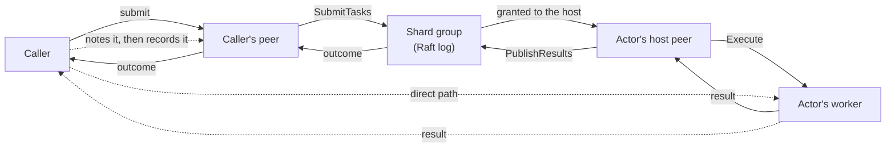

# Actors: state that lives in a worker

Tired of reloading a model on every call? An actor is an instance of your class
that lives in its own worker process and keeps its state between calls. Use one
when calls share something expensive or mutable: a loaded model, a connection,
a counter.

## Create an actor and call it

Put `@ch.remote` on a class, just as on a function. `Class.remote(...)` starts
an instance in a worker and returns a handle; `handle.method.remote(...)` runs
the method there and returns a future.

```python run
import chimaera as ch

@ch.remote
class Counter:
    def __init__(self, start: int = 0):
        self.value = start

    def add(self, by: int = 1) -> int:
        self.value += by
        return self.value

counter = Counter.remote(10)
futures = [counter.add.remote() for _ in range(100)]
assert [f.result() for f in futures] == list(range(11, 111))   # in the order you made them
assert Counter(0).add(5) == 5                                   # still an ordinary class here
assert Counter.remote(1).add.remote().result() == 2             # no handle kept: still works
```

<details>
<summary>Lifetime and common mistakes</summary>

An actor lives until you close it or its run ends, handle or no handle.

`Class.remote(...)` checks your arguments against `__init__` where you call it,
and returns once the peer accepts it. `__init__` itself runs in the worker. If
it raises, every call to that actor raises that error.

- Call a handle's method without `.remote` and you get a `TypeError` that
  names the fix: `Counter.add runs in the actor, not here: call it with .add.remote(...)`.
- Methods can't stream with `yield`. Calling a generator method fails with
  `TypeError: cannot pickle 'generator' object`, so return a list, or stream
  from a generator function ([tasks.md](tasks.md)).

</details>

A method call goes through its shard group to the peer that hosts the actor.
When the caller's own peer hosts the actor, an eligible call can go straight
to the actor's worker instead, and the peer records it just after
(`CHIMAERA_DIRECT` in [configuration.md](../configuration.md)).



## Calls through one handle run in order

Calls through one handle start one at a time, in the order you made them. So
your methods don't race on `self`, unless one call waits on another (see
below).

```python run
@ch.remote
class Ledger:
    def __init__(self):
        self.entries: list[str] = []

    def record(self, entry: str) -> int:
        if not entry:
            raise ValueError("empty entry")
        self.entries.append(entry)
        return len(self.entries)

    def all(self) -> list[str]:
        return list(self.entries)

ledger = Ledger.remote()
ledger.record.remote("open")
assert isinstance(ledger.record.remote("").exception(), ValueError)   # your exception, its own type
ledger.record.remote("close")
assert ledger.all.remote().result() == ["open", "close"]
```

<details>
<summary>Errors and order across handles</summary>

A method that raises fails only its own call. The actor keeps running, and
anything that call changed before raising stays changed.

Order is per handle, though. Pass a handle to another call and it's a separate
handle there, and so is one from `ch.actor(name)`. Its calls keep their own
order, interleaved with yours.

```python run
@ch.remote
def deposit_twice(counter, amount: int) -> int:
    counter.add.remote(amount).result()
    return counter.add.remote(amount).result()

assert deposit_twice.remote(Counter.remote(0), 5).result() == 10
```

There's one exception to "one at a time". While a running call waits on another
call's result (`.result()`, `ch.get`, a queue), the next queued call may start,
so calls that wait on each other can't deadlock. Don't hold an invariant on `self`
across such a wait.

</details>

## Write async methods

Give an async actor `concurrency=N` and up to N calls run as coroutines on its
one event loop, where an awaiting call holds no thread. Leave it out and
`async def` changes nothing: calls still run one by one.

```python run
import asyncio

@ch.remote
class Fetcher:
    def __init__(self):
        self.active = 0

    async def fetch(self) -> int:
        self.active += 1
        await asyncio.sleep(0.05)
        running = self.active                 # calls in progress, this one included
        self.active -= 1
        return running

serial = Fetcher.remote()
assert max(ch.get([serial.fetch.remote() for _ in range(10)])) == 1
overlapping = Fetcher.options(concurrency=10).remote()
assert max(ch.get([overlapping.fetch.remote() for _ in range(10)])) > 1
```

## Run calls side by side

Set `concurrency=N` on the class (default 1) and plain methods run N at once on
threads. Concurrency groups keep a slow method from blocking quick ones.

```python run
import threading
import time

@ch.remote(groups={"io": 4})
class Service:
    def slow(self, seconds: float) -> str:
        time.sleep(seconds)
        return "done"

    @ch.method(group="io")
    def ping(self) -> str:
        return "pong"

    @ch.method(concurrency=2)
    def nap(self, seconds: float) -> int:
        time.sleep(seconds)
        return threading.get_ident()

svc = Service.remote()
svc.ping.remote().result()                          # the actor is up
busy = svc.slow.remote(1.0)
assert svc.ping.remote().result() == "pong" and not busy.done()   # ping didn't wait for slow()
assert busy.result() == "done"
naps = [svc.nap.remote(0.2), svc.nap.remote(0.2)]
assert len({f.result() for f in naps}) == 2         # two threads at once
```

<details>
<summary>How lanes start calls</summary>

Threaded calls start in order but finish in any order, so guard shared state
yourself, say with a `threading.Lock`.

To use groups, declare `groups={name: concurrency}` on the class and put the
quick methods in a concurrency group with `@ch.method(group=...)`.
`@ch.method(concurrency=N)` gives one method a lane of its own.

Within each lane (the default one, each group, each method given
`concurrency`), calls start in arrival order, and no lane waits for another.
Each method takes `group=` or `concurrency=`, not both. Name a group you didn't
declare and decoration fails with a `TypeError` listing the declared groups.

</details>

## Bound a busy method's calls

A flood of calls to one method can fill the actor and hold up the rest.
`@ch.method(mailbox=ch.Mailbox(max_calls=N))` lets the actor hold at most N of
that method's calls at once and turns the others away, so a health check stays
quick under load.

```python run
@ch.remote(groups={"admin": 1})
class Renderer:
    @ch.method(concurrency=2, mailbox=ch.Mailbox(max_calls=4, on_full="reject"))
    def render(self, seconds: float) -> str:
        time.sleep(seconds)
        return "rendered"

    @ch.method(group="admin")
    def health(self) -> str:
        return "ok"

renderer = Renderer.remote()
renderer.health.remote().result()                       # the actor is up
flood = [renderer.render.remote(0.2) for _ in range(50)]
assert renderer.health.remote().result(timeout=5) == "ok"    # not stuck behind the flood
turned_away = [f for f in flood if isinstance(f.exception(), ch.errors.Overloaded)]
assert len(turned_away) >= 40                            # it held at most 4 at a time
```

<details>
<summary>Waiting for room, and what counts</summary>

`max_calls` counts the method's calls the actor's process holds: running, or
waiting there for a thread. Those calls don't count against the actor's
`concurrency`, so its other methods keep their room.

A call past the limit waits at its peer for one of them to finish, for up to
`max_wait` (default 30 s, or a string such as `"2s"`), then raises
`ch.errors.Overloaded`. With `on_full="reject"` it raises at once. An actor
with groups or `concurrency` promises no order, so there a waiting call
doesn't hold back the calls made after it through the same handle. An actor
that runs one call at a time keeps each handle's calls in order, so there it
does. Its calls from different handles take turns by how long they've been
ready to run, and a waiting call counts as ready only once it has room. So a
call from another handle, such as a health check through `ch.actor(name)`,
waits behind at most `max_calls` of the method's calls, however many more of
them are waiting.

`mailbox=` can't be combined with `batch=`, which bounds its own queue (see
`max_bytes` below).

</details>

## Set options for a method or one call

Put options on the class, on a method (`@ch.method(...)`), or on one view of
that method (`.options(...)`).

```python run
@ch.remote
class Stats:
    @ch.method(returns=2)
    def bounds(self, xs: list[int]) -> tuple[int, int]:
        return min(xs), max(xs)

    def slow_sum(self, xs: list[int], seconds: float) -> int:
        time.sleep(seconds)
        return sum(xs)

stats = Stats.remote()
lo, hi = stats.bounds.remote([3, 9, 4]).split()
assert (lo.result(), hi.result()) == (3, 9)

late = stats.slow_sum.options(deadline="100ms").remote([1, 2], 1.0)
assert isinstance(late.exception(), ch.DeadlineExceeded) and late.cancelled()
```

| Where | Applies to | Options you'd set there |
|---|---|---|
| `@ch.remote(...)` on the class, or `Class.options(...)` | the actor and all its calls | `cpus`, `memory`, `gpus`, `concurrency`, `name`, `detach`, `restart`, `max_restarts`; `groups` and `state` on the decorator only |
| `@ch.method(...)` | every call of that method | `group`, `concurrency`, `batch`, `mailbox`, `returns`, `deadline`, `max_attempts`, `retry_exceptions` |
| `handle.method.options(...)` | calls through that view | `deadline`, `returns`, `max_attempts`, `priority`, a stricter `effects`, `command_id` |

<details>
<summary>Option checks and canceling</summary>

Options get checked on the line that sets them, so
`stats.bounds.options(bogus=1)` raises `ch.OptionsError` naming the option.

A deadline or `cancel()` ends your wait at once. Your method, though, stops only
when it checks `ch.context().cancelled()`, and until then it keeps the actor
busy.

</details>

## Find an actor by name

A name picks out one actor across the cluster for your tenant, whichever script
or call uses it. One caveat: ending that actor doesn't free its name yet
(a known bug), so name each new actor differently.

```python run
name = f"registry-{ch.init()}"           # the run id keeps the name fresh (see below)
registry = Counter.options(name=name).remote(0)
registry.add.remote(5).result()
again = Counter.options(name=name).remote(1000)               # the same actor; 1000 is ignored
assert again.id == registry.id and again.add.remote(1).result() == 6
assert ch.actor(name).add.remote(1).result() == 7
assert [a.name for a in ch.runs.actors(name)] == [name]
try:
    ch.actor("nobody")
except ch.NotFound:                       # also a LookupError
    pass
```

<details>
<summary>Finding, reusing and listing names</summary>

`Class.options(name=...).remote(...)` gets or creates it (later
constructor arguments are ignored), and from anywhere else, `ch.actor(name)`
finds it with just the name.

That's why the example adds the run id to the name.

- A named actor still ends with the run that created it, unless it was created
  with `detach=True`.
- `ch.runs.actors(prefix)` lists live named actors, and so does
  `chimaera actors --prefix P` from a shell.
- Creating a name again after its actor ends won't start a new one. Calls
  through the handle raise `ch.ActorDied` in the same run and wait forever in a
  later one, while `ch.actor(name)` raises `ch.NotFound`.

</details>

## Keep an actor after your script exits

Want an actor to outlive your script? `detach=True` keeps it alive after its
run ends.

```python
# first.py, with Counter defined as above
cache = Counter.options(name="cache", detach=True).remote(0)
cache.add.remote(1).result()
```

```python
# later.py, a separate process
import chimaera as ch

cache = ch.actor("cache")
print(cache.add.remote(1).result())   # 2
cache.close()
```

<details>
<summary>Name it, then close it</summary>

Name it so a later script can find it, and close it when you're done, because
nothing else will. Once it's closed, its name stays taken (see above).

</details>

## End an actor

When you're done, `handle.close()` ends it for good: its process exits, its unfinished calls
raise `ch.ActorDied`, it isn't restarted, and any CPUs it held go back.

```python run
temp = Counter.remote(0)
temp.add.remote(1).result()
temp.close()
assert isinstance(temp.add.remote(1).exception(), ch.ActorDied)
```

<details>
<summary>Pending calls and reserved names</summary>

`close()` doesn't wait for unfinished calls, so wait on their futures first if
you need the results.

Inside a method, `ch.context().exit_actor()` ends its actor, and that call
raises `ch.ActorDied` too.

A handle reserves the names `close` and `id` (`handle.id` is the actor's id).
Methods with either name get a warning at decoration and can't be reached
through the handle, so rename them.

</details>

## Restart an actor after a crash

By default, if an actor's process dies, it stays dead. `restart=` changes that.

```python run
import os
import signal

@ch.remote(restart="fresh", max_restarts=2)
class Worker:
    def __init__(self):
        self.calls = 0

    def work(self) -> int:
        self.calls += 1
        return self.calls

    def crash(self) -> None:
        os.kill(os.getpid(), signal.SIGKILL)       # stands in for a segfault or an OOM kill

w = Worker.remote()
assert w.work.remote().result() == 1
died = w.crash.remote().exception()
assert isinstance(died, ch.ActorDied) and "died while this call was running" in str(died)
assert w.work.remote().result() == 1              # a fresh instance: state started over
```

<details>
<summary>Restart modes and ActorDied</summary>

| `restart=` | When the process dies |
|---|---|
| `"never"` (default) | The actor is dead. The call that was running and every later call raise `ch.ActorDied`. |
| `"fresh"` | A new process runs `__init__` again with the original arguments, so state starts over. Up to `max_restarts` times (default 3), then it stays dead. |
| `"checkpoint"` | Accepted, and today restarts like `"fresh"`. For state that survives, use a [durable actor](#keep-state-through-crashes-with-a-durable-actor). |

A call that was running when the process died is never replayed; it raises
`ch.ActorDied`. Calls that hadn't started run on the new instance, in order.

Good news: actors moved off a drained peer restart without using up a restart.

If an actor's peer stops answering long enough to be declared dead, the actor
restarts on another peer, and once the first peer is back it stops the
instance it still ran there. Programs on that machine that call the actor
directly ([`CHIMAERA_DIRECT`](../configuration.md)) stop reaching the old
instance once its peer has gone 3 seconds without hearing from most of the
cluster, sooner than the 6 it takes to declare a peer dead: from then on its
worker begins no call that skips the peer, and those calls go through the
peer instead. That covers a peer that was paused or cut off from most of the
cluster.

One network split isn't covered. If the old peer still hears most of the
cluster, but most of the peers that keep the actor's record (its group, three
peers) are on the other side, the group places the actor again, while callers
on the old peer's machine keep reaching the old instance until the split
heals. Their calls get answers from an instance that is being replaced,
working from its state as of the split; callers elsewhere reach the new
instance. Once the split heals, the old peer learns of the new instance and
stops the old one. Stored state can't diverge: an actor with durable state
takes no direct calls, and its group refuses commits from an instance it has
replaced. Set `CHIMAERA_DIRECT=0` if callers must never reach a replaced
instance.

`ch.ActorDied` (an `InfrastructureFailure`) means the call won't run: the actor
was closed, ended itself or with its run, died with `restart="never"` or ran
out of restarts, or died while this call was running. The other errors are in
[failures.md](failures.md).

</details>

## Give an actor CPUs and memory

Actors ask for no CPU unless you set `cpus`, so an idle actor never sits on a
CPU another call could use. With `@ch.remote(cpus=2)` each instance
holds two CPUs for its whole life and won't start until some peer has them free.

<details>
<summary>CPUs held for an actor's life</summary>

Make a request no peer could ever meet and `Class.remote(...)` raises
`ch.Infeasible`, naming the constraint. Memory, GPUs and placement work as
they do for functions; see [resources.md](resources.md).

</details>

## Spread calls over a pool

A pool spreads your calls over interchangeable replicas of one class, all built
with the same arguments.

```python run
@ch.remote
class Model:
    def __init__(self, weights: str):
        self.weights = weights

    def predict(self, x: int) -> str:
        return f"{self.weights}:{x}"

    def replica(self) -> str:
        return ch.context().actor_id

with Model.options(replicas=3).pool("v1") as pool:
    assert pool.predict.remote(1).result() == "v1:1"
    assert list(pool.predict.map(range(3))) == ["v1:0", "v1:1", "v1:2"]
    user = pool.route("user-7")                            # one replica for this key
    assert user.replica.remote().result() == user.replica.remote().result()
    pool.resize(4)
    pool.upgrade("v2", surge=1)                            # replace replicas one at a time
    assert pool.predict.remote(1).result() == "v2:1" and len(pool) == 4
```

<details>
<summary>Pool methods in full</summary>

`Class.options(replicas=n).pool(...)` creates one, and its methods look
like an actor's. Each call goes to whichever replica has the fewest calls in
flight when you make it. There's no order across replicas.

- Without `replicas=`, you get one replica per core, at most 8.
- `pool.method.map(items)` streams results in input order (`ordered=False` for
  completion order), keeping 16 calls per replica in flight.
- `route(key)` sends all calls for a key to one replica by rendezvous hashing
  of `str(key)`, so a resize moves only a few keys.
- `resize(n)` grows or shrinks the pool (`n` at least 1), dropping the newest
  replicas first. `upgrade(*args, cls=None, surge=1, **kwargs)` rebuilds every
  replica from new arguments or a new class, `surge` at a time. Either way, a
  leaving replica takes no new calls and closes once its calls finish.
- `close()`, or leaving the `with` block, ends every replica.
- Pool methods take only `.remote` and `.map`, so set call options when you
  build the pool (`Model.options(cpus=2, replicas=3)`). Pool handles reserve
  `close`, `decisions`, `resize`, `route` and `upgrade`.

</details>

## Share a pool and size it from load

Give the pool a `name=` and other scripts and calls can share it.

```python run
shared = Model.options(name="docs/model", replicas=2).pool("v1")
assert len(Model.options(name="docs/model").pool()) == 2   # joins; no arguments needed

@ch.remote
def ask(pool, x: int) -> str:
    return pool.predict.remote(x).result()

assert ask.remote(shared, 5).result() == "v1:5"
shared.close()
```

<details>
<summary>Named pools and auto-sizing</summary>

Only a named pool can be passed to calls; an unnamed one raises
`ch.SerializationError`.

`replicas=ch.auto(initial, min=, max=)` sizes a pool from load: it grows while
replicas stay busy and shrinks after a quiet minute. `pool.decisions` tells you
what it did and why.

```python run
@ch.remote
class SlowModel:
    def predict(self, x: int) -> int:
        time.sleep(0.1)
        return x

elastic = SlowModel.options(replicas=ch.auto(1, max=4)).pool()
assert len(elastic) == 1
assert list(elastic.predict.map(range(40))) == list(range(40))
assert elastic.decisions[0].startswith("grow 1 -> 2")
elastic.close()
```

A named pool's membership lives in the cluster's replicated store, and other
handles re-read it at most once a second.

Auto-sizing starts at `initial` (default 1). When calls in flight stay above
80% of what the replicas can run at once for 0.75 s, it doubles, up to `max`
(default the larger of `initial` and the core count). After a minute under 25%
busy it drops one replica, down to `min` (default 1).

Growth only helps calls made after it. Calls already queued on a busy replica
stay put.

</details>

## Batch calls into one method call

Write the method for a list, and your callers still pass one item each.

```python run
@ch.remote
class Embedder:
    def __init__(self):
        self.batch_sizes: list[int] = []

    @ch.method(batch=ch.Batch(max_size=8, max_wait="20ms"))
    def embed(self, texts: list[str]) -> list[int]:
        self.batch_sizes.append(len(texts))
        return [len(t) for t in texts]

    def sizes(self) -> list[int]:
        return self.batch_sizes

embedder = Embedder.remote()
futures = [embedder.embed.remote("x" * n) for n in range(20)]
assert [f.result() for f in futures] == list(range(20))
sizes = embedder.sizes.remote().result()
assert sum(sizes) == 20 and max(sizes) <= 8
```

<details>
<summary>How batches fill and fail</summary>

With `@ch.method(batch=ch.Batch(max_size=, max_wait=))`, calls queue up until
there are `max_size` of them or the first has waited `max_wait`. Then a single
method call takes them all, and each caller gets its element of the
returned list.

- `ch.Batch()` defaults to `max_size=32` and `max_wait=0.005` (seconds, or a
  string such as `"5ms"`).
- Call it with exactly one positional argument. It gets the arguments in
  arrival order and must return a list of the same length, or every call in
  the batch fails with a `ValueError` giving both counts. If the method raises,
  every caller in the batch gets the error.
- A batched method gets a separate lane, so it can run while other methods do.
  The peer keeps at most two batches going, so the next fills while one runs.
  `async def` works too.
- `max_bytes=` (an int, or a string such as `"32MiB"`) also bounds the
  argument bytes of the calls the actor holds, the batch running and the one
  filling, so mixed small and large calls never pile up past it. A call that
  would go over waits at its peer; one larger than `max_bytes` goes alone.
- `batch=` goes in `@ch.method(...)` (on `@ch.remote` it raises
  `ch.OptionsError`) and can't be combined with `group=` or `concurrency=`.

</details>

## Keep state through crashes with a durable actor

Need state that survives a crash? `@ch.remote(state=ch.durable.State())`
commits the instance's attributes after each call, so a restarted instance
resumes from the last commit instead of running `__init__` again.

```python run
@ch.remote(state=ch.durable.State())
class Account:
    def __init__(self):
        self.balance = 0

    def deposit(self, amount: int) -> int:
        self.balance += amount
        return self.balance

    def withdraw(self, amount: int) -> int:
        self.balance -= amount
        if self.balance < 0:
            raise ValueError("insufficient funds")
        return self.balance

    def pid(self) -> int:
        return os.getpid()

acct = Account.remote()
assert acct.deposit.options(command_id="dep-1").remote(5).result() == 5
assert acct.deposit.options(command_id="dep-1").remote(5).result() == 5   # a repeat: no second deposit
reused = acct.deposit.options(command_id="dep-1").remote(9)          # same id, other arguments
assert isinstance(reused.exception(), ch.errors.CommandConflict)
assert isinstance(acct.withdraw.remote(50).exception(), ValueError)
assert acct.deposit.remote(2).result() == 7       # the failed withdraw left no trace

os.kill(acct.pid.remote().result(), signal.SIGKILL)
assert acct.deposit.remote(0).result() == 7       # resumed from the last commit
```

<details>
<summary>Commits and the 128 MiB cap</summary>

- After each method returns, the instance's attributes (or what `__getstate__`
  returns) are pickled and committed before the reply goes out. A call that
  raises commits nothing and puts the instance back at the last commit.
- `.options(command_id=...)` names a command, per call only. A repeated
  command gets its first reply, the stored one, and reusing the id with other
  arguments raises `ch.errors.CommandConflict`. Without one, the call's own id
  is used, so a call cut off by a crash is retried on the restarted instance
  without being applied twice. Command ids are kept for 7 days.
- Pickled state up to 1 MiB is committed whole. Larger state is cut into
  chunks by content, and a commit writes only the chunks that changed, then
  swaps in the new list in one step: a crash part way through leaves the
  previous commit whole. State is capped at 128 MiB. Growing it past that
  fails the call with `ch.errors.RemoteError` ("durable state of N MiB exceeds
  the 128 MiB limit") and leaves the committed state as it was. Keep larger
  data elsewhere and store its key.
- A durable actor runs calls one by one, so setting `concurrency` raises
  `ch.OptionsError`.
- It restarts after a crash whatever `restart=` says, up to `max_restarts`
  (default 3).

</details>

### Change a durable actor's class

State outlives the code that wrote it. Give the new class
`ch.durable.State(version=2, migrate=fn)` and create the named actor with it:
the actor keeps its state and its stored replies, and from then on runs the
new class, rebuilt from the last commit through `migrate(state, version)`.

```python run
@ch.remote(state=ch.durable.State())
class Profile:
    def __init__(self):
        self.name = ""

    def rename(self, name: str) -> str:
        self.name = name
        return name

def split_name(state: dict, version: int) -> dict:
    first, _, last = state["name"].partition(" ")      # version 1 kept one string
    return {"first": first, "last": last}

@ch.remote(state=ch.durable.State(version=2, migrate=split_name))
class ProfileV2:
    def rename(self, name: str) -> str:
        self.first, _, self.last = name.partition(" ")
        return name

    def last_name(self) -> str:
        return self.last

old = Profile.options(name="docs/profile").remote()
assert old.rename.options(command_id="r-1").remote("Ada Lovelace").result() == "Ada Lovelace"
new = ProfileV2.options(name="docs/profile").remote()     # same name, newer version
assert new.last_name.remote().result() == "Lovelace"
retried = new.rename.options(command_id="r-1").remote("Ada Lovelace")
assert retried.result() == "Ada Lovelace"                 # answered from r-1's stored reply
```

<details>
<summary>Versions and migrations</summary>

- Each commit stores its class's `version` (default 1). Creating the named
  actor with a class of a higher version binds the actor to that class; one
  of an equal or lower version gets the actor as it is, so old code still
  running elsewhere can't undo an upgrade.
- `migrate(state, version)` gets what the older class's `__getstate__`
  returned and the version that wrote it, and returns what the new class's
  `__setstate__` (or its attributes) takes. Without `migrate` the state is
  used as is.
- If `migrate` raises, the actor's calls raise that error and the committed
  state stays as it was, ready for a fixed class of a still higher version.

</details>

Next up: give actors CPUs, memory and GPUs in [resources.md](resources.md).
