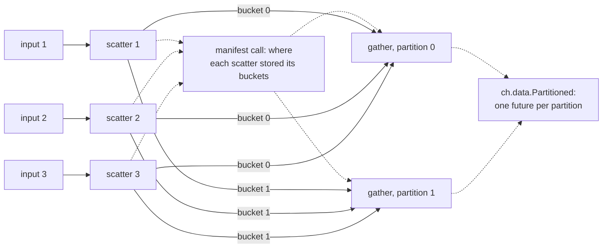

# Data: large values, pipelines and shared state

Got a big NumPy array that a thousand calls all need? Pass it, and it's stored once. You can also regroup results by key and write them out, worker to worker, and share state between calls with queues and stores.

## Pass a large value to many calls

> *Data should move to compute only when compute cannot move to data, and both should know the difference.*

`ch.put(value)` stores a value once and hands you a finished `ch.Future` to pass to as many calls as you like:

```python run
import chimaera as ch
import numpy as np

@ch.remote
def column_mean(table, col: int) -> float:
    return float(table[:, col].mean())

table = ch.put(np.arange(400_000, dtype=np.float64).reshape(100_000, 4))   # 3 MiB, stored once
assert table.done()                                    # ch.put returns a finished future
means = ch.get([column_mean.remote(table, c) for c in range(4)])
assert means == [199998.0, 199999.0, 200000.0, 200001.0]
```

<details>
<summary>How arguments travel by size</summary>

Each call gets the value, read from the stored copy, and `table.result()` hands it back to you. Arguments are captured at `.remote()`, so changing the array afterward won't touch calls you've already made.

You don't always need `ch.put`, though. Every call stores its arguments by size.

| What you pass | How it travels |
|---|---|
| Arguments that encode to 64 KiB or less | inside the call message |
| Arguments of 64 KiB up to 1 MiB | one file for that call, deleted when the call ends |
| A NumPy array, `bytes` or other buffer of 1 MiB or more, or a top-level argument that pickles to 1 MiB or more | stored once, named by a hash of its contents; every call that passes the same bytes reads that one copy |
| `ch.put(value)` | inside the future when it is 4 KiB or less, else one stored file |

- Pass one large value straight to many calls and it's stored once, but each call still reads all of it, because a writable array may have changed since. An array passed again is compared with its stored copy, one pass on one core and two to three times faster than hashing it, and only a changed one is hashed and stored again. A read-only array is hashed once while it lives, and on Linux an array in the object arena is linked without being read. Once a line has passed the same value 20 times and spent 0.1 s or more encoding it, warning `CH107` suggests `ch.put(value)` or binding it once with `fn.partial(value)`.
- A large `list` or `dict` is stored once too, but every call that reads it unpickles its own full copy. A NumPy array or an Arrow table is mapped instead, one copy per machine. You'll see warning `CH118` for collections of 8 MiB or more.
- Don't call `.result()` on a large value just to pass it to the next call. Pass the future, and the value goes worker to worker (warning `CH103` points this out).
- A future passed as an argument, or one level inside a list, tuple or dict argument, arrives as its value. Nest it deeper and it stays a future. [tasks.md](tasks.md) covers dependencies and `ch.handles`.
- An open file can't be sent, so pass its path and open it in your function.

</details>

## Write to an array inside a call

Go ahead and write: arrays arrive writable, and a write stays in the call that made it:

```python run
@ch.remote
def set_first(a, value: float) -> float:
    a[0] = value                    # allowed: the call writes to its own copy-on-write view
    return float(a[0])

@ch.remote
def first(a) -> float:
    return float(a[0])

zeros = np.zeros(1 << 20)           # 8 MiB
assert set_first.remote(zeros, 7.0).result() == 7.0
assert first.remote(zeros).result() == 0.0     # the stored value is unchanged
assert zeros[0] == 0.0                         # and so is your array
```

<details>
<summary>Why arrays here are writable</summary>

A stored value's file is mapped copy-on-write (small files are read instead). Ray hands you read-only arrays. Here, `a[0] = value` works.

</details>

## Know what is kept after a run

Your results outlive their run, so another process can read them later by run id:

```python
import chimaera as ch

run = ch.runs.attach("000003df45a0b6526faca7be64431c6e")   # str(ch.init()) in the original script
for task_id, value, error in run.outcomes():
    print(task_id, value if error is None else error)
```

<details>
<summary>When stored values are deleted</summary>

Here's when Chimaera deletes what it stored:

| What | Deleted |
|---|---|
| A call's argument file (64 KiB to 1 MiB) | when the call ends |
| A `ch.put` value whose future you dropped | once the calls reading it finish (exceptions below) |
| Large arguments, and `ch.put` values your script made | when the run ends |
| Results, stream items, and `ch.put` values made inside a call | 24 hours after the run ends |

- A dropped `ch.put` value sticks around until its run ends if its future was sent to an actor or nested deeper than one level in an argument, or if a script connected to a remote cluster made it.
- While a detached actor of the run is alive, the run's stored arguments and `ch.put` values stay too. A restart rebuilds the actor from them.
- A `ch.put` future kept outside the run (say, in a `ch.coord.Store` key) stops reading when that run ends, unless the value was small enough to travel inside the future.

</details>

## See what the object store holds

Wondering what's taking up space? `chimaera objects` lists what this machine's peer has stored, per run, largest first. Here a script holds one 32 MiB `ch.put` value and a 16 MiB argument (paths shortened):

```bash
$ chimaera objects
objects in .../objects (huge pages: false)
  in memory: 2 objects, 48.0 MiB
  on disk:   0 objects, 0.0 MiB (spilled, or replicas of other peers' objects)
  ...
  run 000003df45a0b6526faca7be64431c6e: 2 objects, 48.0 MiB in memory, 0.0 MiB on disk
        32.0 MiB  000003df45a0b6526faca7be64431c6e/a3b39be9ccb87d5f6b795d40a6550f1e  (memory)
        16.0 MiB  000003df45a0b6526faca7be64431c6e/2073c64c0226e4386789053c9da3b8b1  (memory)
```

<details>
<summary>JSON and cluster-wide output</summary>

Add `--json` for JSON, and `--cluster` to ask every live peer for its store.

</details>

## Let objects spill to disk

On Linux, the peer keeps objects in memory when it can, and as memory fills it moves the oldest ones to disk in the background.

<details>
<summary>Spilling and its settings</summary>

A spilled object is read by mapping its disk file. No restore step. There's no store-full error either. A full disk raises `OSError` naming the directory. On macOS, or when the object directory is already on disk, nothing spills.

The memory is a huge-page tmpfs if one's mounted, else `/dev/shm` when it has at least 2 GiB. Past 80% of the memory limit, the peer moves the oldest objects to disk, and once it's past the limit plus a quarter, new objects go straight there.

They're the peer's environment variables, so set them where it starts:

| Variable | Default | Effect |
|---|---|---|
| `CHIMAERA_MEMORY_POOL` | 90% of the object filesystem | memory objects may use before new ones go to disk, e.g. `8GiB` |
| `CHIMAERA_SPILL_DIR` | `spill/` in the peer's directory | where objects spill; several directories separated by `:` are used in turn |
| `CHIMAERA_SPILL_THRESHOLD` | `0.8` | share of the limit past which the oldest objects move to disk |
| `CHIMAERA_OBJECT_DIR` | found automatically | where objects live |
| `CHIMAERA_OBJECT_REPLICAS` | `1` | copies of each object kept on other peers (Linux only); `0` turns them off |
| `CHIMAERA_SPILL_URL` | unset | spill to `s3://`, `gs://` or `az://`; only in a peer built with the `object-store-spill` cargo feature, which is off by default |

[../objects.md](../objects.md) has the internals and every setting, and [../configuration.md](../configuration.md) lists all variables.

</details>

## Process data in partitions

Here's a word count over a directory of JSON-lines files, end to end:

```python run
import collections
import json
import operator
import os
import tempfile

from chimaera import ext

logs = tempfile.mkdtemp()
for day, lines in enumerate([["the cat sat", "the dog ran"], ["a cat ran", "the end"]]):
    with open(os.path.join(logs, f"day-{day}.jsonl"), "w") as f:
        for i, text in enumerate(lines):
            f.write(json.dumps({"text": text, "level": "info" if i == 0 else "debug"}) + "\n")

@ch.remote
def count_words(partition) -> list[tuple[str, int]]:
    counts = collections.Counter()
    for row in partition:                   # rows are read here, in the worker
        counts.update(row["text"].split())
    return list(counts.items())             # (key, value) pairs for the shuffle

parts = ch.data.partitions(os.path.join(logs, "*.jsonl"), columns=["text"])
totals = count_words.map(parts).reduce_by_key(operator.add, partitions=2)
counts = totals.to_dict()
assert counts["the"] == 3 and counts["cat"] == 2 and len(counts) == 7

out = tempfile.mkdtemp()
manifest = totals.write(ext.FileSink(out)).result()
assert manifest["rows"] == 7 and len(manifest["parts"]) == 2
gen = manifest["generation"]                # this write's own name for its files
assert sorted(os.listdir(out)) == ["_manifest.json", "_manifests", f"part-00000-{gen}.jsonl", f"part-00001-{gen}.jsonl"]
```

<details>
<summary>What your function receives</summary>

`fn.map(partitions)` runs your function on every partition, spread across the peers, and hands it a `ch.data.Partition` to iterate for rows. Only what you ask for comes back to you: here, that's the `to_dict()` and the manifest.

</details>

### Cut input into partitions

`ch.data.partitions` cuts a sequence, a glob or directory of files, or an `ext.Source` into partitions. Only need some of it? `columns=` keeps only those keys of dict rows, and `filter=` only the rows that pass:

```python run
info_only = ch.data.partitions(os.path.join(logs, "*.jsonl"), columns=["text"], filter=[("level", "==", "info")])
assert count_words.map(info_only).reduce_by_key(operator.add).to_dict()["cat"] == 2
```

<details>
<summary>Source kinds and filters</summary>

`ch.data.partitions(source, *, n=None, columns=None, filter=None)` takes three kinds of source:

| Source | Partitions |
|---|---|
| A list or other sequence | `n` chunks (default: the cores of the live peers), each stored once with `ch.put` |
| A glob or a directory | one per file, and several for a file over 128 MiB that isn't CSV ([below](#read-large-files-in-parts)). `.jsonl`/`.ndjson` rows are dicts, `.csv` rows are dicts of strings, `.parquet` rows are dicts (needs `pyarrow`), any other file gives lines. A directory a `FileSink` wrote gives the files of the generation its `_manifest.json` names |
| An `ext.Source` | whatever its `partitions()` returns |

Every peer that might run a call has to find the files under the path you give. A pattern that matches nothing raises `FileNotFoundError`.

`filter=` is either a callable on each row or a list of `(column, op, value)` triples, all of which must hold. The ops are `==`, `!=`, `<`, `<=`, `>`, `>=`, `in` and `not in`.

A triple keeps the same rows whatever the format:

- A missing field is null: a key a JSON row doesn't have, a column a Parquet file doesn't have, or a field after the end of a short CSV row. CSV has no other null, so an empty CSV field is the string `""`.
- Null compares with nothing. `==`, `!=`, `<`, `<=`, `>` and `>=` skip it, `in` keeps it when the list holds `None`, and `not in` keeps it when the list doesn't. `("age", "==", None)` would keep no row, so it raises `ValueError`: write `("age", "in", [None])`.
- A field and the value compare when both are numbers (a bool isn't one), both bools, or both strings, bytes, dates or times. A datetime or time with a time zone and one without are different types. Any other pair raises `TypeError`: in JSON lines when a row reaches the filter, in Parquet when the column's type is wrong, before any row. CSV values are strings, so `("age", ">=", 40)` on a CSV raises. Compare with a string, or filter with a callable.

A filter may name columns you left out of `columns=`: they're read for the filter, then dropped. A callable filter sees every column of the row.

Only `.parquet` pushes the filter and columns down into the reader, where every op but `not in` runs inside Arrow, and row groups whose statistics rule the filter out are never read. Arrow gets each value as the column's own type. A triple Arrow wouldn't compare the way Python does runs on the rows after reading instead: one whose value the column's type can't hold exactly (0.1 on a float32 column, 1.5 or 2**70 on an int64 one, -1 on a uint64 one, or NaN), one on a decimal, float16 or nested column (a list, map or struct), and `!=` on a float column, as statistics leave NaN out. Other formats stream every row through the worker and filter there. Your own `ext.Source` can push predicates down too: `read` gets the columns and the filter, and `residual(part, filter)` returns the triples it left for Chimaera to apply (all of them, unless you override it).

</details>

### Read large files in parts

A JSON-lines, text or Parquet file over 128 MiB becomes several partitions, so several peers read it at once. Rows stream from the open file: a worker holds one line of a text file, or one batch of a Parquet file. `partition.batches()` gives a Parquet partition as Arrow record batches with the file's column types, without making a Python row:

```python run
import pyarrow as pa
import pyarrow.compute as pc
import pyarrow.parquet as pq

tables = tempfile.mkdtemp()
sizes = pa.table({"id": range(1000), "size": [i % 7 for i in range(1000)]})
pq.write_table(sizes, os.path.join(tables, "sizes.parquet"), row_group_size=100)

source = ext.FileSource(os.path.join(tables, "*.parquet"), split_bytes=2048, batch_rows=50)
parts = ch.data.partitions(source, columns=["id"], filter=[("size", "==", 3)])
assert len(parts) > 1                       # runs of whole row groups, each up to 2 KiB

@ch.remote
def total(partition) -> int:
    return sum(pc.sum(batch["id"]).as_py() or 0 for batch in partition.batches())

assert sum(total.map(parts)) == sum(i for i in range(1000) if i % 7 == 3)
```

<details>
<summary>Split sizes, line ends and batches</summary>

`ext.FileSource(pattern, *, split_bytes=128 << 20, batch_rows=65536)` sets both sizes. A JSON-lines or text file over `split_bytes` is cut into byte ranges of that size, and each line belongs to the range its first byte is in, so every line is read once, whole, wherever a cut falls: inside a `\r\n` or a multibyte UTF-8 character, or on a last line with no line end. Lines are UTF-8 and lose their `\n` or `\r\n`. A Parquet file over `split_bytes` is cut into runs of whole row groups, each up to `split_bytes` on disk unless one row group is larger. A CSV file is never cut: a quoted field may hold a newline, so no byte tells where a row starts.

A Parquet reader decodes `batch_rows` rows at a time, so it holds one batch and what Arrow keeps of the row group it is reading, however long the file. `rows()` turns one batch at a time into Python rows.

`batches()` gives the rows `rows()` would, in the same order, with the same columns and filter. A filter Arrow doesn't run (`not in`, a callable, or a triple above that runs after reading) is decided on Python rows, and the batch keeps its columns. Partitions of other formats raise `TypeError`, since an Arrow reader would give `.csv` columns types that its rows don't have. Your own `ext.Source` can give batches by defining `batches(part, columns=None, filter=None)`, which takes the hints `read` does.

</details>

### Group by key with `reduce_by_key`

`results.reduce_by_key(combine=None, *, partitions=None, memory=None)` regroups results by key when they're iterables of `(key, value)` pairs, and the pairs move between workers, never through your script.

<details>
<summary>How the shuffle runs</summary>

`combine` folds two values for the same key and must be associative (`operator.add`). Leave it out, and each key maps to the list of its values.

Scatter calls split each result into buckets by key, one bucket for each partition its keys go to and none for the rest, so a scatter into a million partitions stores only the few it touches. Its buckets go in one file, and a bucket of 64 KiB or more gets a file of its own when the gathers are spread over peers, so each fetches only its own: a scatter writes at most one file more per 64 KiB it stores, never one per partition. One more call waits for the scatters and lists where each stored its buckets, and one gather call per output partition reads its own bucket of each, one at a time, folding each into the partition before it reads the next. A gather holds its partition and one bucket, however many inputs there are. If a worker dies, only its call runs again.

Three inputs shuffled into two partitions. Dashed lines show who waits for whom, solid ones bytes moving between workers:



- `partitions` sets the number of output partitions. By default it is one per input, up to the cores of all the live peers, not only your script's. It's more when the inputs are already stored and that many partitions would not fit in memory: a partition can take about 12 times the bytes it was stored in, a gather holds one bucket beside it, and the two are planned to fill half of `memory`, or else of the memory per core of the peer with the least. The other half is for what that estimate leaves out, such as read buffers and a dict's old and new tables while it grows. The count assumes no key repeats, so a `combine` that folds many pairs into each key gets more partitions than it needs, which costs calls, not memory. A map nobody has read stores nothing before the shuffle, so its count goes by cores alone.
- `memory` (bytes, or a size such as `"2GiB"`) is what each gather may take for its partition. Each gather reserves it, and one whose process's private memory grows by more fails with a `MemoryError` that says to pass more `partitions`. Without it, a gather fails that way only once it has grown past its whole peer's memory.
- Keys go to buckets by a hash every process agrees on, and keys that are equal meet as they would in one `dict`: `1`, `True`, `1.0`, `Fraction(1)`, `Decimal(1)` and NumPy's `1` are one key, `0.0` and `-0.0` are one key, and so are `(1, "a")` and `(True, "a")`. That holds for `int`, `bool`, `float`, `complex`, `Fraction`, `Decimal` and NumPy numbers, `str`, `bytes`, and tuples and frozensets of them. Other keys, including numbers of other types (SymPy's, or your own class with its own `__hash__`), are hashed pickled: they must pickle identically in every process, and they meet only keys that pickle the same. NumPy datetimes in different units don't meet, though NumPy calls them equal.
- If nothing has read the map yet, as in the example, its function runs inside the scatter calls, and its pairs are never stored in between.
- Your script and the cluster track inputs + partitions calls, each gather with one dependency, not one per input. Each gather still reads the whole list, an entry per input with the smallest scatter results in it whole, so the gathers' work grows with inputs × partitions.
- With `operator.add`, `operator.mul`, `max`, `min` or no combine, the scatter runs in native code, and makes the buckets the Python loop would. Any other combine runs in Python.

</details>

### Read a `Partitioned` result

`reduce_by_key` gives you a `ch.data.Partitioned`. Its partitions stay on the workers until you read them:

```python run
assert len(totals) == 2                   # two partitions, still on the workers
assert dict(totals.items()) == counts     # every (word, count) pair, partition by partition
assert totals.to_dict() == counts
```

<details>
<summary>Reading the shuffled pairs</summary>

`items()` and `to_dict()` bring every pair back to the script. `totals.map(fn)` runs a remote function on every partition instead, where the data already is.

A key lives in just one partition, and without a `combine`, its value is the list of its values. `totals.futures` holds one future per partition.

</details>

### Write to a sink

`write(sink)` writes each partition in its own call, never through your script, then calls the sink's `commit`. Reading the directory back goes through its manifest:

```python run
with open(os.path.join(out, "_manifest.json")) as f:
    assert json.load(f) == manifest
assert manifest["parts"][0]["part"] == 0 and sum(p["rows"] for p in manifest["parts"]) == 7
assert sorted(tuple(row) for part in ch.data.partitions(out) for row in part) == sorted(counts.items())
```

<details>
<summary>FileSink files, versions and retries</summary>

`ext.FileSink(directory, format="jsonl")` gives every write its own generation, named by a key that sorts by when the write began. It writes `part-00000-<key>.jsonl` and so on, records them in `_manifests/<key>.json`, then copies that to `_manifest.json`. On a cluster, put the directory somewhere every peer can write.

`write` works on a `Partitioned` and on a map's results, where each result becomes one partition. The file sink writes one JSON value per line, so a pair becomes `["the", 3]`.

A generation's files never change once written, so two writes to one directory, even at the same time, leave two whole generations. `_manifest.json` names the one whose write began last, and a reader of the directory (`ch.data.partitions(out)`) reads only the files it lists, never a mix. Until the first write commits, reading the directory raises `FileNotFoundError`, so you never read a write's half-done parts. Keys come from the clock of the script that started the write, and one script's keys never go back, even if its clock does.

Old generations stay in the directory. A glob (`ch.data.partitions(f"{out}/*.jsonl")`) and tools that read a whole directory, such as `pyarrow.dataset`, pandas and DuckDB, read every generation, so writing twice doubles their rows. Give them the files listed under `parts` in `_manifest.json` instead.

Each part is written under a temporary name, then renamed, so a retried write replaces the whole file. If the commit's worker dies, the commit runs again and publishes the same generation. A commit holds an `flock` on `_manifests/.lock` while it publishes. On a filesystem without `flock` (Lustre mounted without `-o flock`), it publishes without the lock: each generation is still whole, but two commits that finish together can leave the older one in `_manifest.json`. `format="parquet"` (or `write_parquet(directory)`) needs `pyarrow`.

Each entry under `parts` holds the part's `bytes` and `sha256`. Before it publishes anything, the commit reads every part back and checks both. If a part was truncated, changed or deleted since its write, the commit raises `ch.errors.DataLost` naming the part, and `_manifest.json` keeps naming the last generation that committed.

A result that is an Arrow table or record batch reaches the sink in batches of up to 65,536 rows, never as Python rows. A Parquet part keeps the table's schema (an `int16` column stays `int16`), with a row group per batch, so the worker holds one batch at a time beyond the table itself.

</details>

<details>
<summary>Writing to an object store</summary>

An object store can't rename a file, so `FileSink` gets a `store` there, and `directory` becomes a key prefix:

```python
sink = ext.FileSink("events/daily", "parquet", store=ext.S3Store("my-bucket"))
manifest = results.write(sink).result()
```

Each part is put whole, and its entry under `parts` adds the `version` (the ETag) the store gave it. The commit checks each part's size and version, records the generation with a put that only creates (`If-None-Match: *`), and moves `_manifest.json` forward with a put that only replaces the version it read (`If-Match`). If a reply is lost after the store took a put, `S3Store` sends the request again, and the store refuses the repeat; so does a commit run again because its worker died. Either way, the commit reads what it recorded and returns that same generation, and an older write never moves `_manifest.json` back.

`ext.S3Store(bucket, *, endpoint=None, region=None)` speaks S3's API with the standard library, for AWS, MinIO and other S3-compatible stores with conditional puts. Every worker reads its credentials from `AWS_ACCESS_KEY_ID`, `AWS_SECRET_ACCESS_KEY` and `AWS_SESSION_TOKEN` in its peer's environment, so set them where the peers start. A run doesn't ship them, and the local peer a script starts for you keeps only a few variables such as `PATH` and `HOME`: start that one yourself, with `chimaera peer start`, from a shell that has them. `S3Store` doesn't look up instance or pod roles. `endpoint` defaults to `AWS_ENDPOINT_URL_S3` or `AWS_ENDPOINT_URL`, and `region` to `AWS_REGION`. For another store, subclass `ext.ObjectStore` and give it `get`, `head` and `put(key, body, *, sha256=None, if_version=None)`, where `if_version=""` means "only if absent" and a conflict raises `ch.errors.VersionConflict`. `deploy/dev/s3-test.sh` runs these checks against MinIO in Docker.

</details>

### Plug in your own source or sink

A source does two things: list small, picklable partition descriptors, and read one of them. A sink writes every partition, then commits once:

```python run
class Ranges(ext.Source):
    def __init__(self, n: int):
        self.n = n

    def partitions(self):                      # cheap descriptors, not data
        return [(i, min(i + 10, self.n)) for i in range(0, self.n, 10)]

    def read(self, part, columns=None, filter=None):
        return range(*part)                    # columns and filter are hints you may ignore

class SumSink(ext.Sink):
    def write(self, part_id, items):           # may run again if the call is retried
        return sum(items)

    def commit(self, receipts):                # runs once
        return sum(receipts)

@ch.remote
def squared(partition) -> list[int]:
    return [x * x for x in partition]

assert squared.map(ch.data.partitions(Ranges(25))).write(SumSink()).result() == sum(x * x for x in range(25))
```

<details>
<summary>Receipts and idempotent writes</summary>

A sink's `write` returns a receipt per partition, and `commit` gets every receipt, in partition order. A retry runs `write` again for its partition, so `write` must be idempotent: overwrite a part, never append to it.

A partition that is an Arrow table or record batch goes to `write_batches(part_id, batches)` instead. `batches` is a `pyarrow.RecordBatchReader`: iterate it for one batch at a time, each with its `schema`. By default, `write_batches` reads every batch and hands `write` their rows, so a sink with only `write` still gets them. Override it to stream them, as `FileSink` does.

Sources and sinks get pickled to the workers, so keep their state small: paths, URIs, credential names. One-time steps, like publishing a table, belong in `commit`.

Before any call, `write` calls `sink.begin(key)` in your script. The key is unique to that write and stays the same in every retry, so return a copy of the sink that keeps it, and use it to name the output or to publish once. The class attribute `effects` says what happens if `commit`'s worker dies:

| `effects` | A commit whose worker died |
|---|---|
| `"external"` (the default) | is never started again. The write's future raises `ch.OutcomeUnknown`, since the commit may have taken effect |
| `"idempotent"` | runs again with the same key, so it must take effect once per key. `FileSink` is idempotent |

</details>

### Send a type pickle can't handle

Got a type pickle refuses, like one holding a lock? `ext.register_serializer(cls, dumps=..., loads=...)` makes values of `cls` travel as the bytes your `dumps` returns:

```python run
import threading

class Tally:
    def __init__(self, n: int = 0):
        self.n, self.lock = n, threading.Lock()       # pickle refuses locks

def tally_dumps(t: Tally) -> bytes:
    return str(t.n).encode()

def tally_loads(data: bytes) -> Tally:
    return Tally(int(data))

ext.register_serializer(Tally, dumps=tally_dumps, loads=tally_loads)

@ch.remote
def bump(t: Tally) -> int:
    with t.lock:
        t.n += 1
    return t.n

assert bump.remote(Tally(41)).result() == 42
```

<details>
<summary>Where to register a type</summary>

`loads` has to be a module-level function, not a lambda. Every process that sends the type must register it, and that includes a worker whose result is a `Tally`. So register it in a module that both your script and your functions import.

</details>

## Feed a training loop

`ch.data.loader(source, batch_size=)` gives a training loop its rank's
batches. Each epoch shuffles the partitions by `seed` and epoch. Inside a
gang, rank r of W reads every W-th partition, so ranks read disjoint input;
outside one, the process reads them all. `state()` says where the loop
stands, as JSON for a checkpoint's cursor, and `load_state()` resumes there:
after a restart, the loop takes exactly the batches it took after that save.

```python run
import json
import tempfile

shards = tempfile.mkdtemp()
for i in range(4):
    with open(f"{shards}/part-{i}.jsonl", "w") as f:
        f.writelines(json.dumps({"id": i * 10 + j}) + "\n" for j in range(6))

def ids(batches) -> list:
    return [[row["id"] for row in batch] for batch in batches]

epoch = ids(ch.data.loader(f"{shards}/*.jsonl", batch_size=4, seed=0))
assert sorted(i for batch in epoch for i in batch) == [i * 10 + j for i in range(4) for j in range(6)]

loader = ch.data.loader(f"{shards}/*.jsonl", batch_size=4, seed=0)
batches = iter(loader)
first = [next(batches), next(batches)]
cursor = loader.state()                     # what ckpts.save(step, cursor=...) keeps
resumed = ch.data.loader(f"{shards}/*.jsonl", batch_size=4, seed=0)
resumed.load_state(cursor)
assert ids(first) + ids(resumed) == epoch
```

<details>
<summary>Workers, collation and uneven ranks</summary>

`collate=` turns a batch's rows into what the loop takes, such as
`torch.utils.data.default_collate` for tensors. Without it, a batch is a
list of rows. `columns=` and `filter=` work as they do for
`ch.data.partitions`, and you can pass a list of partitions instead of a path.

`num_workers=K` reads through a torch `DataLoader` with K processes. Each
reads every K-th of the rank's partitions, and their batches come out in
turn. A rank's rows don't depend on K, but its cursor does, so resume with
the same K. The cursor counts only batches the loop took, not ones a worker
read ahead.

Iterating a loader runs the current epoch and moves on to the next one.
`set_epoch(e)` jumps to epoch `e`; the epoch a restore left halfway stays
where it stands.

With several ranks, `even=True` (the default) stops every rank as soon as
one runs out, so DDP never waits on a rank with no batch. It needs
`g.torch()` first. `stopped_early` counts the epochs this rank cut short.
Pass `even=False` to handle uneven input yourself.

Every rank must list the same partitions in the same order, which a
`FileSource` on a shared filesystem does. A cursor taken with other input,
or with another rank count, worker count, seed or batch size, raises
`ValueError`.

</details>

## Stream items from a generator

Call a generator function with `.remote()`, and you get its items as it yields them:

```python run
@ch.remote
def events(n: int):
    for i in range(n):
        yield {"id": i}

stream = events.options(max_in_flight=8).remote(100)
assert next(stream) == {"id": 0}
assert sum(1 for _ in stream) == 99
```

<details>
<summary>Backpressure and closing streams</summary>

The generator runs at most `max_in_flight` items ahead of you (default 64). Read slowly, and the producer waits for you instead of filling memory.

`stream.close()` stops the generator, and `async for` works too.

One gap: generator methods on actors don't stream yet. Call one and you'll get `cannot pickle 'generator' object`. Return a list from the method instead, or put items on a `ch.coord.Queue`. [tasks.md](tasks.md) covers generators in full, with errors, retries and replay.

</details>

## Share state between calls

Need calls and scripts to share state? `ch.coord` has four tools for it, and they differ in what they survive:

| Tool | Held by | Lasts | If its holder dies |
|---|---|---|---|
| `Queue`, `Topic` | one actor | until the run ends, or past it with `detach=True` | contents are lost; later calls raise `ch.ActorDied` |
| `Store`, `WorkQueue` | a Raft group, replicated across peers | until you delete the keys, or their `ttl=` passes | nothing is lost while a majority of the group's peers are alive |

### Pass work through a queue

```python run
@ch.remote
def drain(q) -> int:
    return sum(q)                         # takes items until the queue is closed and empty

q = ch.coord.Queue(maxsize=100)
total = drain.remote(q)
for i in range(10):
    q.put(i).result()
q.close()
assert total.result() == 45
```

`put` and `get` both return futures.

<details>
<summary>Bounded queues and timeouts</summary>

Pass `name="jobs"`, and everyone who uses that name shares one queue.

Set `maxsize=`, and a `put` on a full queue waits inside the queue for room. The default, `maxsize=0`, means unbounded. With `timeout=`, a `put`'s future fails with the standard library's `queue.Full`, and a `get`'s with `queue.Empty`. After `close()`, a `put` fails with `ch.errors.Closed`, while `get` drains what's left and then fails with `Closed`. If several callers share a name, the first creator's `maxsize` applies.

</details>

### Broadcast through a topic

```python run
topic = ch.coord.Topic(retain=100)
sub = topic.subscribe("earliest")
for i in range(3):
    topic.publish(i).result()             # each publish gives the item's offset
topic.close()
assert list(sub) == [0, 1, 2]
```

Every subscriber gets every item, at its own pace, from a bounded log of the newest items.

<details>
<summary>Retention and subscriber offsets</summary>

`retain=1024` (the default) counts items, and `retain="1 GiB"` counts bytes. `subscribe("latest")` starts at items published from now on, `"earliest"` at everything retained, and an integer at that offset. A subscriber that falls behind the log skips ahead. `sub.gaps` lists each run of offsets it missed as a `ch.coord.Gap(first_missed, first_available)`, and `sub.skipped` counts them all.

Give a subscriber a name with `cursor=`, and the topic remembers how far it got: `sub.ack()` records every item it has returned so far (or `sub.ack(offset)`, everything before that offset), and a later `subscribe(cursor=...)` with the same name resumes there, even from another process. The first subscription with a name starts at `start`, and later ones ignore it. If the log moved past the cursor meanwhile, the first gap says exactly what was lost:

```python run
topic = ch.coord.Topic(retain=3)
sub = topic.subscribe("earliest", cursor="reports")
topic.publish("a").result()
assert next(sub) == "a"
sub.ack().result()                        # handled everything before offset 1
for i in range(5):
    topic.publish(i).result()             # offsets 1 to 5: the log keeps 3, 4 and 5
again = topic.subscribe(cursor="reports")
assert next(again) == 2
assert again.gaps == [ch.coord.Gap(first_missed=1, first_available=3)]
```

Cursors live in the topic's actor, so they last as long as the topic does.

</details>

### Keep replicated state in a store

A `ch.coord.Store` namespace is a set of keys in one Raft group, and every operation on it is linearizable:

```python run
import uuid

store = ch.coord.Store(f"guide-{uuid.uuid4().hex[:8]}")
v1 = store.put("config", {"lr": 3e-4}, if_version=0)     # create only if absent
v2 = store.put("config", {"lr": 1e-4}, if_version=v1)    # compare-and-set
try:
    store.put("config", {"lr": 9.9}, if_version=v1)      # stale version
except ch.errors.VersionConflict as e:
    assert e.version == v2
assert store.get("config") == {"lr": 1e-4}
assert store.counter("seen").add(2) == 2                 # atomic

with store.lock("leader", ttl="10s") as lease:           # renewed while held
    store.put("state", "mine", fence=lease)              # refused once the lease is lost

changes = store.watch("jobs/")
store.put("jobs/1", "queued")
event = next(changes)
assert (event.kind, event.key, event.value) == ("put", "jobs/1", "queued")

@ch.remote
def meet(store, parties: int) -> int:
    return store.barrier("round", parties).wait(timeout=60)

assert ch.get([meet.remote(store, 2) for _ in range(2)]) == [1, 1]
```

<details>
<summary>Versions, leases and watches</summary>

A namespace survives losing any process and a minority of peers. Keys outlive your run. That's why the example takes a fresh namespace. Each namespace is one Raft group, so spread heavy traffic over several.

- `put` returns the key's new version. `if_version=v` makes it a compare-and-set that raises `ch.errors.VersionConflict` (its `.version` is the current one), and `if_version=0` means "only if the key doesn't exist". `delete` takes `if_version=` too.
- `get_versioned(key)` returns `(value, version)` from one read: the pair a read-modify-write loop passes back as `if_version`.
- Values are pickled and limited to 1 MiB, and a bigger one raises `ValueError`. For those, store the future from `ch.put` instead, though it reads only while its run lasts.
- `ttl="30s"` on `put` makes the key expire.
- `lock(key, ttl="30s", timeout=None)` returns a lease that's renewed in the background while you hold it, and whose `token` grows with every grant. A write with `fence=lease` raises `ch.errors.LeaseLost` once the lease has expired or passed to another holder. That's what makes leader election safe. `store.holder(key)` tells you who holds it.
- `watch(prefix, start="latest")` yields `put` and `delete` events in order. A watch that falls behind the namespace's change log yields a `resync` event, then the current value of every key under the prefix: drop what you hold when you see it. It may repeat a change, but it never misses one.
- `barrier(key, parties).wait()` returns once that many callers arrive, round after round.
- `scan(prefix)` and `keys(prefix)` list keys in order, a page at a time, so writes made during a long scan may or may not show. A scan's `revision` is where to start a watch that catches them: `store.watch(prefix, start=scan.revision)`. Apply its events to the scanned keys and you have the namespace as it is now.

</details>

### Hand out work that must not be lost

`ch.coord.WorkQueue(name)` is a first-in, first-out queue kept in a store. If a consumer fails, the item it claimed is delivered again.

```python run
jobs = ch.coord.WorkQueue(f"guide-jobs-{uuid.uuid4().hex[:8]}")
jobs.put("resize image 7")
try:
    with jobs.claim(lease="30s") as job:
        raise RuntimeError("worker failed")
except RuntimeError:
    pass
with jobs.claim() as job:                 # delivered again
    assert job == "resize image 7"
assert jobs.qsize() == 0
```

<details>
<summary>How WorkQueue differs from Queue</summary>

A consumer claims an item under a lease, and the item's removed when the `with` block finishes. It's delivered again if the block raises, or if the consumer's process dies and the lease lapses. You can pass the queue to calls or open it by name from any process.

Unlike `Queue`, its methods are synchronous: `put` returns once the item is stored, and `get()` claims and removes in one step. `maxsize=`, `timeout=`, `close()` and iteration work as they do on `Queue`. The queue stores its `maxsize`: the first open that gives one sets it for everyone, opens without one use it, and opening it with a different one raises `ValueError`.

A claim is one command, however long the queue and however many consumers share it: an item given back or whose consumer died goes first, then the oldest. A consumer with nothing to claim waits until the queue changes or a claim lapses, rather than polling.

A `put` is one replicated command, so a producer that dies partway stores the whole item or nothing. Finishing a claim removes the item and counts it in one command too, and a consumer whose lease lapsed gets `ch.errors.LeaseLost` instead of removing the item twice. After `close()`, consumers see `Closed` only once no item is left: an item whose consumer dies after the close is delivered again first.

</details>

Next: [failures.md](failures.md) covers what happens to calls, actors and stored values when processes and machines fail.
